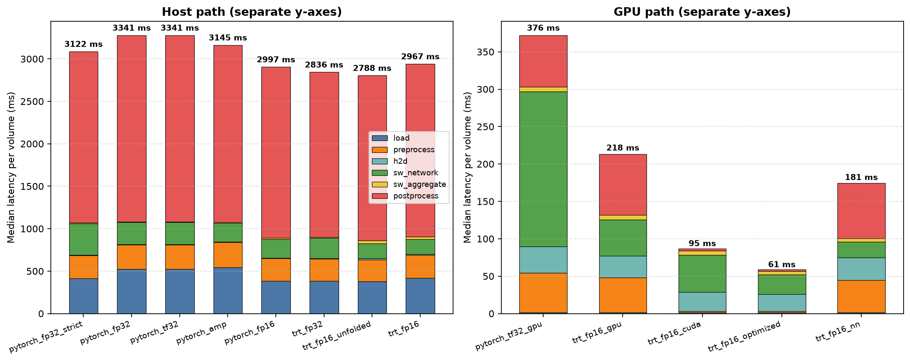
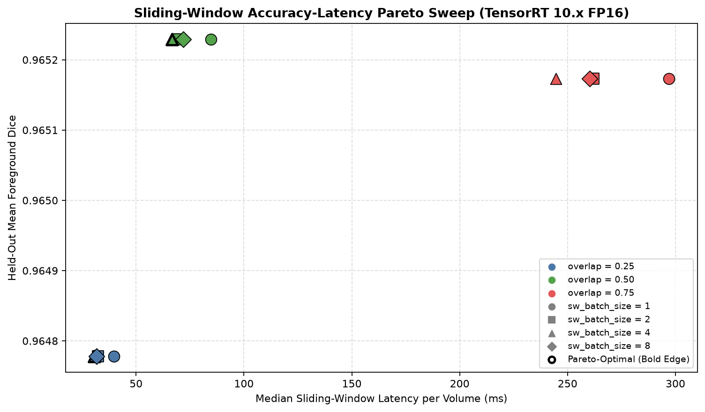

# MedTRT Complete GPU Benchmark Results (`BENCHMARK_RESULTS.md`)

> **Hardware & Provenance:** `NVIDIA GeForce RTX 5080 Laptop GPU` (`15.92 GB` VRAM, `12.0 (sm_120)`), Driver `591.44`, CUDA `12.8`, TensorRT `10.16.1.11`, PyTorch `2.11.0+cu128`, MONAI `1.6.1`. All measurements come from `results/bench_*.json` and `results/benchmark_*.json`.

---

## 1. Master End-to-End & Stage Latency Table Across All 12 Profiles

| Profile | Transforms / I/O | Overlap / Batch | Patch B=1 / B=4 (ms) | Preprocess Median (ms) | Network `sw_network` (ms) | Postprocess Median (ms) | E2E Median [IQR] (ms) | E2E P95 / Max (ms) | Throughput | Peak VRAM | Speedup vs. `pytorch_fp32` |
| :--- | :---: | :---: | :---: | :---: | :---: | :---: | :---: | :---: | :---: | :---: | :---: |
| `pytorch_fp32_strict` | `cpu` / `gzip` | `0.5` / `4` | `6.96` / `22.36` | `268.64` | `375.62` | `2017.36` | **`3122.22`** [`2981.30`] | `6096.38` / `7759.54` | `0.32 vol/s` | `490 MB` | **`1.07×`** |
| `pytorch_fp32` | `cpu` / `gzip` | `0.5` / `4` | `3.90` / `15.95` | `284.40` | `260.81` | `2195.26` | **`3341.11`** [`3180.08`] | `5970.99` / `6179.46` | `0.30 vol/s` | `487 MB` | **`1.00×`** |
| `pytorch_tf32` | `cpu` / `gzip` | `0.5` / `4` | `3.90` / `15.95` | `284.40` | `260.81` | `2195.26` | **`3341.11`** [`3180.08`] | `5970.99` / `6179.46` | `0.30 vol/s` | `487 MB` | **`1.00×`** |
| `pytorch_amp` | `cpu` / `gzip` | `0.5` / `4` | `5.40` / `15.69` | `294.05` | `221.58` | `2084.54` | **`3145.24`** [`3538.89`] | `7003.76` / `7089.59` | `0.32 vol/s` | `457 MB` | **`1.06×`** |
| `pytorch_fp16` | `cpu` / `gzip` | `0.5` / `4` | `4.48` / `14.89` | `264.69` | `224.62` | `2016.75` | **`2996.69`** [`2881.10`] | `5924.24` / `6023.69` | `0.33 vol/s` | `458 MB` | **`1.11×`** |
| `trt_fp32` | `cpu` / `gzip` | `0.5` / `4` | `3.24` / `13.36` | `263.51` | `241.46` | `1947.47` | **`2835.59`** [`2966.32`] | `6058.97` / `6601.12` | `0.35 vol/s` | `368 MB` | **`1.18×`** |
| `trt_fp16_unfolded` | `cpu` / `gzip` | `0.5` / `4` | `1.00` / `3.29` | `259.67` | `175.99` | `1946.93` | **`2787.88`** [`2906.44`] | `5814.95` / `5873.82` | `0.36 vol/s` | `359 MB` | **`1.20×`** |
| `trt_fp16` | `cpu` / `gzip` | `0.5` / `4` | `1.08` / `3.79` | `269.42` | `172.83` | `2035.26` | **`2967.01`** [`2849.86`] | `5908.69` / `6067.32` | `0.34 vol/s` | `359 MB` | **`1.13×`** |
| `pytorch_tf32_gpu` | `gpu` / `mmap` | `0.5` / `4` | `4.24` / `16.80` | `52.77` | `207.00` | `68.73` | **`375.87`** [`241.20`] | `668.60` / `747.10` | `2.66 vol/s` | `2307 MB` | **`8.89×`** |
| `trt_fp16_gpu` | `gpu` / `mmap` | `0.5` / `4` | `0.97` / `3.25` | `46.50` | `48.56` | `81.20` | **`218.04`** [`168.50`] | `352.09` / `428.97` | `4.59 vol/s` | `2301 MB` | **`15.32×`** |
| `trt_fp16_cuda` | `cuda` / `mmap` | `0.5` / `4` | `0.94` / `3.48` | `1.43` | `49.56` | `2.64` | **`95.10`** [`55.68`] | `171.66` / `240.71` | `10.51 vol/s` | `455 MB` | **`35.13×`** |
| `trt_fp16_optimized` | `cuda` / `mmap` | `0.25` / `8` | `1.00` / `3.20` | `1.37` | `26.21` | `2.39` | **`60.83`** [`49.02`] | `108.32` / `115.30` | `16.44 vol/s` | `522 MB` | **`54.92×`** |
| `trt_fp16_nn` | `gpu` / `mmap` | `0.25` / `8` | `1.04` / `3.10` | `43.17` | `21.02` | `74.03` | **`181.35`** [`145.80`] | `288.01` / `399.55` | `5.51 vol/s` | `2149 MB` | **`18.42×`** |

---

## 2. Sliding-Window Parameter Grid Sweep (`results/sweep.csv`)

| Overlap | `sw_batch_size` | Median SW Latency (ms) | IQR (ms) | Mean SW Latency (ms) | Peak VRAM (MB) | Held-Out Mean Dice ± SD | Pareto-Optimal |
| :--- | :---: | :---: | :---: | :---: | :---: | :---: | :---: |
| `0.25` | `1` | `39.84` | `25.99` | `48.22` | `791.3` | `0.964778 ± 0.013491` | No |
| `0.25` | `2` | `32.29` | `18.99` | `41.40` | `808.5` | `0.964778 ± 0.013491` | No |
| `0.25` | `4` | `30.63` | `18.96` | `38.80` | `842.5` | `0.964778 ± 0.013491` | **Yes** |
| `0.25` | `8` | `31.64` | `21.16` | `40.98` | `909.5` | `0.964778 ± 0.013491` | No |
| `0.50` | `1` | `84.78` | `34.32` | `89.66` | `791.3` | `0.965229 ± 0.011723` | No |
| `0.50` | `2` | `69.73` | `25.31` | `72.65` | `808.5` | `0.965229 ± 0.011723` | No |
| `0.50` | `4` | `66.59` | `19.81` | `70.45` | `842.5` | `0.965229 ± 0.011723` | **Yes** |
| `0.50` | `8` | `71.80` | `49.99` | `78.38` | `909.5` | `0.965229 ± 0.011723` | No |
| `0.75` | `1` | `296.90` | `283.98` | `363.73` | `791.3` | `0.965173 ± 0.012858` | No |
| `0.75` | `2` | `262.05` | `215.59` | `288.33` | `808.5` | `0.965173 ± 0.012858` | No |
| `0.75` | `4` | `244.70` | `217.08` | `277.26` | `842.5` | `0.965173 ± 0.012858` | No |
| `0.75` | `8` | `260.22` | `243.82` | `298.47` | `909.5` | `0.965173 ± 0.012858` | No |

---

## 3. GPU Memory Footprint Summary (`results/benchmark_memory.json`)

- **PyTorch FP32 Static Model Weights:** `18.39 MB`
- **PyTorch FP16 Static Model Weights:** `28.21 MB`
- **TensorRT 10.16 FP32 Engine (`spleen_unet_fp32.engine`):** `22.97 MB` file + `0.00 MB` execution context = `22.97 MB`
- **TensorRT 10.16 FP16 Engine (`spleen_unet_fp16.engine`):** `13.70 MB` file + `0.00 MB` execution context = `13.70 MB`
- **Full-Pipeline Peak Allocated VRAM (`spleen_6`, `512 × 512 × 135`):**
  - `trt_fp16_gpu` (MONAI GPU `grid_sample` with 3D coordinate meshgrid): **`2301.3 MB`** (`2.20 GB`)
  - `trt_fp16_cuda` (Custom CUDA C++ register-affine kernels, `overlap=0.5, B=4`): **`454.6 MB`** (**`5.06×` lower peak VRAM**)
  - `trt_fp16_optimized` (Custom CUDA C++ register-affine kernels, `overlap=0.25, B=8`): **`522.1 MB`** (`7.0%` of 16 GB VRAM)
