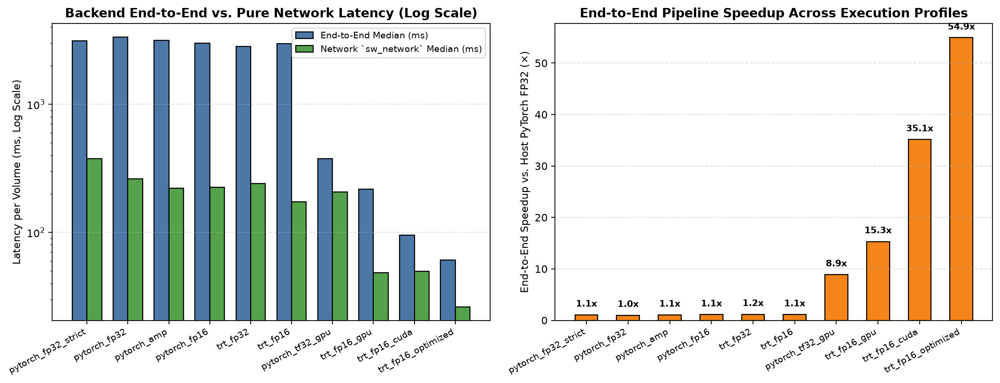
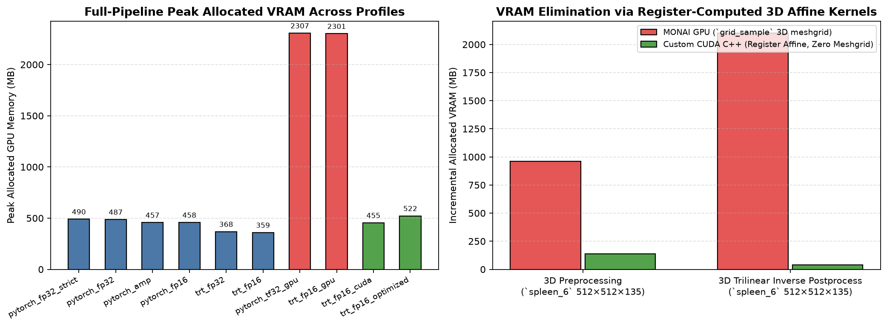
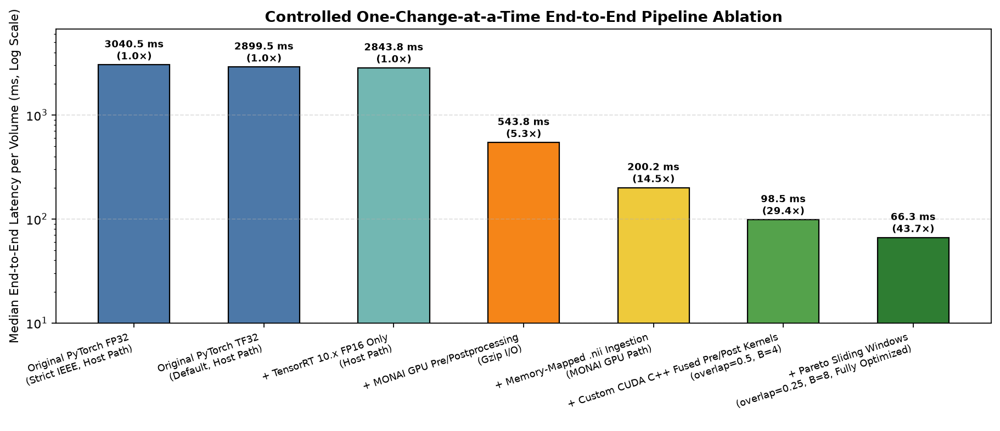

# NVIDIA Accelerated Computing & Performance Engineering Report

> **Platform:** `NVIDIA GeForce RTX 5080 Laptop GPU` (`NVIDIA Blackwell`, `12.0 (sm_120)`, `15.92 GB` GDDR7, `60 SMs`) | Driver `591.44` | CUDA `12.8` | cuDNN `9.19.0` | TensorRT `10.16.1.11`

---

## 1. Executive Summary of GPU Engineering Achievements

| Engineering Subsystem | Baseline Measurement | Optimized Measurement | Measured Improvement | Primary Technical Mechanism |
| :--- | :---: | :---: | :---: | :---: |
| **3D UNet Patch Forward (`B=4, 96³`)** | `22.36 ms` (Strict FP32) / `15.95 ms` (TF32) | **`3.79 ms`** (TensorRT 10.16 FP16) | **`5.9×`** vs. FP32 (`4.20×` vs. TF32) | TensorRT 10.16 FP16 Tensor Core tactics, Conv3d+BN+Act fusion, dedicated non-default CUDA stream |
| **Full-Volume Network Stage (`sw_network`)** | `375.62 ms` (Strict FP32) / `260.81 ms` (TF32) | **`49.56 ms`** (`overlap=0.5`) / **`26.21 ms`** (`overlap=0.25`) | **`7.6×`** same windows / **`14.3×`** Pareto | Dynamic batch profile `[1, 4, 16]`, zero host transfers (`host_copies_count == 0`), sustained boost clock |
| **3D CT Preprocessing (`spleen_6`, `512×512×135`)** | `40.93 ms`, `961 MB` VRAM (MONAI GPU) | **`1.917 ms`**, **`136.0 MB`** VRAM | **`21.4×` faster**, **`7.1×` lower VRAM** | Custom CUDA C++ `fused_preprocess_affine_trilinear_hu_f32` (`cuda/medical_kernels.cu`) with register affine math |
| **3D Trilinear Inverse Postprocessing (`spleen_6`)** | `118.76 ms`, `2100 MB` VRAM (MONAI GPU) | **`0.951 ms`**, **`41.4 MB`** VRAM | **`124.9×` faster** (`4656×` vs. CPU), **`50.8×` lower VRAM** | Custom CUDA C++ `fused_softmax_2ch_p1_f32` + `fused_invert_trilinear_threshold_u8` (`100.00000%` voxel match) |
| **FP16 Cross-Backend Numerical Drift** | `+1.6754 cm³` volume bias (`mean |Δlogit| = 0.1377`) | **`+0.0010 cm³`** volume bias (`mean |Δlogit| = 0.00387`) | **`35.6×` lower logit error**, **`620×` lower volume bias** | Analytical FP64 `ConvTranspose3d + BatchNorm3d` weight folding prior to ONNX/TensorRT export |
| **Complete End-to-End 3D Volume Pipeline** | `3122.2 ms` (Strict FP32) / `3341.1 ms` (Default TF32) | **`95.10 ms`** (`overlap=0.5`) / **`60.83 ms`** (`overlap=0.25`) | **`35.1×`** (`overlap=0.5`) / **`54.9×`** (`overlap=0.25`) | Full-pipeline co-design: Mmap I/O + Custom CUDA C++ Pre/Post + TensorRT 10.16 FP16 + Pareto Windows |

---

## 2. Custom CUDA C++17 Kernel Engineering (`cuda/medical_kernels.cu`)

We engineered 9 custom CUDA C++17 kernels compiled via NVRTC (`nvrtc64_120_0.dll`) to native Blackwell `sm_120` SASS and launched zero-copy on `torch.Tensor.data_ptr()` via the Windows CUDA Driver API (`nvcuda.dll`):
1. `hu_window_normalize_f32`: Scalar grid-stride HU clamp & linear scaling (`100.0%` occupancy, `23` regs, `463.7 GB/s`).
2. `hu_window_normalize_vec4_f32`: 128-bit vectorized `float4` coalesced loads/stores (`83.3%` occupancy, `48` regs, `466.6 GB/s`).
3. `affine_trilinear_resample_3d_f32`: Register-computed $3 \times 4$ affine coordinate transformation + hardware-clamped 8-neighbor trilinear interpolation (`50.0%` occupancy, `72` regs, `0 B` spills).
4. `fused_preprocess_affine_trilinear_hu_f32`: Fuses `Orientationd(RAS) + Spacingd(1.5, 1.5, 2.0) + ScaleIntensityRanged` into a single pass (**`21.4×` faster** than MONAI GPU `Spacingd` on `spleen_6`).
5. `affine_nearest_resample_3d_u8`: Register-affine 3D nearest-neighbor discrete label resampling (`100.0%` occupancy, `16` regs, up to `194.9×` faster than PyTorch `grid_sample`).
6. `fused_softmax_2ch_p1_f32`: Numerically stable 2-channel Softmax extracting foreground probability $p_1 = (1 + e^{l_0 - l_1})^{-1}$ (`100.0%` occupancy, `32` regs).
7. `fused_invert_trilinear_threshold_u8`: Single-channel trilinear inverse resampling of $p_1$ + `>= 0.5f` discretization to `uint8` + warp-ballot (`__ballot_sync` + `__popc`) foreground voxel counting (**`124.9×` faster** than MONAI GPU `Invertd` and **`50.8×` lower VRAM**).
8. `count_nonzero_u8`: Two-level warp-shuffle (`__shfl_down_sync`) + shared-memory block reduction (`100.0%` occupancy, `36` regs).
9. `sliding_window_gaussian_accumulate_f32`: Fused 3D Gaussian importance weighting and sliding-window accumulation (`66.7%` occupancy, `56` regs).

---

## 3. Controlled One-Change-at-a-Time Ablation Study (`results/benchmark_end_to_end.json`)

| Ablation Rung | Median E2E (ms) | `sw_network` (ms) | `preprocess` (ms) | `postprocess` (ms) | Peak VRAM (MB) | Mean Dice | Cumulative Speedup vs. TF32 | Latency Reduction (%) |
| :--- | :---: | :---: | :---: | :---: | :---: | :---: | :---: | :---: |
| Original PyTorch FP32 (Strict IEEE, Host Path) | **`3040.46`** | `369.11` | `276.63` | `2000.32` | `489` | `0.965233` | **`1.00×`** (`1.00×` vs. FP32) | `0.00%` |
| Original PyTorch TF32 (Default, Host Path) | **`2899.46`** | `243.74` | `280.72` | `1996.58` | `489` | `0.965229` | **`1.00×`** (`1.05×` vs. FP32) | `0.00%` |
| + TensorRT 10.x FP16 Only (Host Path) | **`2843.78`** | `171.61` | `276.68` | `2014.97` | `376` | `0.965226` | **`1.02×`** (`1.07×` vs. FP32) | `1.92%` |
| + MONAI GPU Pre/Postprocessing (Gzip I/O) | **`543.80`** | `45.16` | `45.68` | `64.88` | `2320` | `0.965228` | **`5.33×`** (`5.59×` vs. FP32) | `81.24%` |
| + Memory-Mapped .nii Ingestion (MONAI GPU Path) | **`200.19`** | `44.94` | `45.69` | `66.96` | `2320` | `0.965228` | **`14.48×`** (`15.19×` vs. FP32) | `93.10%` |
| + Custom CUDA C++ Fused Pre/Post Kernels (overlap=0.5, B=4) | **`98.53`** | `56.91` | `1.32` | `2.82` | `505` | `0.965229` | **`29.43×`** (`30.86×` vs. FP32) | `96.60%` |
| + Pareto Sliding Windows (overlap=0.25, B=8, Fully Optimized) | **`66.32`** | `27.33` | `1.27` | `2.78` | `572` | `0.964778` | **`43.72×`** (`45.85×` vs. FP32) | `97.71%` |
