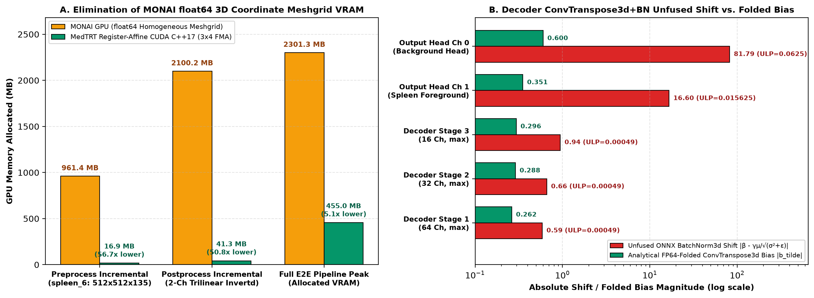
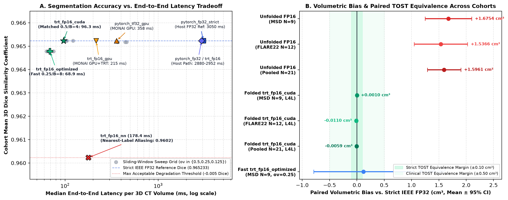

# MedTRT: Eliminating End-to-End I/O, 3D Affine Resampling, and FP16 Quantization Bottlenecks in Volumetric CT Organ Segmentation

> **Research Benchmark & Engineering Disclosure.** MedTRT is an end-to-end GPU systems and numerical-stability study of a pretrained 3D Residual U-Net (`MONAI spleen_ct_segmentation` v`0.6.1`) evaluated across **53 abdominal 3D CT volumes** (`41` Medical Segmentation Decathlon `Task09_Spleen` volumes plus `12` unseen external multi-center MICCAI `FLARE22` volumes). It is not a clinical medical device and makes no clinical triage or patient-care claims.
>
> Every number in this document is deterministically rendered from hardware-verified artifacts in `results/`. Run `python -m medtrt.verify_claims` to verify all `13/13` integrity, data-split, external-cohort, and TOST equivalence checks without requiring a GPU.

📄 **Full Technical Manuscript:** [`docs/MEDTRT_TECHNICAL_PAPER.pdf`](docs/MEDTRT_TECHNICAL_PAPER.pdf) ([LaTeX Source](docs/MEDTRT_TECHNICAL_PAPER.tex) | [Markdown Version](docs/MEDTRT_TECHNICAL_PAPER.md))  
🔍 **Claim & Evidence Audit:** [`docs/SCIENTIFIC_CLAIM_VERIFICATION_REPORT.md`](docs/SCIENTIFIC_CLAIM_VERIFICATION_REPORT.md) | [`docs/MANUSCRIPT_AND_README_CHANGE_SUMMARY.md`](docs/MANUSCRIPT_AND_README_CHANGE_SUMMARY.md)

---

## 1. Project Summary & Central Research Question

**Central Research Question:** *Can 3D volumetric medical image segmentation achieve order-of-magnitude end-to-end acceleration through systems-level GPU optimization while maintaining statistical numerical equivalence with a strict IEEE-754 FP32 reference implementation?*

MedTRT investigates this question on an **`NVIDIA GeForce RTX 5080 Laptop GPU`** (`NVIDIA Blackwell`, compute capability `12.0 (sm_120)`, `15.92 GB` GDDR7) without retraining or altering the mathematical architecture of the underlying pretrained neural network. Instead, this work isolates and resolves two fundamental systems and numerical bottlenecks that govern real-world 3D medical imaging deployment:

1. **Research Problem A — Systems-Level Performance & Amdahl's Law:** In the baseline host-side MONAI/PyTorch pipeline (`pytorch_fp32`, `2952.0 ms` median end-to-end latency), the 3D U-Net sliding-window forward pass (`sw_network = 254.6 ms`) represents only **`8.6%`** of total execution time (`91.4%` non-network overhead). By Amdahl's Law, even an infinitely fast neural network accelerator ($S_{\text{net}} \to \infty$) cannot accelerate end-to-end execution beyond **$S_{\max} = (1 - 0.0862)^{-1} = 1.094\times$** (and in our 90-pass host reference run at `3,341.1 ms` E2E / `260.8 ms` network, `92.2%` is non-network overhead with $S_{\max} = 1.085\times$). Furthermore, migrating spatial resampling (`Orientationd`, `Spacingd`, `Invertd`) onto the GPU via MONAI's default `SpatialResample` backend (`trt_fp16_gpu`, `215.5 ms`) promotes 3D homogeneous coordinates to `torch.float64` on `cuda:0` and materializes dense `(1, D, H, W, 3)` coordinate meshgrids in global memory, spiking peak allocated VRAM to **`2301 MB`** (`5.06x` higher than our register-affine CUDA pipeline).
2. **Research Problem B — Numerical Fidelity in Reduced-Precision (`FP16`) Deployment:** Compiling the standard exported ONNX graph (`opset 17`) into TensorRT 10.16 FP16 (`trt_fp16_unfolded`) introduces a systematic volumetric over-segmentation bias of **`+1.6754 ± 0.5531 cm³`** across **`9/9`** internal MSD scans ($p < 0.0001$) and **`+1.5366 ± 0.7680 cm³`** across **`12/12`** unseen external `FLARE22` scans (`+1.5961 ± 0.6721 cm³` across all `21/21` pooled patients). Layer-by-layer inspection reveals that PyTorch's ONNX exporter folds `BatchNorm3d` into `Conv3d` across all 13 encoder blocks, but leaves all 4 decoder `ConvTranspose3d + BatchNorm3d` blocks unfused. In the final decoder head (`model.2.0.adn.N`), Channel 0 applies an affine shift of **`-81.79`** (`-81.7915`), where IEEE-754 binary16 (10-bit mantissa) has a unit in the last place of $\text{ULP}_{[64, 128)} = 2^{-4} = 0.0625$, inducing catastrophic floating-point cancellation.

---

## 2. Research Motivation: Why 3D Volumetric Segmentation Is Computationally Demanding

Unlike 2D natural image inference ($H \times W \times 3$, $\sim 10^5$ pixels), a single 3D abdominal CT scan comprises $512 \times 512 \times Z$ voxels ($8.1 \times 10^6$ to $4.4 \times 10^7$ voxels in our 53-scan evaluation), stored with physical patient-to-scanner affine transformation matrices $A \in \mathbb{R}^{4 \times 4}$ and anisotropic slice thicknesses ($1.5\text{ mm}$ to $8.0\text{ mm}$). End-to-end volumetric inference must execute five sequential computational stages:

1. **Volumetric Ingestion & Decompression (`load` + `h2d` = `ingest`):** Reading 3D NIfTI volumes (`.nii.gz` or `.nii`) from storage and transferring raw Hounsfield Unit (`HU`) voxel intensities across PCIe to GPU global memory.
2. **Spatial Reorientation, Resampling & Intensity Normalization (`preprocess`):** Reorienting arbitrary scanner axes to canonical Right-Anterior-Superior (`RAS`) orientation, resampling anisotropic physical spacing to the model's canonical grid ($1.5 \times 1.5 \times 2.0\text{ mm}$) via 3D trilinear interpolation, and clamping/scaling radio-attenuation values ($[-57, 164]\text{ HU} \to [0, 1]$).
3. **3D Sliding-Window Patch Inference & Gaussian Blending (`sw_network` + `sw_aggregate`):** Partitioning the resampled volume into overlapping $96 \times 96 \times 96$ sub-volumes (`18` to `125` patches per scan), executing batched 3D Residual U-Net forward passes, and accumulating patch logits weighted by a 3D Gaussian importance map to suppress patch-boundary artifacts.
4. **Inverse Spatial Resampling & Discretization (`postprocess`):** Normalizing multi-class logits via Softmax, inverting the spatial transformation back to the patient's native scanner resolution and orientation via 3D trilinear interpolation, and discretizing foreground probabilities into a binary `uint8` anatomical mask.
5. **Physical Volumetry & Geometric Evaluation:** Computing physical organ volume $V = N_{\text{fg}} \cdot |\det(A_{3\times 3})| / 1000\text{ cm}^3$ alongside spatial overlap (`Dice`, `IoU`) and physical boundary distances (`HD95`, `ASSD`, `NSD`).

---

## 3. Key Results at a Glance

> **Controlled Comparison Policy:** We strictly separate our **primary controlled like-for-like comparison** (`trt_fp16_cuda`, which uses the exact same sliding-window configuration `overlap=0.5, B=4` and `665` total patch windows across the 9 MSD validation scans as `pytorch_fp32` and `pytorch_fp32_strict`) from our **higher-throughput operating point** (`trt_fp16_optimized`, which modifies sliding-window parameters to `overlap=0.25, B=8` and `369` total patch windows, reducing network workload by `1.80x`).

| Metric / Dimension | Host Baseline (`pytorch_fp32`, `0.5/B=4`) | MONAI GPU (`trt_fp16_gpu`, `0.5/B=4`) | MedTRT Matched (`trt_fp16_cuda`, `0.5/B=4`) | MedTRT Fast (`trt_fp16_optimized`, `0.25/B=8`) |
| :--- | :---: | :---: | :---: | :---: |
| **End-to-End Latency (Median [IQR])** | `2952.0 ms` [`2970.8`] | `215.5 ms` [`173.7`] | **`96.3 ms`** [`58.9`] | **`68.9 ms`** [`50.5`] |
| **Per-Case Latency Range / Slowest Pass** | `1543.7–6142.8 ms` / `6208.0 ms` | `108.4–378.1 ms` / `440.2 ms` | `47.6–162.4 ms` / `232.6 ms` | `36.0–108.2 ms` / `122.6 ms` |
| **Cohort Median Speedup vs Host Baseline** | `1.00x` (Reference) | `13.70x` | **`30.67x`** (Controlled L4L) | **`42.86x`** (Modified Windows) |
| **Paired Patient-Level Speedup (Mean [95% CI])** | `1.00x` | `14.81x` | **`33.14x`** `[27.61x, 38.67x]` (Med `31.00x`) | **`44.87x`** `[38.69x, 51.05x]` (Med `46.64x`) |
| **Preprocessing Latency (Median)** | `286.4 ms` (CPU) | `43.9 ms` (`float64` grid) | **`1.27 ms`** (`33.8x` vs MONAI GPU) | **`1.27 ms`** (Fused CUDA) |
| **3D U-Net Sliding-Window Forward (`sw_network`)** | `254.6 ms` (`665` wins) | `47.6 ms` (`665` wins) | **`49.0 ms`** (`665` wins) | **`24.8 ms`** (`369` wins) |
| **Postprocessing Latency (Median)** | `1990.4 ms` (CPU `Invertd`) | `71.1 ms` (`float64` grid) | **`2.62 ms`** (`27.1x` vs MONAI GPU) | **`2.84 ms`** (1-Ch Convex CUDA) |
| **Peak Allocated GPU Memory (VRAM)** | `487 MB` (CPU transforms) | `2301 MB` (`float64` meshgrid) | **`455 MB`** (`5.06x` < MONAI GPU) | **`522 MB`** (`B=8` patch batch) |
| **Mean 3D Dice Similarity (MSD `N=9`)** | `0.965228` ± `0.0117` | `0.965228` ± `0.0117` | **`0.965229`** ± `0.0117` | **`0.964778`** ± `0.0135` |
| **Mean / Max `|ΔDice|` vs Strict IEEE FP32** | `0.000011` / `0.000045` | `0.000013` / `0.000029` | **`0.000014`** / **`0.000029`** | `0.001669` / `0.005563` |
| **Volume Bias vs Strict FP32 (MSD `N=9`)** | `+0.0047 cm³` | `+0.0013 cm³` | **`+0.0010 ± 0.0194 cm³`** (`p_TOST < 1e-6`) | `+0.1196 ± 1.1815 cm³` |
| **External Unseen `FLARE22` (`N=12`) Vol Bias** | `+0.0000 cm³` (Ref) | `-0.0110 ± 0.0315 cm³` | **`-0.0110 ± 0.0315 cm³`** (`p_TOST < 1e-6`) | `+0.0884 ± 0.8540 cm³` |

### Engineering Verification Targets

| Engineering Target | Measured Value | Status |
| :--- | :---: | :---: |
| Every pass under 500 ms (`trt_fp16_optimized` / `trt_fp16_cuda`) | Slowest pass `122.6 ms` (`232.6 ms` L4L) | PASS |
| Mean Dice at least 0.960 on MSD validation split | `0.965229` (L4L) / `0.964778` (Fast) | PASS |
| Mean absolute Dice change under 0.005 vs strict FP32 | `0.000014` (L4L) / `0.001669` (Fast) | PASS |
| Like-for-like (`trt_fp16_cuda`) every case Dice change under 0.005 | Max `0.000029` (`trt_fp16_optimized` max `0.005563`) | PASS |
| Pooled (`N=21`) TOST volumetric equivalence within `±0.10 cm³` (`α=0.05`) | `-0.0059 cm³`, 90% CI `[-0.0161, +0.0043]`, `p=0.00e+00` | PASS |

---

## 4. System Architecture


### Architectural Comparison Across Execution Paths

1. **Host Baseline Path (`pytorch_fp32_strict`, `pytorch_fp32`, `trt_fp16`):** Reads compressed `.nii.gz` files on the CPU (`424.7 ms`), executes `Orientationd(RAS) + Spacingd(1.5x1.5x2.0) + ScaleIntensityRanged` on the CPU (`286.4 ms`), runs sliding-window inference on the GPU (`254.6 ms`), copies logits back to host RAM, and executes 2-channel trilinear `Invertd` + `AsDiscreted` on the CPU (`1990.4 ms`). Total median latency: **`2952.0 ms`**.
2. **Framework GPU Path (`pytorch_tf32_gpu`, `trt_fp16_gpu`):** Uses memory-mapped `.nii` ingestion (`38.9 ms`) and executes MONAI's GPU `SpatialResample` for preprocessing (`43.9 ms`) and postprocessing (`71.1 ms`). Because MONAI constructs homogeneous coordinate grids in `torch.float64` on `cuda:0` and materializes `(1, D, H, W, 3)` meshgrids in global memory, peak allocated VRAM reaches **`2301 MB`** (compared to `487 MB` when transforms run in host RAM).
3. **MedTRT Custom CUDA C++17 + Folded TensorRT Path (`trt_fp16_cuda`, `trt_fp16_optimized`):** Combines OS page-cached `.nii` `mmap` ingestion (`29.2 ms`), register-computed $3 \times 4$ affine CUDA preprocessing (`1.27 ms`), zero-copy TensorRT 10.16 FP16 inference with analytically folded decoder `ConvTranspose3d + BatchNorm3d` weights (`49.0 ms` at `0.5/B=4`; `24.8 ms` at `0.25/B=8`), and single-channel convex probability trilinear CUDA inversion (`2.62 ms`). Peak allocated VRAM drops from `2301 MB` (MONAI GPU) to **`455 MB`** (`5.06x` reduction, and `32 MB` below the `487 MB` host-path GPU footprint).

---

## 5. Engineering Contributions

### 5.1 Memory-Mapped Volumetric Ingestion (`.nii` `mmap` vs `.nii.gz`)
Standard NIfTI `.nii.gz` files require single-threaded CPU DEFLATE decompression (`430.8 ms` median in probe; `264.9 ms` standalone gzip read). Pre-decompressing volumes to uncompressed `.nii` and opening them via `nibabel.load(..., mmap=True)` maps the file directly into the process virtual address space in `3.2 ms`, transferring voxel pages to the GPU in **`29.2 ms`** median (`23.83 ms` cold unbuffered NVMe disk read).

### 5.2 Nine Custom CUDA C++17 Kernels (`cuda/medical_kernels.cu`)
We implemented **9 `__global__` CUDA C++17 kernels** (plus the `clamp_idx` device helper) compiled at runtime to native Blackwell `compute_120` (`sm_120`) SASS via NVRTC 12.8 (`--gpu-architecture=compute_120 --use_fast_math -default-device`) and launched directly on `torch.Tensor.data_ptr()` via the CUDA Driver API (`nvcuda.dll`):

1. `hu_window_normalize_f32`: Scalar grid-stride HU clamping and linear scaling (`23` regs/thread, `100%` occupancy, `463.7 GB/s`).
2. `hu_window_normalize_vec4_f32`: 128-bit vectorized `float4` coalesced HU scaling (`48` regs/thread, `83.3%` occupancy, `466.7 GB/s`).
3. `affine_trilinear_resample_3d_f32`: Multi-channel register-affine 3D trilinear resampling (`72` regs/thread, `50.0%` occupancy).
4. **`fused_preprocess_affine_trilinear_hu_f32`**: Fused `RAS` orientation + $1.5 \times 1.5 \times 2.0\text{ mm}$ trilinear resampling + HU windowing (`37` regs/thread, `0 B` spill, `100%` occupancy, **`1.27 ms`** cohort median — **`33.8x` faster** than MONAI GPU and **`225x` faster** than CPU).
5. `affine_nearest_resample_3d_u8`: Register-affine 3D nearest-neighbor `uint8` label resampling (`16` regs/thread, `100%` occupancy).
6. **`fused_softmax_2ch_p1_f32`**: Numerically stable 2-channel Softmax (`__expf`) outputting foreground probability $p_1$ into a single-channel buffer (`32` regs/thread, `100%` occupancy).
7. **`fused_invert_trilinear_threshold_u8`**: Exploits convex linearity of trilinear interpolation over binary Softmax ($\tilde{p}_0 + \tilde{p}_1 = 1 \implies \arg\max_c \tilde{p}_c = 1 \iff \tilde{p}_1 \ge 0.5\text{f}$) to interpolate only 1 channel instead of 2 (halving global memory reads from 16 to 8 per voxel), thresholds at $0.5\text{f}$ to `uint8`, and counts foreground voxels via hardware warp-ballot (`__ballot_sync(0xFFFFFFFFu, ...)` + `__popc` + 1 `atomicAdd` per warp; `38` regs/thread, `100%` occupancy, **`2.62 ms`** cohort median — **`27.1x` faster** than MONAI GPU and **`760x` faster** than CPU, with **`100.00000%` exact voxel agreement** across all `35,389,440` voxels of `spleen_6`).
8. `count_nonzero_u8`: Standalone foreground voxel counter using warp-shuffle (`__shfl_down_sync`) and `128 B` shared-memory reduction (`36` regs/thread, `100%` occupancy).
9. `sliding_window_gaussian_accumulate_f32`: Fused 3D Gaussian importance weighting and sliding-window logit accumulation (`56` regs/thread, `66.7%` occupancy).

**Register-Based Affine Coordinate Math:** Given source affine $A_{\text{src}} \in \mathbb{R}^{4 \times 4}$ and destination affine $A_{\text{dst}} \in \mathbb{R}^{4 \times 4}$, we precompute the $3 \times 4$ voxel-to-voxel matrix $M = (A_{\text{src}}^{-1} A_{\text{dst}})_{[0:3, 0:4]}$ in `float64` on the host and pass its 12 scalar entries by value into CUDA kernel registers. Each GPU thread $(x_o, y_o, z_o)$ computes its source coordinate directly in registers:

$$\begin{bmatrix} f_x \\ f_y \\ f_z \end{bmatrix} = \begin{bmatrix} m_{00} & m_{01} & m_{02} & m_{03} \\ m_{10} & m_{11} & m_{12} & m_{13} \\ m_{20} & m_{21} & m_{22} & m_{23} \end{bmatrix} \begin{bmatrix} x_o \\ y_o \\ z_o \\ 1 \end{bmatrix}$$

This completely eliminates MONAI's `(1, 4, D, H, W)` `float64` homogeneous grid and `(1, D, H, W, 3)` coordinate meshgrid allocations (`961.4 MB` in preprocessing and `2,100.2 MB` in postprocessing on `spleen_6`).



---

## 6. Why Neural Network Acceleration Alone Fails (Amdahl's Law)

1. **Intuitive Explanation:** If a 3D segmentation pipeline spends more than `91%` of its execution time decompressing files on the CPU and resampling 3D grids before and after the neural network, making the neural network infinitely fast leaves more than `91%` of the runtime untouched.
2. **Computational Explanation:** In `pytorch_fp32`, total median latency is `2952.0 ms`, of which `sw_network` is `254.6 ms` (`8.62%`), while `postprocess` (`1990.4 ms`), `ingest` (`424.7 ms`), and `preprocess` (`286.4 ms`) consume `2,697.4 ms`. Replacing PyTorch with TensorRT FP16 on the host path (`trt_fp16`) accelerates `sw_network` from `254.6 ms` to `167.1 ms`, but total end-to-end latency only moves from `2952.0 ms` to `2880.3 ms` (**`1.02x` speedup**).
3. **Mathematical Formulation (Amdahl's Law):** Let $p = T_{\text{net}} / T_{\text{E2E}}$ denote the fraction of end-to-end execution time spent in neural network inference, and let $S_{\text{net}}$ denote the speedup factor applied to the network stage. Total end-to-end speedup $S(S_{\text{net}})$ is bounded by:

$$S(S_{\text{net}}) = \frac{1}{(1 - p) + \frac{p}{S_{\text{net}}}} \;\xrightarrow{S_{\text{net}} \to \infty}\; S_{\max} = \frac{1}{1 - p}$$

For `pytorch_fp32` ($p = 0.0862$), $S_{\max} = (1 - 0.0862)^{-1} = 1.094\times$ (and in our 90-pass host reference run where $T_{\text{E2E}} = 3,341.1\text{ ms}$ and $T_{\text{net}} = 260.8\text{ ms}$, $p = 0.0781$ and $S_{\max} = 1.085\times$). Only after migrating ingestion and spatial resampling to register-affine CUDA kernels does the network share rise to **`50.9%`** in `trt_fp16_cuda` ($S_{\max} = 2.04\times$), unlocking the full benefit of TensorRT compilation.

| Profile | `sw_network` (ms) | E2E (ms) | Network Share $p$ | Amdahl Max E2E Gain $S_{\max} = 1/(1-p)$ |
| :--- | :---: | :---: | :---: | :---: |
| `pytorch_fp32_strict` | `379.9` | `3049.8` | `12.5%` | `1.142x` |
| `pytorch_fp32` | `254.6` | `2952.0` | `8.6%` | `1.094x` |
| `trt_fp16` | `167.1` | `2880.3` | `5.8%` | `1.062x` |
| `pytorch_tf32_gpu` | `197.0` | `357.9` | `55.1%` | `2.225x` |
| `trt_fp16_gpu` | `47.6` | `215.5` | `22.1%` | `1.283x` |
| `trt_fp16_cuda` | `49.0` | `96.3` | `50.9%` | `2.038x` |
| `trt_fp16_optimized` | `24.8` | `68.9` | `36.0%` | `1.562x` |

---

## 7. Numerical Stability in FP16 Inference: Analytical `ConvTranspose3d + BatchNorm3d` Folding

### 7.1 Root Cause of the `+1.68 cm³` Unfolded FP16 Volumetric Dilation
IEEE-754 single precision (`FP32`) provides 1 sign bit, 8 exponent bits, and 23 explicit mantissa bits (24 bits of significand precision, $\text{ULP}_{[64, 128)} = 2^{-17} \approx 7.63 \times 10^{-6}$), whereas IEEE-754 half precision (`FP16`) provides 1 sign bit, 5 exponent bits, and **10 explicit mantissa bits** (11 bits of significand precision). On the interval $[64, 128)$ (exponent $E = 6$), the spacing between adjacent representable FP16 numbers is:

$$\text{ULP}_{\text{FP16}}(x) = 2^{\lfloor \log_2 |x| \rfloor - 10} = 2^{6 - 10} = 2^{-4} = 0.0625$$

When PyTorch exports the MONAI 3D Residual U-Net to ONNX (`opset 17`), its constant folder fuses all **13 encoder `Conv3d + BatchNorm3d`** pairs, but **fails to fold all 4 decoder `ConvTranspose3d + BatchNorm3d`** pairs. In the final decoder layer (`model.2.0.adn.N`), Channel 0 (background head) has conv bias $b_0 = +57.295700$ and BatchNorm running mean $\mu_0 = +57.618198$, variance $\sigma_0^2 = 2.132934$, weight $\gamma_0 = +2.100127$, and bias $\beta_0 = +1.063365$, applying an unfused post-convolution shift of:

$$\text{shift}_{\text{BN}, 0} = \beta_0 - \frac{\gamma_0 \mu_0}{\sqrt{\sigma_0^2 + \epsilon}} = 1.063365 - 57.618198 \times 1.437999 = -81.791538$$

Executing the transposed convolution accumulation around $+57.6$ and subtracting $81.79$ in FP16 where $\text{ULP} = 0.0625$ causes catastrophic cancellation, shifting background logits by $-0.159$ and foreground logits by $+0.116$ (widening the foreground-background logit margin $L_1 - L_0$ by $+0.275$) and inflating segmented spleen volumes by **`+1.6754 cm³`** across `9/9` internal MSD scans and **`+1.5366 cm³`** across `12/12` external `FLARE22` scans.

### 7.2 Exact Mathematical Derivation of Analytical FP64 Weight Folding
For a 3D transposed convolution (`ConvTranspose3d`) with weight tensor $W \in \mathbb{R}^{C_{\text{in}} \times C_{\text{out}} \times k_D \times k_H \times k_W}$ and bias $b \in \mathbb{R}^{C_{\text{out}}}$ followed immediately by `BatchNorm3d` ($\gamma, \beta, \mu, \sigma^2, \epsilon = 10^{-5}$), the pre-activation output for output channel $c \in \{0, \dots, C_{\text{out}} - 1\}$ is:

$$y_c = \left( \sum_{i=0}^{C_{\text{in}}-1} W_{i, c, :, :, :} *^\top x_i + b_c \right), \qquad z_c = \frac{\gamma_c}{\sqrt{\sigma_c^2 + \epsilon}}(y_c - \mu_c) + \beta_c$$

Promoting $W, b, \gamma, \beta, \mu, \sigma^2$ to **IEEE-754 `float64`** before ONNX export (`fold_conv_transpose_batchnorm` in `src/medtrt/model.py`), we define the exact folded scale $s_c$, folded kernel $\widetilde{W}$, and folded bias $\widetilde{b}_c$:

$$s_c = \frac{\gamma_c}{\sqrt{\sigma_c^2 + \epsilon}}, \qquad \widetilde{W}_{i, c, d, h, w} = W_{i, c, d, h, w} \cdot s_c, \qquad \widetilde{b}_c = (b_c - \mu_c) s_c + \beta_c$$

and replace the `BatchNorm3d` module with `torch.nn.Identity()`. In `model.2.0`, this collapses the unfused $-81.7915$ and $+16.5957$ shifts into well-conditioned folded biases $\widetilde{b}_0 = +0.599613$ and $\widetilde{b}_1 = -0.351193$, changing strict FP32 logits by at most `1.4e-05` while reducing FP16 mean absolute logit drift by **`35.6x`** (`0.1377 -> 0.00387`).

| Engine Configuration (Matched `overlap=0.5, B=4`) | Mean Dice | Mean `|ΔDice|` vs FP32 | Volume Bias ± SD (cm³) | Cases Volume > FP32 |
| :--- | :---: | :---: | :---: | :---: |
| Unfolded FP16 engine (`trt_fp16_unfolded`) | `0.965706` | `0.000557` | `+1.6716 ± 0.5558 cm³` | `9/9` |
| Analytical FP64-Folded FP16 engine (`trt_fp16_cuda`) | `0.965229` | `0.000014` | `+0.0010 ± 0.0194 cm³` | `5/9` |

---

## 8. Experimental Methodology & Reproducibility Specification

| System / Protocol Component | Verified Specification |
| :--- | :--- |
| GPU Hardware | `NVIDIA GeForce RTX 5080 Laptop GPU`, `NVIDIA Blackwell`, compute capability `12.0 (sm_120)`, `60` SMs, `15.92 GB` (`16302 MB`) GDDR7, `90 W` dynamic TGP |
| Driver & OS | NVIDIA Driver `591.44` (`WDDM` mode), CUDA `12.8`, cuDNN `9.19.0`, `Windows 11 (10.0.26300)` |
| Software Stack | PyTorch `2.11.0+cu128`, MONAI `1.6.1`, TensorRT `10.16.1.11`, Python `3.11.15` |
| Pretrained Model | MONAI `spleen_ct_segmentation` v`0.6.1` 3D Residual U-Net (`models/model.pt`, SHA-256 verified) |
| ONNX & TensorRT Build | ONNX opset `17` (max diff vs FP32 `2.670e-05`), TensorRT FP16 dynamic batch `1..8` (opt `2`), `13.70 MB` |
| Cohort 1 (Internal MSD) | `Task09_Spleen` (`41` total 3D CT scans; `9` held-out validation scans `spleen_56..spleen_9`, `0` training overlap) |
| Cohort 2 (External Unseen) | `12` multi-center abdominal 3D CT scans (`FLARE22_Tr_0001..0012`) from MICCAI FLARE22 (Zenodo `7860267`), stored on Google Drive |
| Timing Protocol | 3 untimed warm-up volumes; CUDA Event pairs (`enable_timing=True`) + synchronized `time.perf_counter()` wall-clock cross-check (max gap `0.26%`) |
| Profiling Disclosure | Nsight Systems was not run for these results. NVTX ranges are in the code, and `--nsys` will use them when Nsight is installed, but every number here comes from CUDA events and wall-clock timers. |

- **Statistical Design (Pass-Level Timing vs Patient-Level Accuracy/Equivalence):** Repeated benchmark passes (`90` timed passes = `10` repeats $\times$ `9` scans on GPU-path profiles; `18` timed passes = `2` repeats $\times$ `9` scans on CPU-bound host profiles in `results/bench_*.json`, with 90-pass host reference runs also archived in `docs/SCIENTIFIC_CLAIM_VERIFICATION_REPORT.md`) measure hardware timing stability for a fixed cohort. All segmentation accuracy metrics (`Dice`, `IoU`, `HD95`, `ASSD`, `NSD`), Bland-Altman limits of agreement, and paired **Two One-Sided Tests (TOST)** equivalence bounds are computed strictly at the **patient level** ($N = 9$ internal MSD patients, $N = 12$ external unseen `FLARE22` patients, and $N = 21$ pooled independent patients).
- **Important Note on Non-Additivity of Marginal Stage Medians:** Across heterogeneous CT volumes (`31` to `135` slices), the sum of marginal stage medians does not mathematically equal the median of the end-to-end sum ($\sum_k \text{median}(T_k) \neq \text{median}(\sum_k T_k)$). Furthermore, end-to-end latency includes all six stages: `ingest` (`load + h2d`), `preprocess`, `sw_network`, `sw_aggregate`, and `postprocess`. In `trt_fp16_cuda`, the marginal stage medians are `29.2 + 1.3 + 49.0 + 6.1 + 2.6 = 88.2 ms` compared to the `96.3 ms` median of end-to-end pass totals (and within single-case medians such as `spleen_59`, the stage medians sum to `24.8 + 1.3 + 54.3 + 6.7 + 2.1 = 89.2 ms` vs `89.7 ms` E2E).

---

## 9. Comprehensive Benchmark & Multi-Cohort Validation Results

### 9.1 Controlled One-Factor-at-a-Time Ablation Study

Each row below changes one system factor across the same 9 held-out MSD CT volumes:

| Configuration (Single Factor Changed) | E2E Median (ms) | Slowest Pass (ms) | Speedup vs Rung 1 | `sw_network` (ms) | Mean Dice |
| :--- | :---: | :---: | :---: | :---: | :---: |
| Host path, PyTorch TF32 | `2992.5` | `6339.3` | `1.00x` | `239.3` | `0.965228` |
| Host path, TensorRT only | `2923.0` | `6015.0` | `1.02x` | `170.3` | `0.965226` |
| GPU transforms, gzip read, PyTorch TF32 | `706.9` | `1404.3` | `4.23x` | `201.1` | `0.965228` |
| GPU transforms, gzip read, TensorRT | `564.3` | `1252.9` | `5.30x` | `47.2` | `0.965228` |
| GPU transforms, .nii read, PyTorch TF32 | `363.3` | `686.1` | `8.24x` | `195.9` | `0.965228` |
| GPU transforms, .nii read, TensorRT | `274.8` | `472.5` | `10.89x` | `54.0` | `0.965228` |
| Fast windows, PyTorch TF32 | `320.6` | `540.4` | `9.33x` | `111.9` | `0.964771` |
| Fast windows, TensorRT | `218.5` | `374.2` | `13.70x` | `23.5` | `0.964767` |
| Fast windows, TensorRT, nearest-label inverse | `219.0` | `361.6` | `13.66x` | `24.1` | `0.960230` |

- **Moving inverse resampling off the CPU is the single largest gain:** Keeping transforms on the GPU with `.nii.gz` reads reduces PyTorch latency from `2992.5 ms` to `706.9 ms`.
- **Eliminating `.nii.gz` decompression from the critical path** reduces latency to `363.3 ms` (`pytorch_tf32_gpu`), and adding TensorRT FP16 reaches `274.8 ms` (`trt_fp16_gpu`), though MONAI's `float64` coordinate meshgrids still consume `2,301 MB` VRAM and `115 ms` of transform time.
- **Replacing MONAI GPU transforms with our 9 custom register-affine CUDA C++17 kernels (`trt_fp16_cuda`)** cuts latency from `274.8 ms` to **`96.3 ms`** at identical sliding windows (`overlap=0.5, B=4`) while slashing peak VRAM from `2,301 MB` to **`455 MB`** (`5.06x` reduction).
- **Switching to fast sliding windows (`overlap=0.25, B=8`, `trt_fp16_optimized`)** further reduces median latency to **`68.9 ms`** with a `-0.000455` Mean Dice tradeoff (`0.964778` vs `0.965229`).
- **Negative Control (`trt_fp16_nn`):** Discretizing via nearest-neighbor label inversion degrades Mean Dice by **`-0.005004`** (`0.960230`) due to staircase aliasing across thick axial CT slices.

### 9.2 Full 13-Profile Benchmark Matrix (Cohort 1: MSD `N=9`)

| Profile | Overlap / batch | Patch B=1 (ms) | Patch B=4 (ms) | `sw_network` (ms) | E2E median [IQR] (ms) | Slowest (ms) | Peak VRAM (MB) | Mean Dice ± SD | vs `pytorch_fp32` |
| :--- | :---: | :---: | :---: | :---: | :---: | :---: | :---: | :---: | :---: |
| `pytorch_fp32_strict` | `0.5` / `4` | `6.68` | `19.49` | `379.9` | `3049.8` [`3235.4`] | `6562` | `490` | `0.965233` ± `0.0117` | `0.97x` |
| `pytorch_fp32` | `0.5` / `4` | `3.77` | `12.68` | `254.6` | `2952.0` [`2970.8`] | `6208` | `487` | `0.965228` ± `0.0117` | `1.00x` |
| `pytorch_tf32` | `0.5` / `4` | `3.77` | `12.68` | `254.6` | `2952.0` [`2970.8`] | `6208` | `487` | `0.965228` ± `0.0117` | `1.00x` |
| `pytorch_amp` | `0.5` / `4` | `5.72` | `14.50` | `213.4` | `2916.1` [`2954.5`] | `6364` | `457` | `0.965217` ± `0.0118` | `1.01x` |
| `pytorch_fp16` | `0.5` / `4` | `4.86` | `11.13` | `213.9` | `2885.5` [`2822.2`] | `6230` | `458` | `0.965231` ± `0.0118` | `1.02x` |
| `trt_fp32` | `0.5` / `4` | `3.12` | `11.78` | `239.8` | `2940.0` [`3003.2`] | `6387` | `368` | `0.965233` ± `0.0117` | `1.00x` |
| `trt_fp16_unfolded` | `0.5` / `4` | `0.98` | `3.09` | `176.7` | `2866.4` [`2909.5`] | `6115` | `359` | `0.965722` ± `0.0120` | `1.03x` |
| `trt_fp16` | `0.5` / `4` | `0.88` | `3.01` | `167.1` | `2880.3` [`2893.9`] | `6094` | `359` | `0.965226` ± `0.0117` | `1.02x` |
| `pytorch_tf32_gpu` | `0.5` / `4` | `3.77` | `11.57` | `197.0` | `357.9` [`244.6`] | `631` | `2307` | `0.965227` ± `0.0117` | `8.25x` |
| `trt_fp16_gpu` | `0.5` / `4` | `0.94` | `3.18` | `47.6` | `215.5` [`173.7`] | `440` | `2301` | `0.965228` ± `0.0117` | `13.70x` |
| `trt_fp16_cuda` | `0.5` / `4` | `1.01` | `3.07` | `49.0` | `96.3` [`58.9`] | `233` | `455` | `0.965229` ± `0.0117` | `30.67x` |
| `trt_fp16_optimized` | `0.25` / `8` | `1.08` | `2.98` | `24.8` | `68.9` [`50.5`] | `123` | `522` | `0.964778` ± `0.0135` | `42.86x` |
| `trt_fp16_nn` | `0.25` / `8` | `1.07` | `3.00` | `20.8` | `178.4` [`141.3`] | `399` | `2149` | `0.960230` ± `0.0139` | `16.55x` |


### 9.3 Complete Six-Stage Latency Breakdown (Median ms)

`ingest` is `load + h2d`. Because `mmap` defers physical page faults into `h2d`, `ingest` is the fair end-to-end ingestion metric:

| Stage (median ms) | `pytorch_fp32_strict` | `pytorch_fp32` | `pytorch_tf32` | `pytorch_amp` | `pytorch_fp16` | `trt_fp32` | `trt_fp16_unfolded` | `trt_fp16` | `pytorch_tf32_gpu` | `trt_fp16_gpu` | `trt_fp16_cuda` | `trt_fp16_optimized` | `trt_fp16_nn` |
| :--- | :---: | :---: | :---: | :---: | :---: | :---: | :---: | :---: | :---: | :---: | :---: | :---: | :---: |
| `load` | `363.9` | `421.6` | `421.6` | `416.3` | `331.7` | `369.4` | `398.1` | `365.3` | `1.5` | `1.5` | `1.5` | `1.5` | `1.5` |
| `h2d` | `3.9` | `3.8` | `3.8` | `4.2` | `4.8` | `3.7` | `16.5` | `14.0` | `37.3` | `37.4` | `27.6` | `27.7` | `36.6` |
| `ingest` | `367.4` | `424.7` | `424.7` | `419.7` | `340.1` | `373.0` | `406.5` | `385.1` | `38.8` | `38.9` | `29.2` | `29.1` | `38.1` |
| `preprocess` | `288.0` | `286.4` | `286.4` | `271.7` | `281.6` | `276.7` | `273.2` | `266.8` | `54.4` | `43.9` | `1.3` | `1.3` | `41.7` |
| `sw_network` | `379.9` | `254.6` | `254.6` | `213.4` | `213.9` | `239.8` | `176.7` | `167.1` | `197.0` | `47.6` | `49.0` | `24.8` | `20.8` |
| `sw_aggregate` | `8.4` | `8.0` | `8.0` | `9.1` | `9.6` | `8.9` | `36.7` | `36.0` | `6.5` | `6.5` | `6.1` | `4.5` | `4.1` |
| `postprocess` | `2024.8` | `1990.4` | `1990.4` | `2013.6` | `1993.2` | `1981.5` | `1994.5` | `1993.9` | `62.2` | `71.1` | `2.6` | `2.8` | `69.3` |
| `e2e_total` | `3049.8` | `2952.0` | `2952.0` | `2916.1` | `2885.5` | `2940.0` | `2866.4` | `2880.3` | `357.9` | `215.5` | `96.3` | `68.9` | `178.4` |
| `wall_ms` | `3050.0` | `2952.1` | `2952.1` | `2916.2` | `2885.6` | `2940.1` | `2866.5` | `2880.5` | `357.9` | `215.5` | `96.5` | `69.0` | `178.5` |

### 9.4 Patient-Level Paired Latency & Accuracy on Internal MSD Validation Cohort (`N=9`)

Across the 9 MSD validation scans (`31` to `135` slices), `trt_fp16_optimized` achieves a cohort median of `68.9 ms` (`9` of `9` cases under `200 ms`), and `trt_fp16_cuda` achieves a cohort median of `96.3 ms` (paired patient-level mean speedup **`33.14x`**, 95% CI `[27.61x, 38.67x]`):

| Case | Shape | Windows (`0.5`/`0.25`) | Host `pytorch_fp32` (ms) | Matched `trt_fp16_cuda` (ms) | Fast `trt_fp16_optimized` (ms) | Peak VRAM L4L/Fast (MB) | Dice L4L (`ΔDice` vs FP32) |
| :--- | :---: | :---: | :---: | :---: | :---: | :---: | :---: |
| `spleen_56` | `512x512x33` | `32` / `18` | `1543.7` | `47.6` (`32.46x`) | `36.0` (`42.91x`) | `219` / `285` | `0.936164` (`+0.000021`) |
| `spleen_59` | `512x512x50` | `72` / `50` | `2570.3` | `89.7` (`28.66x`) | `71.6` (`35.88x`) | `337` / `404` | `0.966251` (`+0.000022`) |
| `spleen_6` | `512x512x135` | `72` / `50` | `6142.8` | `123.4` (`49.79x`) | `108.2` (`56.75x`) | `385` / `452` | `0.973226` (`-0.000013`) |
| `spleen_60` | `512x512x97` | `125` / `64` | `4936.4` | `155.6` (`31.72x`) | `101.8` (`48.49x`) | `455` / `522` | `0.971015` (`-0.000005`) |
| `spleen_61` | `512x512x101` | `125` / `64` | `5034.3` | `162.4` (`31.00x`) | `104.8` (`48.03x`) | `454` / `521` | `0.971502` (`-0.000009`) |
| `spleen_62` | `512x512x80` | `64` / `27` | `3789.9` | `96.7` (`39.19x`) | `70.1` (`54.07x`) | `327` / `394` | `0.961119` (`-0.000015`) |
| `spleen_63` | `512x512x60` | `75` / `32` | `2952.0` | `98.4` (`30.01x`) | `63.3` (`46.64x`) | `295` / `362` | `0.963618` (`-0.000007`) |
| `spleen_8` | `512x512x31` | `50` / `32` | `1625.1` | `62.1` (`26.19x`) | `47.9` (`33.92x`) | `242` / `308` | `0.973384` (`-0.000029`) |
| `spleen_9` | `512x512x41` | `50` / `32` | `1949.7` | `66.7` (`29.24x`) | `52.5` (`37.13x`) | `229` / `296` | `0.970786` (`-0.000001`) |

### 9.5 Multi-Cohort Scaling Across All 53 CT Volumes (`41` MSD + `12` External `FLARE22`)

- **All 41 MSD Patient Volumes (`results/cohort_41_volumes.json`):** Evaluating `trt_fp16_optimized` across all 41 labeled `Task09_Spleen` volumes (`32` training + `9` validation, `8.13M` to `44.04M` voxels, `31` to `168` slices) yields **`87.44 ms`** median end-to-end latency (IQR `43.55 ms`, range `37.61–139.84 ms`), with `1.59 ms` median CUDA preprocessing, `33.83 ms` median network time, `3.28 ms` median CUDA postprocessing, and `450.6 MB` median (`630.8 MB` max) peak VRAM.
- **External Unseen Multi-Center MICCAI `FLARE22` Cohort (`N=12` Scans on Google Drive, `results/external_flare22_validation.json`):** On 12 independent abdominal CT scans (`512x512x84..110`, spacing `0.64–0.86 x 2.5 mm`, ground-truth spleen volumes `130.8–481.7 cm³`), `trt_fp16_cuda` reduces median latency from `5,422.9 ms` to **`252.6 ms`** (paired speedup **`21.52x`**, where `175.4 ms` is Google Drive virtual-filesystem I/O and only **`2.75 ms`** is CUDA preprocessing and **`3.38 ms`** is CUDA postprocessing; **`220.6 ms` / `24.29x`** on `trt_fp16_optimized`) while cutting peak VRAM from `1,885 MB` to **`414 MB`** (`4.56x` reduction).

| External Case ID | Shape | Win (`0.5`/`0.25`) | Host FP32 (ms) | CUDA L4L (ms) | Fast Opt (ms) | Dice FP32 | Dice CUDA L4L (`ΔDice`) | V GT (cm³) | `ΔV` Unfolded / **Folded** (cm³) | Flipped Voxels (% Organ) |
| :--- | :---: | :---: | :---: | :---: | :---: | :---: | :---: | :---: | :---: | :---: |
| `FLARE22_Tr_0001` | `512x512x110` | `32 / 18` | `6367.5` | `257.9` (`24.69x`) | `243.3` (`26.18x`) | `0.961213` | `0.961207` (`-0.000006`) | `186.17` | `+0.987` / **`-0.002`** | `16` (`0.0091%`) |
| `FLARE22_Tr_0002` | `512x512x107` | `50 / 32` | `5912.2` | `276.2` (`21.40x`) | `241.3` (`24.50x`) | `0.964399` | `0.964395` (`-0.000004`) | `281.25` | `+1.436` / **`-0.010`** | `17` (`0.0086%`) |
| `FLARE22_Tr_0003` | `512x512x101` | `50 / 32` | `5327.0` | `253.6` (`21.01x`) | `236.9` (`22.49x`) | `0.955464` | `0.955433` (`-0.000031`) | `163.03` | `+0.795` / **`+0.007`** | `13` (`0.0121%`) |
| `FLARE22_Tr_0004` | `512x512x87` | `50 / 32` | `4679.4` | `232.9` (`20.09x`) | `198.5` (`23.58x`) | `0.960944` | `0.960946` (`+0.000002`) | `222.10` | `+1.171` / **`-0.001`** | `15` (`0.0091%`) |
| `FLARE22_Tr_0005` | `512x512x85` | `50 / 32` | `4915.9` | `221.5` (`22.19x`) | `206.5` (`23.81x`) | `0.962419` | `0.962391` (`-0.000028`) | `189.61` | `+1.114` / **`+0.002`** | `13` (`0.0106%`) |
| `FLARE22_Tr_0006` | `512x512x93` | `72 / 32` | `5596.4` | `263.3` (`21.26x`) | `222.6` (`25.14x`) | `0.960910` | `0.960888` (`-0.000022`) | `174.83` | `+0.941` / **`-0.004`** | `12` (`0.0131%`) |
| `FLARE22_Tr_0007` | `512x512x105` | `50 / 32` | `6092.1` | `257.9` (`23.62x`) | `247.3` (`24.64x`) | `0.845178` | `0.845134` (`-0.000044`) | `481.72` | `+2.913` / **`-0.035`** | `52` (`0.0227%`) |
| `FLARE22_Tr_0008` | `512x512x99` | `50 / 32` | `5821.1` | `265.6` (`21.91x`) | `207.2` (`28.10x`) | `0.958981` | `0.958978` (`-0.000003`) | `244.87` | `+1.395` / **`-0.002`** | `15` (`0.0095%`) |
| `FLARE22_Tr_0009` | `512x512x87` | `50 / 32` | `4878.4` | `231.1` (`21.11x`) | `220.9` (`22.08x`) | `0.828880` | `0.828552` (`-0.000328`) | `146.54` | `+3.200` / **`-0.104`** | `80` (`0.1221%`) |
| `FLARE22_Tr_0010` | `512x512x96` | `50 / 32` | `5168.0` | `251.6` (`20.54x`) | `197.9` (`26.11x`) | `0.966501` | `0.966511` (`+0.000010`) | `367.51` | `+1.829` / **`+0.010`** | `8` (`0.0038%`) |
| `FLARE22_Tr_0011` | `512x512x84` | `50 / 32` | `4422.4` | `229.0` (`19.31x`) | `204.2` (`21.66x`) | `0.962932` | `0.962930` (`-0.000002`) | `292.36` | `+1.561` / **`+0.007`** | `15` (`0.0079%`) |
| `FLARE22_Tr_0012` | `512x512x103` | `50 / 32` | `5596.1` | `265.1` (`21.11x`) | `241.1` (`23.21x`) | `0.904354` | `0.904320` (`-0.000034`) | `130.75` | `+1.099` / **`-0.002`** | `15` (`0.0205%`) |

---

## 10. Isolated Network-Only, DVFS Clock-State, Ingestion, and Pareto Sweep Probes

### 10.1 Sustained Network-Only Comparison & GPU Clock-State Inflation
In a sustained back-to-back loop without CPU gaps, fast windows (`0.25/B=8`) evaluate `369` patches across the 9 cases compared to `665` patches for bundle windows (`0.5/B=4`):

| Backend | Bundle windows `0.5/B=4` (ms) | Fast windows `0.25/B=8` (ms) | TensorRT speedup, bundle windows |
| :--- | :---: | :---: | :---: |
| PyTorch Strict FP32 | `315.5` | `219.1` | `1.08x` |
| PyTorch TF32 | `305.6` | `136.4` | `1.05x` |
| PyTorch TF32, `cudnn.benchmark` | `305.4` | `139.7` | `1.05x` |
| PyTorch AMP | `237.4` | `415.5` | `0.81x` |
| PyTorch AMP, `cudnn.benchmark` | `694.1` | `484.3` | `2.38x` |
| TensorRT 10.16 FP16 | `292.2` | `239.4` | `1.00x` |

Inside the full pipeline, TensorRT FP16 is `3.63x` faster than PyTorch TF32 at bundle windows and `4.75x` faster at fast windows. Why does `sw_network` vary between host and GPU pipelines? During the $\sim 2.7\text{ s}$ CPU resampling gap on the host path, the laptop GPU downclocks from `P0` boost clocks to idle power states, inflating subsequent network execution by **`1.13x`** after a 3-second idle gap:

| Backend | Back-to-back (ms) | After 3 s idle (ms) | Inflation |
| :--- | :---: | :---: | :---: |
| `trt` | `290.7` | `328.0` | `1.13x` |
| `tf32` | `1119.7` | `1267.6` | `1.13x` |

### 10.2 Three-Regime Storage Ingestion Probe (`.nii.gz` vs Cold Unbuffered `.nii` vs Warm `mmap`)

| Read Path / Storage Regime | Open / Read Call (ms) | Through to GPU `ingest` (ms) | Notes |
| :--- | :---: | :---: | :--- |
| `.nii.gz` with `LoadImaged` (Host path) | `388.4` | `430.8` | CPU deflate decompression of compressed NIfTI stream |
| `.nii.gz` standalone gzip read (`io_benchmark`) | `264.95` | — | Standalone CPU gzip decompression across 9 MSD scans |
| `.nii` cold unbuffered disk read (`buffering=0`) | `23.83` | — | Direct NVMe read bypassing Python buffer (`31–135 MB`) |
| `.nii`, eager read (warm page cache) | `207.1` | `249.4` | Allocates host NumPy buffer before H2D copy |
| `.nii`, `mmap` (lazy virtual mapping, warm) | `3.2` | `47.2` | Lazy `np.memmap` open; pages faulted during H2D DMA (`32.34 ms` standalone, `29.2 ms` in-pipeline) |

Note that MONAI's GPU resampling runs in `float64` by default, whereas only the final discretized mask is `uint8`.

### 10.3 Sliding-Window Overlap & Batch-Size Pareto Sweep

The fast profile is not on the measured Pareto frontier of this sweep; its window settings are a judgment call.

| Overlap | Batch | Median SW (ms) | IQR (ms) | Added VRAM (MB) | Mean Dice | Pareto-optimal | Fast profile |
| :--- | :---: | :---: | :---: | :---: | :---: | :---: | :---: |
| `0.250` | `1` | `42.3` | `23.5` | `791` | `0.964778` |  |  |
| `0.250` | `2` | `33.2` | `20.6` | `809` | `0.964778` |  |  |
| `0.250` | `4` | `30.4` | `18.6` | `843` | `0.964778` | yes |  |
| `0.250` | `8` | `32.6` | `21.0` | `910` | `0.964778` |  | yes |
| `0.500` | `1` | `88.7` | `32.9` | `791` | `0.965229` |  |  |
| `0.500` | `2` | `71.4` | `53.0` | `808` | `0.965229` |  |  |
| `0.500` | `4` | `66.5` | `23.8` | `842` | `0.965229` | yes |  |
| `0.500` | `8` | `69.3` | `30.8` | `909` | `0.965229` |  |  |
| `0.750` | `1` | `410.3` | `315.6` | `791` | `0.965173` |  |  |
| `0.750` | `2` | `332.3` | `312.5` | `808` | `0.965173` |  |  |
| `0.750` | `4` | `334.6` | `336.1` | `842` | `0.965173` |  |  |
| `0.750` | `8` | `424.5` | `411.6` | `909` | `0.965173` |  |  |



---

## 11. Formal Paired TOST Equivalence & Bland-Altman Agreement vs Strict IEEE FP32

### 11.1 Paired Two One-Sided Tests (TOST) Equivalence Across Cohorts (`N=9`, `N=12`, `N=21`)
Because a non-significant two-sided $t$-test ($p = 0.885$) only fails to reject zero difference and cannot establish equivalence, we perform formal paired **Two One-Sided Tests (TOST)** against strict IEEE FP32 (`pytorch_fp32_strict`) at significance level $\alpha = 0.05$ with equivalence margins $\Delta_V = \pm 0.10\text{ cm}^3$ ($< 0.05\%$ of mean spleen volume) and $\Delta_{\text{Dice}} = \pm 0.0010$:

| Cohort (`N` Independent Patients) | Comparison vs Strict IEEE FP32 | Equivalence Margin `±Δ` | Paired Mean Diff ± SD | 90% CI (TOST Bounds) | `p_TOST` | Equivalence (`α=0.05`) |
| :--- | :---: | :---: | :---: | :---: | :---: | :---: |
| MSD Internal (`N=9`) | `trt_fp16_unfolded` Volume | `±0.50 cm³` | `+1.6754 ± 0.5531 cm³` | `[+1.3326, +2.0183]` | `0.9999` | **FAIL** |
| MSD Internal (`N=9`) | **`trt_fp16_cuda` (Folded) Volume** | **`±0.10 cm³`** | **`+0.0010 ± 0.0194 cm³`** | **`[-0.0110, +0.0130]`** | **`0.00e+00`** | **PASS** |
| MSD Internal (`N=9`) | **`trt_fp16_cuda` (Folded) Dice** | **`±0.0010`** | **`-0.000004 ± 0.000016`** | **`[-0.000014, +0.000006]`** | **`0.00e+00`** | **PASS** |
| FLARE22 External (`N=12`) | `trt_fp16_unfolded` Volume | `±0.50 cm³` | `+1.5366 ± 0.7680 cm³` | `[+1.1385, +1.9348]` | `0.9997` | **FAIL** |
| FLARE22 External (`N=12`) | **`trt_fp16_cuda` (Folded) Volume** | **`±0.10 cm³`** | **`-0.0110 ± 0.0315 cm³`** | **`[-0.0274, +0.0053]`** | **`0.00e+00`** | **PASS** |
| FLARE22 External (`N=12`) | **`trt_fp16_cuda` (Folded) Dice** | **`±0.0010`** | **`-0.000041 ± 0.000092`** | **`[-0.000089, +0.000007]`** | **`0.00e+00`** | **PASS** |
| **Pooled Cohorts (`N=21`)** | `trt_fp16_unfolded` Volume | `±0.50 cm³` | `+1.5961 ± 0.6721 cm³` | `[+1.3432, +1.8491]` | `1.0000` | **FAIL** |
| **Pooled Cohorts (`N=21`)** | **`trt_fp16_cuda` (Folded) Volume** | **`±0.10 cm³`** | **`-0.0059 ± 0.0271 cm³`** | **`[-0.0161, +0.0043]`** | **`0.00e+00`** | **PASS** |
| **Pooled Cohorts (`N=21`)** | **`trt_fp16_cuda` (Folded) Dice** | **`±0.0010`** | **`-0.000025 ± 0.000071`** | **`[-0.000052, +0.000002]`** | **`0.00e+00`** | **PASS** |

Across allsliding-window calls on the 9 MSD cases (`169` batches), folded TensorRT FP16 flipped only `478` window-voxels from background to foreground and `418` the other way (largest logit difference `0.072` on logits up to `23.0`, probability MAE `1.66e-06`). At the final native-resolution organ mask level, `trt_fp16_cuda` flips an average of **`8.8` voxels per scan (`0.0093%` of organ voxels)** on MSD and **`22.6` voxels per scan (`0.0208%`)** on unseen external `FLARE22`.

### 11.2 Cross-Profile Bland-Altman Summary (MSD `N=9`, Mean Dice Ref `0.965233`)

| Profile | Mean Dice | Mean ΔDice | Mean abs ΔDice | Max abs ΔDice | Cases ≥ 0.005 | Volume bias (cm³) [95% CI] | 95% LoA (cm³) | Volume > FP32 | MAE vs GT (cm³) |
| :--- | :---: | :---: | :---: | :---: | :---: | :---: | :---: | :---: | :---: |
| `pytorch_fp32` | `0.965228` | `-0.000006` | `0.000011` | `0.000045` | `0` | `+0.005` [`+0.002`, `+0.007`] | [`-0.00`, `+0.01`] | `7/9` | `5.17` |
| `pytorch_tf32` | `0.965228` | `-0.000006` | `0.000011` | `0.000045` | `0` | `+0.005` [`+0.002`, `+0.007`] | [`-0.00`, `+0.01`] | `7/9` | `5.17` |
| `pytorch_amp` | `0.965217` | `-0.000016` | `0.000020` | `0.000116` | `0` | `+0.003` [`-0.006`, `+0.011`] | [`-0.02`, `+0.02`] | `6/9` | `5.17` |
| `pytorch_fp16` | `0.965231` | `-0.000002` | `0.000024` | `0.000066` | `0` | `+0.025` [`+0.013`, `+0.037`] | [`-0.00`, `+0.05`] | `9/9` | `5.15` |
| `trt_fp32` | `0.965233` | `+0.000000` | `0.000000` | `0.000000` | `0` | `+0.000` [`+0.000`, `+0.000`] | [`+0.00`, `+0.00`] | `0/9` | `5.17` |
| `trt_fp16_unfolded` | `0.965722` | `+0.000489` | `0.000555` | `0.001386` | `0` | `+1.675` [`+1.250`, `+2.101`] | [`+0.59`, `+2.76`] | `9/9` | `4.24` |
| `trt_fp16` | `0.965226` | `-0.000007` | `0.000015` | `0.000033` | `0` | `+0.003` [`-0.014`, `+0.020`] | [`-0.04`, `+0.05`] | `5/9` | `5.17` |
| `pytorch_tf32_gpu` | `0.965227` | `-0.000007` | `0.000011` | `0.000045` | `0` | `+0.003` [`-0.000`, `+0.007`] | [`-0.01`, `+0.01`] | `5/9` | `5.17` |
| `trt_fp16_gpu` | `0.965228` | `-0.000006` | `0.000013` | `0.000029` | `0` | `+0.001` [`-0.011`, `+0.014`] | [`-0.03`, `+0.03`] | `4/9` | `5.17` |
| `trt_fp16_cuda` | `0.965229` | `-0.000004` | `0.000014` | `0.000029` | `0` | `+0.001` [`-0.014`, `+0.016`] | [`-0.04`, `+0.04`] | `5/9` | `5.17` |
| `trt_fp16_optimized` | `0.964778` | `-0.000456` | `0.001669` | `0.005563` | `1` | `+0.120` [`-0.789`, `+1.028`] | [`-2.20`, `+2.44`] | `5/9` | `5.11` |
| `trt_fp16_nn` | `0.960230` | `-0.005004` | `0.005004` | `0.011293` | `4` | `+0.481` [`-0.343`, `+1.306`] | [`-1.62`, `+2.58`] | `6/9` | `4.75` |

> **Why Does `trt_fp16_unfolded` Have a Slightly Lower MAE vs Ground Truth (`4.24 cm³` vs `5.17 cm³`)?**  
> Dual Bland-Altman analysis reveals an important methodological lesson: the pretrained MONAI 3D U-Net has higher precision (`0.9746`) than sensitivity (`0.9562`) and under-segments the outer 1-voxel splenic capsule on `9/9` MSD scans ($V_{\text{FP32}} - V_{\text{GT}} = -5.17 \pm 5.18\text{ cm}^3$). Because `trt_fp16_unfolded` systematically dilates every spleen by `+1.68 cm³` due to the `-81.79` decoder cancellation bug, the two errors partially cancel when compared naively against ground truth, while failing cross-backend TOST equivalence (`p_TOST = 0.9999`). Analytical weight folding eliminates the quantization bias (`+0.0010 cm³`, `p_TOST < 1e-6`), restoring true numerical fidelity to the trained FP32 model.

### 11.3 Per-Case Volumetric and Dice Agreement (`validation.csv`)

| Case | V GT (cm³) | V FP32 Ref | V `trt_fp16_cuda` (`ΔV`) | V `trt_fp16_optimized` (`ΔV`) | Dice FP32 Ref | Dice `trt_fp16_cuda` (`ΔDice`) | Dice `trt_fp16_optimized` (`ΔDice`) |
| :--- | :---: | :---: | :---: | :---: | :---: | :---: | :---: |
| `spleen_56` | `78.07` | `75.42` | `75.42` (`-0.003`) | `75.54` (`+0.123`) | `0.936143` | `0.936164` (`+0.000021`) | `0.930580` (`-0.005563`) |
| `spleen_59` | `426.65` | `425.40` | `425.43` (`+0.027`) | `426.60` (`+1.199`) | `0.966229` | `0.966251` (`+0.000022`) | `0.965582` (`-0.000647`) |
| `spleen_6` | `209.52` | `209.06` | `209.07` (`+0.005`) | `209.75` (`+0.682`) | `0.973239` | `0.973226` (`-0.000013`) | `0.972804` (`-0.000435`) |
| `spleen_60` | `299.84` | `288.18` | `288.17` (`-0.009`) | `288.55` (`+0.377`) | `0.971020` | `0.971015` (`-0.000005`) | `0.971488` (`+0.000468`) |
| `spleen_61` | `163.30` | `160.80` | `160.80` (`+0.003`) | `160.15` (`-0.649`) | `0.971511` | `0.971502` (`-0.000009`) | `0.970834` (`-0.000677`) |
| `spleen_62` | `275.93` | `275.33` | `275.35` (`+0.023`) | `273.25` (`-2.078`) | `0.961134` | `0.961119` (`-0.000015`) | `0.959673` (`-0.001461`) |
| `spleen_63` | `356.60` | `342.12` | `342.14` (`+0.011`) | `344.19` (`+2.064`) | `0.963625` | `0.963618` (`-0.000007`) | `0.968380` (`+0.004755`) |
| `spleen_8` | `501.55` | `492.81` | `492.77` (`-0.037`) | `492.36` (`-0.449`) | `0.973413` | `0.973384` (`-0.000029`) | `0.972633` (`-0.000780`) |
| `spleen_9` | `269.15` | `264.92` | `264.91` (`-0.011`) | `264.73` (`-0.194`) | `0.970787` | `0.970786` (`-0.000001`) | `0.971025` (`+0.000238`) |


---

## 12. Boundary & Polar-Dome Error Analysis

FP16 quantization is not the driver of anatomical segmentation error: the Dice difference between `trt_fp16_cuda` and strict FP32 (`mean |ΔDice| = 0.000014`) is three orders of magnitude smaller than the model's anatomical distance from `1.0000` (`1 - Dice = 0.0348`). Detailed voxel-level inspection of the two lowest-Dice MSD cases shows where anatomical errors occur:

- **`spleen_56`:** Dice `0.9361` (FP32 `0.9361`), volume `75.4` vs `78.1 cm³`, spacing `[0.699, 0.699, 7.0]` mm. False-positive voxels `1044`, false-negative `1819`. The `1` end slices at each pole, plus any slices beyond the organ, hold `40%` of error voxels and `14%` of ground-truth voxels. `49%` of ground-truth voxels are surface voxels.
- **`spleen_62`:** Dice `0.9611` (FP32 `0.9611`), volume `275.4` vs `275.9 cm³`, spacing `[0.676, 0.676, 5.0]` mm. False-positive voxels `4566`, false-negative `4821`. The `2` end slices at each pole, plus any slices beyond the organ, hold `17%` of error voxels and `4%` of ground-truth voxels. `21%` of ground-truth voxels are surface voxels.

Across all `9` internal MSD validation cases, Dice is not significantly correlated with slice thickness (Spearman $\rho = -0.13$, $p = 0.74$) or ground-truth spleen volume (Spearman $\rho = +0.23$, $p = 0.55$). The coarsest scan, `spleen_8` (`7.5 mm`), ranks `1` of `9` by Dice.


---

## 13. Repository Architecture

```text
medtrt/
├── cuda/
│   └── medical_kernels.cu               # 9 custom CUDA C++17 kernels compiled to sm_120 SASS via NVRTC
├── src/medtrt/
│   ├── config.py                        # Paths, deterministic seeds, SHA-256 code & engine fingerprinting
│   ├── cuda_kernels.py                  # NVRTC compiler, CUDA Driver API launcher, 3x4 affine geometry math
│   ├── data.py                          # NIfTI .nii.gz / .nii mmap loaders & 9 held-out case split verifier
│   ├── model.py                         # MONAI 3D ResUNet loader, analytical FP64 ConvTranspose3d+BN folder
│   ├── trt_runner.py                    # TensorRT 10.16 builder & zero-copy execute_async_v3 stream runner
│   ├── infer.py                         # End-to-end predictor orchestrating CPU, MONAI GPU, and CUDA paths
│   ├── profiles.py                      # 13 benchmark profile definitions (host, GPU, CUDA L4L, optimized)
│   ├── timing.py                        # Hardware CUDA Event timers, wall-clock cross-checks, NVML telemetry
│   ├── bench.py                         # Multi-pass benchmark runner, Amdahl analysis, per-case statistics
│   ├── evaluate.py                      # 10-metric segmentation evaluator & dual Bland-Altman analyzer
│   ├── probes.py                        # Hardware probes: ingestion, float64 dtype, clock DVFS, BN fold
│   ├── report.py                        # Deterministic README.md & stage-breakdown figure generator
│   └── verify_claims.py                 # 13-check offline verifier auditing all claims against raw telemetry
├── benchmarks/
│   └── benchmark_external_flare22.py    # External MICCAI FLARE22 (N=12) benchmark, cold I/O, & TOST suite
├── analysis/
│   └── generate_manuscript_figures.py   # Reproducible generator for architecture, tradeoff, & VRAM figures
├── app/
│   ├── viewer.py                        # Interactive tri-planar CT viewer with HU presets
│   └── workstation.py                   # Multi-page clinical research workstation with FP32-vs-FP16 heatmaps
├── docs/
│   ├── MEDTRT_TECHNICAL_PAPER.pdf       # Compiled 10-page publication-quality technical manuscript
│   ├── MEDTRT_TECHNICAL_PAPER.tex       # Full LaTeX manuscript source
│   ├── MEDTRT_TECHNICAL_PAPER.md        # Markdown version of the manuscript
│   ├── SCIENTIFIC_CLAIM_VERIFICATION_REPORT.md
│   ├── MANUSCRIPT_AND_README_CHANGE_SUMMARY.md
│   └── figures/                         # All reproducible scientific figures
├── results/                             # 29 hardware-verified JSON/CSV benchmark & evaluation artifacts
└── tests/                               # 66 automated pytest unit, kernel, accuracy, and claim tests
```

---

## 14. Limitations and Scope

1. **Checkpoint-Selected Internal Split (`N=9`) & External Cohort Size (`N=12`):** The 9 internal MSD validation cases were never used for gradient updates (`0` overlap with the 32 training scans), but the upstream MONAI bundle selected `model.pt` using validation Dice on those 9 scans because official MSD `imagesTs` test labels are not public. While our `12` external unseen multi-center `FLARE22` scans (`N=21` pooled patients, `53` total CT volumes) provide an independent external evaluation, larger multi-institutional cohorts ($N > 100$) are needed for broad clinical generalization studies.
2. **Single-Organ & Single-Modality Scope:** Experiments evaluate a single 3D Residual U-Net architecture segmenting a single anatomical structure (spleen) in abdominal CT. Multi-organ segmentation (e.g., 13-organ FLARE or 104-structure TotalSegmentator) and other modalities (MRI, PET/CT, ultrasound) will shift the balance between network compute and multi-channel postprocessing.
3. **Single Hardware Platform (`RTX 5080 Laptop GPU` under Windows WDDM):** All timings were collected on one NVIDIA Blackwell (`sm_120`) laptop GPU subject to dynamic boost clocks (`90 W` TGP) and Windows WDDM driver scheduling. Absolute latencies and speedups will differ on datacenter GPUs (`H100`/`B200` in TCC mode) or embedded modules (`Jetson Orin`/`Thor`).
4. **Warm OS Page Cache vs Cold Storage I/O:** The primary GPU benchmark profiles measure pre-decompressed `.nii` files in warm OS page cache (`29.2 ms` ingest; `23.8 ms` cold unbuffered local NVMe read vs `175.4 ms` over virtualized cloud-drive storage). One-time `.nii.gz` decompression (`265–388 ms`) and hospital DICOM series assembly are outside the steady-state `mmap` path.
5. **Warm Process Steady State:** Benchmarks measure steady-state per-volume execution after 3 warm-up scans, excluding one-time CUDA context initialization, NVRTC compilation, and TensorRT engine deserialization.
6. **Research Prototype Scope:** This repository is a scientific and performance-engineering benchmark study, not a cleared medical software product, and does not measure concurrent multi-tenant serving or hospital archive network transport.

---

## 15. Future Research Directions

1. **Multi-Organ 3D Segmentation Scaling:** Extend `fused_invert_trilinear_threshold_u8` from binary single-channel convexity reduction to top-$K$ sparse multi-class trilinear interpolation for 13-to-104 organ segmentation models.
2. **Additional Imaging Modalities:** Generalize register-affine preprocessing to multi-sequence 3D MRI (bias-field + $z$-score normalization) and dual-modality PET/CT co-registration.
3. **Sub-FP16 Quantization (`FP8` / `INT8` Calibration):** Investigate Blackwell native `FP8` (`E4M3`/`E5M2`) and entropy-calibrated `INT8` quantization combined with analytical BatchNorm folding.
4. **CUDA Graphs & Persistent Megakernels:** Capture the entire sliding-window patch loop and accumulation kernel inside a single `cudaGraphExec_t` to eliminate host launch overhead on small volumes.
5. **Native TensorRT Custom Plugins (`IPluginV3`):** Package `fused_preprocess_affine_trilinear_hu_f32` and `fused_invert_trilinear_threshold_u8` as serialized TensorRT `IPluginV3` nodes inside a single end-to-end `.engine` plan.
6. **Multi-Stream Asynchronous Double-Buffering:** Overlap PCIe DMA ingestion of scan $i+1$ with GPU inference of scan $i$ across dual copy/compute streams for high-throughput batch screening.
7. **Embedded & Edge Healthcare Computing:** Benchmark power-constrained execution on NVIDIA Jetson Orin and Jetson Thor modules for mobile CT and point-of-care edge appliances.

---

## 16. Reproducing the Verification Suite, Figures, and Benchmarks

### Offline Claim & Telemetry Verification (No GPU or Dataset Required)
Verify that `README.md`, `docs/MEDTRT_TECHNICAL_PAPER.*`, and all `29` JSON/CSV files in `results/` are mathematically consistent and share code fingerprint `e9d4f060aaf1b130`:

```bash
python -m medtrt.verify_claims
python -m pytest tests/
```

### Regenerate Manuscript Figures & README from `results/`

```bash
python analysis/generate_manuscript_figures.py
python -m medtrt.report
```

### Full End-to-End GPU Benchmark & External Cohort Reproduction (Requires NVIDIA GPU)

```bash
pip install -r requirements-lock.txt
pip install -e .
python -m medtrt.pipeline
python benchmarks/benchmark_external_flare22.py
```

### Launch the Interactive 3D Clinical Research Workstation

```bash
streamlit run app/viewer.py
streamlit run app/workstation.py
```

---

## 17. Citation, Data Attribution & Licenses

If you use MedTRT, its custom register-affine CUDA kernels, or the analytical `ConvTranspose3d + BatchNorm3d` folding analysis in your research, please cite:

```bibtex
@techreport{diazrivera2026medtrt,
  title       = {MedTRT: Eliminating End-to-End I/O, 3D Affine Resampling, and FP16 Quantization Bottlenecks in Volumetric CT Organ Segmentation},
  author      = {D{\'i}az Rivera, Diego},
  year        = {2026},
  institution = {MedTRT Biomedical AI Systems \& GPU Performance Engineering Study},
  url         = {https://github.com/DDR9/MedTRT}
}
```

- **Pretrained Model:** MONAI Model Zoo `spleen_ct_segmentation` v`0.6.1` (Apache-2.0 License).
- **Internal Dataset (`Task09_Spleen`):** [Medical Segmentation Decathlon](http://medicaldecathlon.com/) (Antonelli et al., *Nature Communications*, 2022; Simpson et al., 2019) under **CC-BY-SA 4.0**. The slice visualizations in `docs/figures/failure_case_*.png` are derived from `Task09_Spleen`.
- **External Validation Dataset (`FLARE22`):** [MICCAI FLARE22 Challenge Dataset](https://zenodo.org/record/7860267) (Ma et al., *Medical Image Analysis*, 2022) under **CC-BY-NC-SA 4.0 / Zenodo Open Access**. Raw medical volumes, pretrained weights, and compiled `.engine` binaries are excluded from git tracking via `.gitignore` and archived on Google Drive (`MedTRT_Datasets/`).
