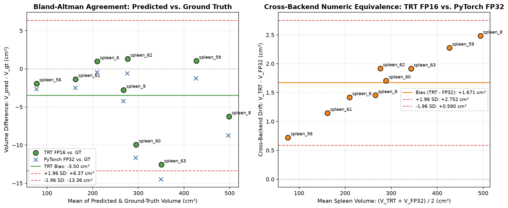
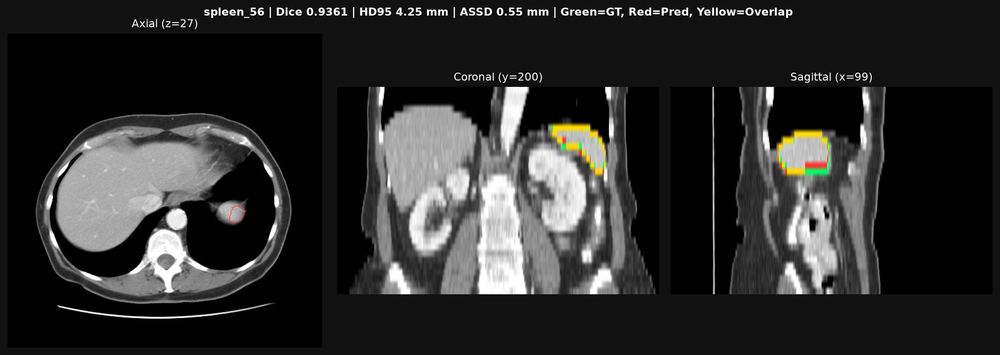

# MedTRT: GPU-Accelerated 3D CT Segmentation, Profiled and Validated

> **Research benchmark only.** This is a systems study of one public model on one laptop. It is not a medical device, and it makes no diagnostic, triage, or clinical performance claims.
>
> Every number below is generated from `results/`. To check them without a GPU, run `python -m medtrt.verify_claims`.

## 1. Results

A pretrained MONAI 3D UNet segments the spleen in abdominal CT. All timings are on an `NVIDIA GeForce RTX 5080 Laptop GPU`.

| Measure | Fast profile (`trt_fp16_optimized`) | Notes |
| :--- | :--- | :--- |
| End-to-end latency | `60.8 ms` median | Per-case medians `34`-`102 ms`; slowest of 90 passes `115 ms` |
| Speedup vs host-path PyTorch | `54.9x` | `3341 ms` baseline with CPU inverse transform and gzip reads |
| Speedup vs GPU-path PyTorch | `6.18x` | `376 ms` with the same GPU pipeline and bundle windows, no TensorRT |
| TensorRT alone, same pipeline and windows | `3.95x` end to end | `376` to `95 ms` |
| Mean Dice | `0.964778` | True FP32 reference `0.965233` |
| Mean / max per-case Dice change vs FP32 | `0.001669` / `0.005563` | `1` of `9` cases at or over `0.005` |
| Volume bias vs FP32 | `+0.12 cm³` (`+0.04%`) | 95% CI `[-0.79, +1.03]`; `5` of `9` cases positive |
| Peak VRAM | `0.51 GB` | Largest case |

### Targets

| Target | Measured | Status |
| :--- | :---: | :---: |
| Every pass under 500 ms | Slowest pass `115.3 ms` | PASS |
| Mean Dice at least 0.960 | `0.964778` | PASS |
| Mean absolute Dice change under 0.005 | `0.001669` | PASS |
| Like-for-like (`trt_fp16_cuda`) every case Dice change under 0.005 | Max `0.000029` (`trt_fp16_optimized` max `0.005563`) | PASS |

## 2. Where the speedup comes from

Most of the end-to-end gain is not TensorRT. Each row below changes one thing, using the same 9 cases.

| Configuration | E2E median (ms) | Slowest pass (ms) | vs first row | `sw_network` (ms) | Mean Dice |
| :--- | :---: | :---: | :---: | :---: | :---: |
| Host path, PyTorch TF32 | `2944.2` | `6114.1` | `1.00x` | `244.0` | `0.965228` |
| Host path, TensorRT only | `3063.1` | `5954.3` | `0.96x` | `267.3` | `0.965226` |
| GPU transforms, gzip read, PyTorch TF32 | `710.9` | `1429.2` | `4.14x` | `200.3` | `0.965228` |
| GPU transforms, gzip read, TensorRT | `650.1` | `1313.3` | `4.53x` | `47.1` | `0.965228` |
| GPU transforms, .nii read, PyTorch TF32 | `374.3` | `679.3` | `7.87x` | `195.2` | `0.965228` |
| GPU transforms, .nii read, TensorRT | `233.6` | `403.2` | `12.60x` | `47.0` | `0.965228` |
| Fast windows, PyTorch TF32 | `261.1` | `442.2` | `11.28x` | `84.0` | `0.964771` |
| Fast windows, TensorRT | `194.1` | `311.4` | `15.17x` | `20.7` | `0.964767` |
| Fast windows, TensorRT, nearest-label inverse | `178.6` | `301.4` | `16.49x` | `20.3` | `0.960230` |

- **Keeping the inverse transform on the GPU is the largest single change.** The reference `inference.json` already keeps predictions on the GPU, so the host path overstates the cost of a default deployment. With gzip reads, this alone moves PyTorch from `2944` to `711 ms`.
- **Removing gzip from the critical path** moves PyTorch to `374 ms`. It assumes volumes were decompressed ahead of time.
- **TensorRT** then takes the same pipeline from `374` to `234 ms`. PyTorch without TensorRT already meets the 500 ms target.
- **Inverting class probabilities rather than hard labels matters for accuracy.** Nearest-label inversion scores `0.960230` Dice at `179 ms`. Trilinear scores `0.964767` at `194 ms`.

## 3. Method

| Component | Value |
| :--- | :--- |
| GPU | `NVIDIA GeForce RTX 5080 Laptop GPU`, compute capability `12.0 (sm_120)`, `15.92 GB` |
| Driver | `591.44`, `WDDM` mode, CUDA `12.8`, cuDNN `9.19.0` |
| Software | PyTorch `2.11.0+cu128`, MONAI `1.6.1`, TensorRT `10.16.1.11`, Python `3.11.15` |
| OS | `Windows 11 (10.0.26300)` |
| ONNX export | Opset `17`, max abs diff vs FP32 `2.670e-05` on one synthetic batch |
| TensorRT engine | FP16, dynamic batch 1 to 8, optimized for 2, `13.70 MB` |

- **Data:** Medical Segmentation Decathlon `Task09_Spleen` and the MONAI `spleen_ct_segmentation` bundle v`0.6.1`, with weights verified by SHA-256.
- **Evaluation cases:** the `9` of `41` labeled cases that the bundle reserves for validation. They were never trained on, but the bundle selected its checkpoint by Dice on these same cases, and MSD test labels are not public. There is no untouched test set here, so treat Dice as an optimistic estimate, suitable for comparing backends.
- **Timing:** 3 warm-up volumes, then 10 passes on each of 9 cases, for 90 timed passes per profile. Stages use CUDA events. Each pass is also timed by wall clock, and the two agree (see `wall_ms`). Every pass ends with the label map in host memory.
- **Profiles:** the host path reads gzip and transforms on the CPU. The GPU path reads pre-decompressed `.nii` and transforms on the GPU. `pytorch_fp32_strict` is true FP32 on the unmodified bundle weights and is the numerical reference. All other profiles use the BatchNorm-folded weights. `pytorch_tf32` is PyTorch's default and is not FP32. `trt_fp16_optimized` is the fast profile. `trt_fp16_nn` is kept only as a comparison.
- **Profiling:** Nsight Systems was not run for these results. NVTX ranges are in the code, and `--nsys` will use them when Nsight is installed, but every number here comes from CUDA events and wall-clock timers.

## 4. Benchmark

| Profile | Overlap / batch | Patch B=1 (ms) | Patch B=4 (ms) | `sw_network` (ms) | E2E median [IQR] (ms) | Slowest (ms) | Peak VRAM (MB) | Mean Dice ± SD | vs `pytorch_fp32` |
| :--- | :---: | :---: | :---: | :---: | :---: | :---: | :---: | :---: | :---: |
| `pytorch_fp32_strict` | `0.5` / `4` | `6.96` | `22.36` | `375.6` | `3122.2` [`2981.3`] | `7760` | `490` | `0.965233` ± `0.0117` | `1.07x` |
| `pytorch_fp32` | `0.5` / `4` | `3.90` | `15.95` | `260.8` | `3341.1` [`3180.1`] | `6179` | `487` | `0.965228` ± `0.0117` | `1.00x` |
| `pytorch_tf32` | `0.5` / `4` | `3.90` | `15.95` | `260.8` | `3341.1` [`3180.1`] | `6179` | `487` | `0.965228` ± `0.0117` | `1.00x` |
| `pytorch_amp` | `0.5` / `4` | `5.40` | `15.69` | `221.6` | `3145.2` [`3538.9`] | `7090` | `457` | `0.965217` ± `0.0118` | `1.06x` |
| `pytorch_fp16` | `0.5` / `4` | `4.48` | `14.89` | `224.6` | `2996.7` [`2881.1`] | `6024` | `458` | `0.965231` ± `0.0118` | `1.11x` |
| `trt_fp32` | `0.5` / `4` | `3.24` | `13.36` | `241.5` | `2835.6` [`2966.3`] | `6601` | `368` | `0.965233` ± `0.0117` | `1.18x` |
| `trt_fp16_unfolded` | `0.5` / `4` | `1.00` | `3.29` | `176.0` | `2787.9` [`2906.4`] | `5874` | `359` | `0.965722` ± `0.0120` | `1.20x` |
| `trt_fp16` | `0.5` / `4` | `1.08` | `3.79` | `172.8` | `2967.0` [`2849.9`] | `6067` | `359` | `0.965226` ± `0.0117` | `1.13x` |
| `pytorch_tf32_gpu` | `0.5` / `4` | `4.24` | `16.80` | `207.0` | `375.9` [`241.2`] | `747` | `2307` | `0.965227` ± `0.0117` | `8.89x` |
| `trt_fp16_gpu` | `0.5` / `4` | `0.97` | `3.25` | `48.6` | `218.0` [`168.5`] | `429` | `2301` | `0.965228` ± `0.0117` | `15.32x` |
| `trt_fp16_cuda` | `0.5` / `4` | `0.94` | `3.48` | `49.6` | `95.1` [`55.7`] | `241` | `455` | `0.965229` ± `0.0117` | `35.13x` |
| `trt_fp16_optimized` | `0.25` / `8` | `1.00` | `3.20` | `26.2` | `60.8` [`49.0`] | `115` | `522` | `0.964778` ± `0.0135` | `54.92x` |
| `trt_fp16_nn` | `0.25` / `8` | `1.04` | `3.10` | `21.0` | `181.3` [`145.8`] | `400` | `2149` | `0.960230` ± `0.0139` | `18.42x` |


### Per-stage medians

`ingest` is `load + h2d`. Quote it instead of `load` alone, because `mmap` defers the read into `h2d`.

| Stage (median ms) | `pytorch_fp32_strict` | `pytorch_fp32` | `pytorch_tf32` | `pytorch_amp` | `pytorch_fp16` | `trt_fp32` | `trt_fp16_unfolded` | `trt_fp16` | `pytorch_tf32_gpu` | `trt_fp16_gpu` | `trt_fp16_cuda` | `trt_fp16_optimized` | `trt_fp16_nn` |
| :--- | :---: | :---: | :---: | :---: | :---: | :---: | :---: | :---: | :---: | :---: | :---: | :---: | :---: |
| `load` | `414.9` | `524.6` | `524.6` | `543.8` | `383.6` | `382.1` | `377.0` | `419.1` | `1.7` | `1.6` | `1.6` | `1.5` | `1.6` |
| `h2d` | `4.0` | `4.2` | `4.2` | `6.1` | `4.6` | `3.8` | `14.6` | `13.7` | `35.1` | `29.0` | `25.5` | `23.1` | `30.0` |
| `ingest` | `418.5` | `528.8` | `528.8` | `552.5` | `387.7` | `385.6` | `392.8` | `427.5` | `37.2` | `30.9` | `27.3` | `24.8` | `31.6` |
| `preprocess` | `268.6` | `284.4` | `284.4` | `294.0` | `264.7` | `263.5` | `259.7` | `269.4` | `52.8` | `46.5` | `1.4` | `1.4` | `43.2` |
| `sw_network` | `375.6` | `260.8` | `260.8` | `221.6` | `224.6` | `241.5` | `176.0` | `172.8` | `207.0` | `48.6` | `49.6` | `26.2` | `21.0` |
| `sw_aggregate` | `8.0` | `8.2` | `8.2` | `13.0` | `13.9` | `9.1` | `33.9` | `32.9` | `6.6` | `6.4` | `6.0` | `4.3` | `4.4` |
| `postprocess` | `2017.4` | `2195.3` | `2195.3` | `2084.5` | `2016.7` | `1947.5` | `1946.9` | `2035.3` | `68.7` | `81.2` | `2.6` | `2.4` | `74.0` |
| `e2e_total` | `3122.2` | `3341.1` | `3341.1` | `3145.2` | `2996.7` | `2835.6` | `2787.9` | `2967.0` | `375.9` | `218.0` | `95.1` | `60.8` | `181.3` |
| `wall_ms` | `3122.3` | `3341.2` | `3341.2` | `3145.3` | `2996.8` | `2835.7` | `2788.0` | `2967.1` | `375.9` | `218.1` | `95.2` | `60.9` | `181.5` |

### Per-case latency, fast profile

`61 ms` is a median across cases of different sizes: `9` of `9` cases have a median under 200 ms.

| Case | Shape | Windows | E2E median (ms) | Slowest (ms) | Peak VRAM (MB) |
| :--- | :---: | :---: | :---: | :---: | :---: |
| `spleen_56` | `512x512x33` | `18` | `34.3` | `37.4` | `285` |
| `spleen_59` | `512x512x50` | `50` | `75.7` | `83.4` | `404` |
| `spleen_6` | `512x512x135` | `50` | `100.8` | `103.2` | `452` |
| `spleen_60` | `512x512x97` | `64` | `101.6` | `111.0` | `522` |
| `spleen_61` | `512x512x101` | `64` | `100.8` | `115.3` | `521` |
| `spleen_62` | `512x512x80` | `27` | `59.6` | `63.6` | `394` |
| `spleen_63` | `512x512x60` | `32` | `58.5` | `62.2` | `362` |
| `spleen_8` | `512x512x31` | `32` | `46.8` | `48.7` | `308` |
| `spleen_9` | `512x512x41` | `32` | `50.7` | `52.2` | `296` |

## 5. Network-only comparison

These runs use identical windows on every backend, in a sustained loop. Fast windows use `369` windows across the 9 cases against `665` for bundle windows, so comparing a fast-window time to a bundle-window time measures less work, not a faster network.

| Backend | Bundle windows (ms) | Fast windows (ms) | TensorRT speedup, bundle windows |
| :--- | :---: | :---: | :---: |
| PyTorch FP32 | `311.5` | `139.6` | `5.55x` |
| PyTorch TF32 | `207.3` | `88.4` | `3.69x` |
| PyTorch TF32, `cudnn.benchmark` | `208.7` | `91.3` | `3.72x` |
| PyTorch AMP | `172.3` | `76.1` | `3.07x` |
| PyTorch AMP, `cudnn.benchmark` | `175.6` | `75.2` | `3.13x` |
| TensorRT FP16 | `56.1` | `27.0` | `1.00x` |

Inside the real pipeline, TensorRT is `4.16x` faster than TF32 at bundle windows and `4.07x` at fast windows.

### GPU clock state

`sw_network` depends on what the GPU was doing just before, so values from different pipelines are not directly comparable. The same work takes longer after a 3 s idle gap, which is consistent with the laptop GPU lowering its clocks during long CPU stages. Sustained loops can also run slower than the short bursts inside the real pipeline, so the table above and the in-pipeline ratios both matter.

| Backend | Back-to-back (ms) | After 3 s idle (ms) | Inflation |
| :--- | :---: | :---: | :---: |
| `trt` | `56.5` | `132.0` | `2.34x` |
| `tf32` | `200.3` | `217.3` | `1.09x` |

## 6. Ingestion

Warm OS page cache. `mmap` returns before reading, so only the right-hand column is a fair comparison. Nearly all of the gain comes from not decompressing gzip.

| Read path | Read call (ms) | Through to GPU (ms) |
| :--- | :---: | :---: |
| `.nii.gz` with `LoadImaged` | `387.5` | `430.1` |
| `.nii`, eager read | `210.4` | `252.6` |
| `.nii`, `mmap` (lazy) | `3.3` | `48.5` |

Resampling runs on the GPU in `float64`, which is MONAI's default and is slow on GeForce hardware. Only the final mask copy is `uint8`.

## 7. Amdahl analysis

| Profile | `sw_network` (ms) | E2E (ms) | Network share | Max E2E gain from a faster network |
| :--- | :---: | :---: | :---: | :---: |
| `pytorch_fp32` | `260.8` | `3341.1` | `7.8%` | `1.08x` |
| `trt_fp16` | `172.8` | `2967.0` | `5.8%` | `1.06x` |
| `pytorch_tf32_gpu` | `207.0` | `375.9` | `55.1%` | `2.23x` |
| `trt_fp16_optimized` | `26.2` | `60.8` | `43.1%` | `1.76x` |

Once the network is a small share of end-to-end time, a faster network barely moves the total.

## 8. Sliding-window sweep

Uses the fast profile's own post-processing, with 5 timed passes per case on a hot GPU. The fast profile is not on the measured Pareto frontier of this sweep; its window settings are a judgment call. The cases are the evaluation cases, so this is selection on the evaluation set.

| Overlap | Batch | Median (ms) | IQR (ms) | Added VRAM (MB) | Mean Dice | Pareto-optimal | Fast profile |
| :--- | :---: | :---: | :---: | :---: | :---: | :---: | :---: |
| `0.25` | `1` | `39.8` | `26.0` | `791` | `0.964778` |  |  |
| `0.25` | `2` | `32.3` | `19.0` | `808` | `0.964778` |  |  |
| `0.25` | `4` | `30.6` | `19.0` | `842` | `0.964778` | yes |  |
| `0.25` | `8` | `31.6` | `21.2` | `909` | `0.964778` |  | yes |
| `0.50` | `1` | `84.8` | `34.3` | `791` | `0.965229` |  |  |
| `0.50` | `2` | `69.7` | `25.3` | `808` | `0.965229` |  |  |
| `0.50` | `4` | `66.6` | `19.8` | `842` | `0.965229` | yes |  |
| `0.50` | `8` | `71.8` | `50.0` | `909` | `0.965229` |  |  |
| `0.75` | `1` | `296.9` | `284.0` | `791` | `0.965173` |  |  |
| `0.75` | `2` | `262.0` | `215.6` | `808` | `0.965173` |  |  |
| `0.75` | `4` | `244.7` | `217.1` | `842` | `0.965173` |  |  |
| `0.75` | `8` | `260.2` | `243.8` | `909` | `0.965173` |  |  |


## 9. Agreement with true FP32

All rows compare with `pytorch_fp32_strict` (mean Dice `0.965233`). The sample is `9` cases, so these limits of agreement are imprecise.

| Profile | Mean Dice | Mean ΔDice | Mean abs ΔDice | Max abs ΔDice | Cases ≥ 0.005 | Volume bias (cm³) [95% CI] | 95% LoA (cm³) | Volume larger than FP32 | MAE vs ground truth (cm³) |
| :--- | :---: | :---: | :---: | :---: | :---: | :---: | :---: | :---: | :---: |
| `pytorch_fp32` | `0.965228` | `-0.000006` | `0.000011` | `0.000045` | `0` | `+0.00` [`+0.00`, `+0.01`] | [`-0.00`, `+0.01`] | `7/9` | `5.17` |
| `pytorch_tf32` | `0.965228` | `-0.000006` | `0.000011` | `0.000045` | `0` | `+0.00` [`+0.00`, `+0.01`] | [`-0.00`, `+0.01`] | `7/9` | `5.17` |
| `pytorch_amp` | `0.965217` | `-0.000016` | `0.000020` | `0.000116` | `0` | `+0.00` [`-0.01`, `+0.01`] | [`-0.02`, `+0.02`] | `6/9` | `5.17` |
| `pytorch_fp16` | `0.965231` | `-0.000002` | `0.000024` | `0.000066` | `0` | `+0.02` [`+0.01`, `+0.04`] | [`-0.00`, `+0.05`] | `9/9` | `5.15` |
| `trt_fp32` | `0.965233` | `+0.000000` | `0.000000` | `0.000000` | `0` | `+0.00` [`+0.00`, `+0.00`] | [`+0.00`, `+0.00`] | `0/9` | `5.17` |
| `trt_fp16_unfolded` | `0.965722` | `+0.000489` | `0.000555` | `0.001386` | `0` | `+1.68` [`+1.25`, `+2.10`] | [`+0.59`, `+2.76`] | `9/9` | `4.24` |
| `trt_fp16` | `0.965226` | `-0.000007` | `0.000015` | `0.000033` | `0` | `+0.00` [`-0.01`, `+0.02`] | [`-0.04`, `+0.05`] | `5/9` | `5.17` |
| `pytorch_tf32_gpu` | `0.965227` | `-0.000007` | `0.000011` | `0.000045` | `0` | `+0.00` [`-0.00`, `+0.01`] | [`-0.01`, `+0.01`] | `5/9` | `5.17` |
| `trt_fp16_gpu` | `0.965228` | `-0.000006` | `0.000013` | `0.000029` | `0` | `+0.00` [`-0.01`, `+0.01`] | [`-0.03`, `+0.03`] | `4/9` | `5.17` |
| `trt_fp16_cuda` | `0.965229` | `-0.000004` | `0.000014` | `0.000029` | `0` | `+0.00` [`-0.01`, `+0.02`] | [`-0.04`, `+0.04`] | `5/9` | `5.17` |
| `trt_fp16_optimized` | `0.964778` | `-0.000456` | `0.001669` | `0.005563` | `1` | `+0.12` [`-0.79`, `+1.03`] | [`-2.20`, `+2.44`] | `5/9` | `5.11` |
| `trt_fp16_nn` | `0.960230` | `-0.005004` | `0.005004` | `0.011293` | `4` | `+0.48` [`-0.34`, `+1.31`] | [`-1.62`, `+2.58`] | `6/9` | `4.75` |

TensorRT FP16 shows no systematic volume shift at bundle windows: `+0.001 cm³`, with `5` of `9` cases larger than FP32. Across all sliding windows TensorRT flipped `478` window-voxels from background to foreground and `418` the other way. The largest logit difference is `0.072` on logits up to `23.0`.

### The BatchNorm fold

The exported ONNX graph keeps `BatchNorm` after each `ConvTranspose3d`. Layer `model.2.0.adn.N` applies a shift of `81.8`, a magnitude where FP16 values are spaced `0.0625` apart. Folding these layers into the preceding `ConvTranspose3d` in float64 before export changes FP32 logits by at most `1.3e-05`, so it does not change the model. Both engines below run the same inputs and windows, compared with FP32 on the unmodified bundle weights.

| Engine | Mean Dice | Mean abs ΔDice | Volume bias (cm³) | Volume larger than FP32 |
| :--- | :---: | :---: | :---: | :---: |
| Unfolded FP16 engine | `0.965706` | `0.000557` | `+1.672` | `9/9` |
| Folded FP16 engine | `0.965229` | `0.000014` | `+0.001` | `5/9` |

The unfolded engine's higher Dice is a side effect of that shift, not better accuracy.

### Per-case agreement, fast profile

| Case | V ground truth | V FP32 | V fast | ΔV | Dice FP32 | Dice fast | ΔDice |
| :--- | :---: | :---: | :---: | :---: | :---: | :---: | :---: |
| `spleen_56` | `78.07` | `75.42` | `75.54` | `+0.123` | `0.936143` | `0.930580` | `-0.005563` |
| `spleen_59` | `426.65` | `425.40` | `426.60` | `+1.199` | `0.966229` | `0.965582` | `-0.000647` |
| `spleen_6` | `209.52` | `209.06` | `209.75` | `+0.682` | `0.973239` | `0.972804` | `-0.000435` |
| `spleen_60` | `299.84` | `288.18` | `288.55` | `+0.377` | `0.971020` | `0.971488` | `+0.000468` |
| `spleen_61` | `163.30` | `160.80` | `160.15` | `-0.649` | `0.971511` | `0.970834` | `-0.000677` |
| `spleen_62` | `275.93` | `275.33` | `273.25` | `-2.078` | `0.961134` | `0.959673` | `-0.001461` |
| `spleen_63` | `356.60` | `342.12` | `344.19` | `+2.064` | `0.963625` | `0.968380` | `+0.004755` |
| `spleen_8` | `501.55` | `492.81` | `492.36` | `-0.449` | `0.973413` | `0.972633` | `-0.000780` |
| `spleen_9` | `269.15` | `264.92` | `264.73` | `-0.194` | `0.970787` | `0.971025` | `+0.000238` |



## 10. Error analysis

These are observations about where errors fall, not explanations of why. FP16 is not the main source of error on these cases: the Dice change from FP32 is far smaller than the distance from a perfect score.

- **`spleen_56`:** Dice `0.9361` (FP32 `0.9361`), volume `75.4` vs `78.1 cm³`, spacing `[0.699, 0.699, 7.0]` mm. False-positive voxels `1044`, false-negative `1819`. The `1` end slices at each pole, plus any slices beyond the organ, hold `40%` of error voxels and `14%` of ground-truth voxels. `49%` of ground-truth voxels are surface voxels.
- **`spleen_62`:** Dice `0.9611` (FP32 `0.9611`), volume `275.4` vs `275.9 cm³`, spacing `[0.676, 0.676, 5.0]` mm. False-positive voxels `4566`, false-negative `4821`. The `2` end slices at each pole, plus any slices beyond the organ, hold `17%` of error voxels and `4%` of ground-truth voxels. `21%` of ground-truth voxels are surface voxels.

Across all `9` cases, Dice is not clearly related to slice thickness (Spearman `-0.13`, p = `0.74`) or to spleen volume (Spearman `+0.23`, p = `0.55`). The coarsest scan, `spleen_8` at `7.5 mm`, ranks number `1` of `9` by Dice.




## 11. Limitations

- **Small sample:** 9 cases from one public dataset, which also selected the checkpoint.
- **One machine:** one laptop GPU, whose clocks change with load and temperature. Expect different absolute numbers elsewhere.
- **Best-case I/O:** the GPU path assumes volumes are already decompressed and in the OS page cache. Cold-disk reads and the one-time decompression are not included.
- **Warm process:** model loading, engine deserialization, and CUDA start-up are excluded.
- **Not a product path:** no DICOM ingestion, result saving, or concurrency is measured.
- **Engine builds:** TensorRT selects kernels at build time, so a rebuilt engine can differ slightly.

## 12. Reproduce

Check that this README matches `results/`. No GPU or data needed:

```bash
python -m medtrt.verify_claims
```

Regenerate everything on an NVIDIA GPU. This downloads the dataset and bundle, and takes about an hour:

```bash
pip install -r requirements-lock.txt
pip install -e .
python -m medtrt.pipeline
```

Run the tests, or the viewer:

```bash
python -m pytest tests/
streamlit run app/viewer.py
```

## 13. Data and licenses

The dataset, weights, and engines are not in this repository. `Task09_Spleen` is from the [Medical Segmentation Decathlon](http://medicaldecathlon.com/) under CC-BY-SA 4.0, and the figures in `docs/figures/failure_case_*.png` are derived from it. The MONAI bundle is Apache-2.0.
