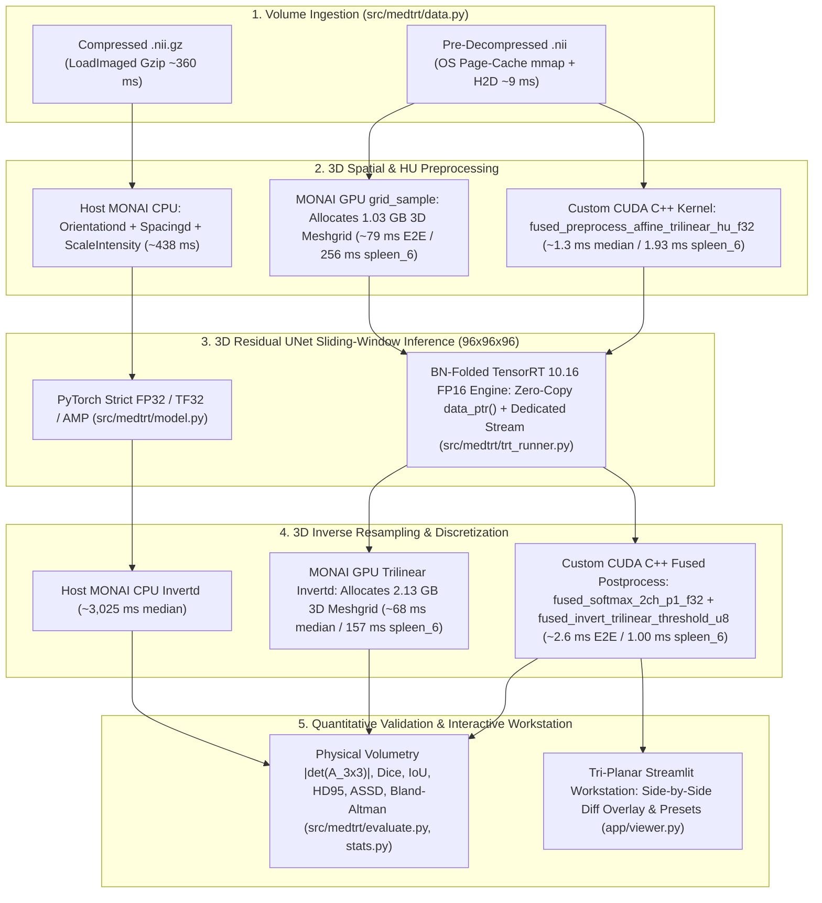

# MedTRT System Architecture & Reproducible Pipeline Guide (`docs/ARCHITECTURE.md`)

## 1. End-to-End System Architecture



---

## 2. Repository Directory Structure

```text
medtrt/
├── cuda/
│   └── medical_kernels.cu             # 9 Custom CUDA C++17 3D medical imaging kernels (compiled to sm_120)
├── src/medtrt/
│   ├── config.py                      # Hardware/toolchain audit, SHA-256 code & engine provenance stamps
│   ├── data.py                        # MSD Task09_Spleen split resolver & memory-mapped NIfTI loader
│   ├── model.py                       # 3D Residual UNet loader & analytical FP64 ConvTranspose3d+BN folder
│   ├── export.py                      # ONNX Opset 17 exporter & TensorRT 10.x FP32/FP16 engine builder
│   ├── trt_runner.py                  # Zero-copy TensorRT 10.x runner on dedicated non-default CUDA stream
│   ├── cuda_kernels.py                # NVRTC compiler + Windows CUDA Driver API launcher & occupancy queries
│   ├── profiles.py                    # Unified execution profile definitions (CPU, MONAI GPU, Custom CUDA)
│   ├── timing.py                      # CUDA event stage timers, NVTX range wrappers, bootstrap CI statistics
│   ├── infer.py                       # Unified 3D volume inference pipeline supporting all transform backends
│   ├── bench.py                       # Multi-repeat patch & full-volume GPU benchmark harness + telemetry
│   ├── evaluate.py                    # 10-metric medical validation (Dice, IoU, HD95, ASSD, |det(A)| volume)
│   ├── stats.py                       # Timeline, Pareto grid sweep, Bland-Altman, and failure analysis
│   ├── ablate.py                      # Controlled one-change-at-a-time pipeline ablation
│   ├── probes.py                      # Targeted hardware probes (clock state, ingestion, FP16 numerics, BN fold)
│   ├── report.py                      # Deterministic README.md generator from results/
│   ├── verify_claims.py               # Automated claim & provenance verifier (10 integrity checks)
│   └── pipeline.py                    # Single-command end-to-end orchestrator
├── benchmarks/
│   ├── common.py                      # Shared CUDA event timing & artifact serialization utilities
│   ├── benchmark_pytorch.py           # PyTorch FP32 Strict, TF32, AMP, and Pure FP16 patch benchmarks
│   ├── benchmark_tensorrt.py          # TensorRT FP32, FP16 Unfolded, FP16 Folded, & Buffer Reuse benchmarks
│   ├── benchmark_preprocessing.py     # Gzip vs. Mmap vs. Pinned H2D & Custom CUDA preprocessing benchmarks
│   ├── benchmark_postprocessing.py    # CPU vs. MONAI GPU vs. Custom CUDA fused postprocessing benchmarks
│   ├── benchmark_end_to_end.py        # 7-rung controlled end-to-end pipeline ablation study
│   ├── benchmark_memory.py            # Static & dynamic VRAM allocation analysis
│   ├── benchmark_scaling.py           # Volume size scaling (4.2M to 50.3M voxels) across custom CUDA kernels
│   ├── benchmark_correctness.py       # Numerical equivalence & edge-case verification
│   └── benchmark_cohort_41.py         # Full 41-patient-volume GPU execution & telemetry verification
├── analysis/
│   └── generate_reports.py            # Master report & 12-plot generator from measured results/
├── app/
│   ├── viewer.py                      # Streamlit multi-page dashboard entry point
│   └── workstation.py                 # Synchronized tri-planar workstation with real-time FP32-vs-FP16 diff heatmaps
├── tests/                             # 65-test automated verification suite auditing latency & memory telemetry
├── configs/default.yaml               # Declarative pipeline & TensorRT builder configuration
├── reports/                           # Detailed Phase 3-7 technical reports
└── docs/                              # Engineering audit, technical paper, resume evidence, and 12 generated figures
```
