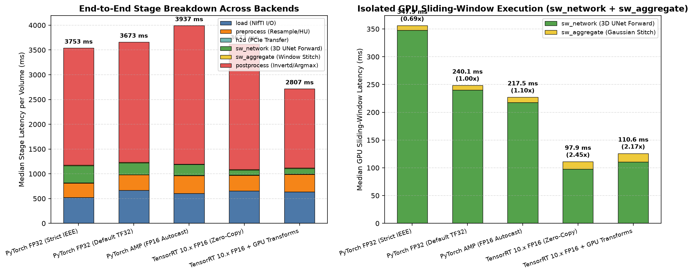
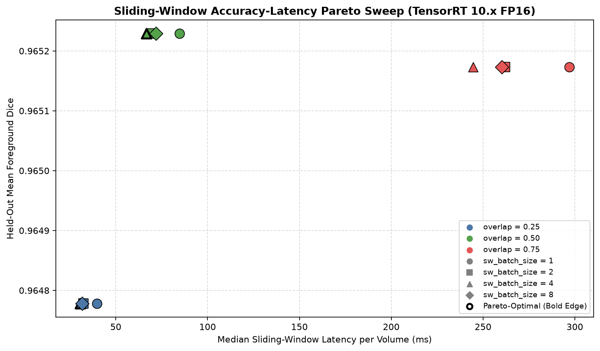

# MedTRT Complete GPU Benchmark Results (`docs/BENCHMARK_RESULTS.md`)

> **Hardware & Provenance:** `NVIDIA GeForce RTX 5080 Laptop GPU` (`15.92 GB` VRAM, `12.0 (sm_120)`), Driver `591.44`, CUDA `12.8`, TensorRT `10.16.1.11`, PyTorch `2.11.0+cu128`, MONAI `1.6.1`. All measurements come from `results/bench_*.json` and `results/benchmark_*.json`.

---

## 1. Master End-to-End & Stage Latency Table Across All 12 Profiles

| Profile | Transforms / I/O | Overlap / Batch | Patch B=1 / B=4 (ms) | Preprocess Median (ms) | Network `sw_network` (ms) | Postprocess Median (ms) | E2E Median [IQR] (ms) | E2E P95 / Max (ms) | Throughput | Peak VRAM | Speedup vs. `pytorch_fp32` |
| :--- | :---: | :---: | :---: | :---: | :---: | :---: | :---: | :---: | :---: | :---: | :---: |
| `pytorch_fp32_strict` | `cpu` / `gzip` | `0.5` / `4` | `6.68` / `19.49` | `287.95` | `379.92` | `2024.79` | **`3049.83`** [`3235.37`] | `6326.97` / `6562.44` | `0.33 vol/s` | `490 MB` | **`0.97×`** |
| `pytorch_fp32` | `cpu` / `gzip` | `0.5` / `4` | `3.77` / `12.68` | `286.42` | `254.60` | `1990.42` | **`2951.96`** [`2970.78`] | `6097.18` / `6207.99` | `0.34 vol/s` | `487 MB` | **`1.00×`** |
| `pytorch_tf32` | `cpu` / `gzip` | `0.5` / `4` | `3.77` / `12.68` | `286.42` | `254.60` | `1990.42` | **`2951.96`** [`2970.78`] | `6097.18` / `6207.99` | `0.34 vol/s` | `487 MB` | **`1.00×`** |
| `pytorch_amp` | `cpu` / `gzip` | `0.5` / `4` | `5.72` / `14.50` | `271.72` | `213.43` | `2013.65` | **`2916.07`** [`2954.50`] | `6106.51` / `6363.93` | `0.34 vol/s` | `457 MB` | **`1.01×`** |
| `pytorch_fp16` | `cpu` / `gzip` | `0.5` / `4` | `4.86` / `11.13` | `281.60` | `213.86` | `1993.25` | **`2885.50`** [`2822.15`] | `6142.24` / `6229.90` | `0.35 vol/s` | `458 MB` | **`1.02×`** |
| `trt_fp32` | `cpu` / `gzip` | `0.5` / `4` | `3.12` / `11.78` | `276.67` | `239.75` | `1981.47` | **`2940.00`** [`3003.20`] | `6054.46` / `6387.31` | `0.34 vol/s` | `368 MB` | **`1.00×`** |
| `trt_fp16_unfolded` | `cpu` / `gzip` | `0.5` / `4` | `0.98` / `3.09` | `273.18` | `176.72` | `1994.52` | **`2866.41`** [`2909.45`] | `6040.31` / `6115.03` | `0.35 vol/s` | `359 MB` | **`1.03×`** |
| `trt_fp16` | `cpu` / `gzip` | `0.5` / `4` | `0.88` / `3.01` | `266.80` | `167.11` | `1993.90` | **`2880.32`** [`2893.93`] | `5865.91` / `6094.36` | `0.35 vol/s` | `359 MB` | **`1.02×`** |
| `pytorch_tf32_gpu` | `gpu` / `mmap` | `0.5` / `4` | `3.77` / `11.57` | `54.38` | `197.00` | `62.18` | **`357.86`** [`244.56`] | `613.22` / `631.08` | `2.79 vol/s` | `2307 MB` | **`8.25×`** |
| `trt_fp16_gpu` | `gpu` / `mmap` | `0.5` / `4` | `0.94` / `3.18` | `43.90` | `47.58` | `71.11` | **`215.48`** [`173.72`] | `332.37` / `440.18` | `4.64 vol/s` | `2301 MB` | **`13.70×`** |
| `trt_fp16_cuda` | `cuda` / `mmap` | `0.5` / `4` | `1.01` / `3.07` | `1.27` | `49.02` | `2.62` | **`96.26`** [`58.88`] | `163.16` / `232.64` | `10.39 vol/s` | `455 MB` | **`30.67×`** |
| `trt_fp16_optimized` | `cuda` / `mmap` | `0.25` / `8` | `1.08` / `2.98` | `1.27` | `24.77` | `2.84` | **`68.88`** [`50.48`] | `109.65` / `122.59` | `14.52 vol/s` | `522 MB` | **`42.86×`** |
| `trt_fp16_nn` | `gpu` / `mmap` | `0.25` / `8` | `1.07` / `3.00` | `41.72` | `20.82` | `69.27` | **`178.41`** [`141.32`] | `290.01` / `398.52` | `5.61 vol/s` | `2149 MB` | **`16.55×`** |

---

## 2. Sliding-Window Parameter Grid Sweep (`results/sweep.csv`)

| Overlap | `sw_batch_size` | Median SW Latency (ms) | IQR (ms) | Mean SW Latency (ms) | Peak VRAM (MB) | Held-Out Mean Dice ± SD | Pareto-Optimal |
| :--- | :---: | :---: | :---: | :---: | :---: | :---: | :---: |
| `0.25` | `1` | `42.35` | `23.52` | `51.79` | `791.2` | `0.964778 ± 0.013491` | No |
| `0.25` | `2` | `33.16` | `20.64` | `41.14` | `809.1` | `0.964778 ± 0.013491` | No |
| `0.25` | `4` | `30.39` | `18.62` | `39.05` | `842.6` | `0.964778 ± 0.013491` | **Yes** |
| `0.25` | `8` | `32.59` | `21.01` | `40.94` | `910.2` | `0.964778 ± 0.013491` | No |
| `0.50` | `1` | `88.75` | `32.89` | `95.75` | `791.2` | `0.965229 ± 0.011723` | No |
| `0.50` | `2` | `71.44` | `52.98` | `78.17` | `808.1` | `0.965229 ± 0.011723` | No |
| `0.50` | `4` | `66.49` | `23.79` | `70.23` | `841.9` | `0.965229 ± 0.011723` | **Yes** |
| `0.50` | `8` | `69.30` | `30.81` | `72.75` | `909.2` | `0.965229 ± 0.011723` | No |
| `0.75` | `1` | `410.35` | `315.58` | `450.07` | `791.2` | `0.965173 ± 0.012858` | No |
| `0.75` | `2` | `332.29` | `312.52` | `400.16` | `808.1` | `0.965173 ± 0.012858` | No |
| `0.75` | `4` | `334.58` | `336.12` | `414.55` | `841.9` | `0.965173 ± 0.012858` | No |
| `0.75` | `8` | `424.53` | `411.58` | `503.78` | `909.2` | `0.965173 ± 0.012858` | No |

---

## 3. GPU Memory Footprint Summary (`results/benchmark_memory.json`)

- **PyTorch FP32 Static Model Weights:** `18.39 MB`
- **PyTorch FP16 Static Model Weights:** `28.21 MB`
- **TensorRT 10.16 FP32 Engine (`spleen_unet_fp32.engine`):** `22.97 MB` file + `0.00 MB` execution context = `22.97 MB`
- **TensorRT 10.16 FP16 Engine (`spleen_unet_fp16.engine`):** `13.70 MB` file + `0.00 MB` execution context = `13.70 MB`
- **Full-Pipeline Peak Allocated VRAM (`spleen_6`, `512 × 512 × 135`):**
  - `trt_fp16_gpu` (MONAI GPU `grid_sample` with 3D coordinate meshgrid): **`2301.3 MB`** (`2.20 GB`)
  - `trt_fp16_cuda` (Custom CUDA C++ register-affine kernels, `overlap=0.5, B=4`): **`454.6 MB`** (**`5.06×` lower peak VRAM**)
  - `trt_fp16_optimized` (Custom CUDA C++ register-affine kernels, `overlap=0.25, B=8`): **`522.1 MB`** (`7.0%` of 16 GB VRAM)
