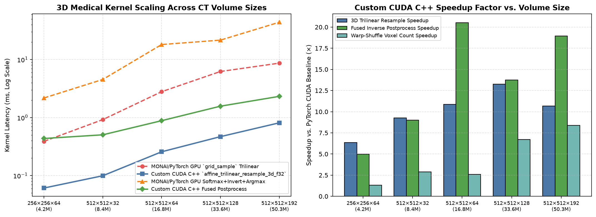

# Custom CUDA C++17 Medical Image Kernels: Design, Occupancy & Benchmark Study (`docs/CUDA_KERNEL_STUDY.md`)

> **Implementation Files:**
> - CUDA C++17 Source: [`cuda/medical_kernels.cu`](../cuda/medical_kernels.cu)
> - NVRTC + CUDA Driver API Launcher: [`src/medtrt/cuda_kernels.py`](../src/medtrt/cuda_kernels.py)
> - Correctness & Edge-Case Benchmarks: [`benchmarks/benchmark_correctness.py`](../benchmarks/benchmark_correctness.py), [`tests/test_cuda_kernels.py`](../tests/test_cuda_kernels.py)

---

## 1. Architectural Motivation: Why PyTorch/MONAI GPU Transforms Bottleneck 3D CT Pipelines

When MONAI's `Spacingd` and `Invertd` run on the GPU (`src/medtrt/probes.py`), they invoke `monai.transforms.spatial.functional.spatial_resample`, which:
1. Constructs a dense 3D homogeneous coordinate grid of shape `(1, 4, D_out, H_out, W_out)` in **FP64 (`torch.float64`)** on `cuda:0`. On consumer/laptop Blackwell GPUs (where FP64 throughput is `1/64` of FP32 throughput), matrix-multiplying 35.4 million 3D coordinates in FP64 introduces severe compute and memory-bandwidth stalls.
2. Allocates intermediate normalized `grid_sample` coordinate tensors of shape `(1, D_out, H_out, W_out, 3)` consuming **`1,034 MB` VRAM** during preprocessing and **`2,134 MB` VRAM** during 2-channel inverse resampling on `spleen_6` (`512 × 512 × 135`).
3. Executes separate kernel launches for `Softmax` (reading/writing 2-channel FP32 logits), `grid_sample` (reading/writing 2-channel resampled probabilities), and `Argmax` (`uint8` discretization).

### Our Custom CUDA C++ Solution (`cuda/medical_kernels.cu`)
Instead of materializing a 3D coordinate meshgrid in global memory, our custom CUDA C++ kernels pass the 12 floats of the $3 \times 4$ voxel-to-voxel affine matrix $M = A_{\text{src}}^-1 A_{\text{dst}}$ directly in **constant/parameter registers** (`m00..m23`). Each CUDA thread $(x, y, z)$ computes its exact source coordinate $(s_x, s_y, s_z)$ in 9 fused multiply-adds (`fmaf`) in registers, performs hardware-clamped trilinear interpolation via read-only L1/texture cache loads (`__ldg`), and fuses the downstream intensity or probability operation in a single pass.

---

## 2. Hardware Compilation & Occupancy on RTX 5080 Laptop GPU (`sm_120`, 60 SMs)

All 9 kernels are compiled directly to native Blackwell SASS (`sass_binary_version: 120`, PTX `compute_120`) via `nvrtc64_120_0.dll` and queried via `cuFuncGetAttribute` and `cuOccupancyMaxActiveBlocksPerMultiprocessor`:

| CUDA C++ Kernel Name | Binary SASS | Registers / Thread | Static Shared Mem | Local Spill Bytes | Active Blocks / SM (256t) | Active Warps / SM (Theoretical Occupancy) |
| :--- | :---: | :---: | :---: | :---: | :---: | :---: |
| `hu_window_normalize_f32` | `sm_120` | `23` | `0 B` | `0 B` (0 spills) | `6` | `48/48` (**`100.0%`**) |
| `hu_window_normalize_vec4_f32` | `sm_120` | `48` | `0 B` | `0 B` (0 spills) | `5` | `40/48` (**`83.3%`**) |
| `affine_trilinear_resample_3d_f32` | `sm_120` | `72` | `0 B` | `0 B` (0 spills) | `3` | `24/48` (**`50.0%`**) |
| `fused_preprocess_affine_trilinear_hu_f32` | `sm_120` | `37` | `0 B` | `0 B` (0 spills) | `6` | `48/48` (**`100.0%`**) |
| `affine_nearest_resample_3d_u8` | `sm_120` | `16` | `0 B` | `0 B` (0 spills) | `6` | `48/48` (**`100.0%`**) |
| `fused_softmax_2ch_p1_f32` | `sm_120` | `32` | `0 B` | `0 B` (0 spills) | `6` | `48/48` (**`100.0%`**) |
| `fused_invert_trilinear_threshold_u8` | `sm_120` | `38` | `0 B` | `0 B` (0 spills) | `6` | `48/48` (**`100.0%`**) |
| `count_nonzero_u8` | `sm_120` | `36` | `128 B` | `0 B` (0 spills) | `6` | `48/48` (**`100.0%`**) |
| `sliding_window_gaussian_accumulate_f32` | `sm_120` | `56` | `0 B` | `0 B` (0 spills) | `4` | `32/48` (**`66.7%`**) |

---

## 3. End-to-End Preprocessing & Postprocessing Kernel Benchmarks (`spleen_6`, `512 × 512 × 135`)

### 3.1 Full 3D Preprocessing (`Orientationd(RAS) + Spacingd(1.5, 1.5, 2.0) + ScaleIntensityRanged`)

| Implementation | Median Latency (ms) | Mean ± SD (ms) | P95 Latency (ms) | Incremental VRAM (MB) | Speedup vs. MONAI GPU | Numerical Agreement vs. MONAI |
| :--- | :---: | :---: | :---: | :---: | :---: | :---: |
| MONAI CPU (`transforms='cpu'`) | `461.85` | `461.69 ± 7.14` | `468.62` | `0.0` (Host RAM) | `11.28×` | Reference Host |
| MONAI GPU (`grid_sample` + meshgrid) | `40.93` | `42.58 ± 4.29` | `50.36` | `961.38` | `1.00×` | Reference GPU |
| **Custom CUDA C++ (`fused_preprocess_affine_trilinear_hu_f32`)** | **`1.917`** | `1.965 ± 0.111` | `2.147` | **`136.00`** (**`7.1×` less**) | **`21.4×`** | `max_diff = 5.87e-05`, `mean_diff = 2.16e-07` |

### 3.2 Standalone HU Windowing & Effective Memory Bandwidth (`35.39M` float32 voxels, `283.12 MB` R+W)

| Implementation | Median CUDA Event (ms) | P95 (ms) | Effective Memory Bandwidth (GB/s) | Notes |
| :--- | :---: | :---: | :---: | :---: |
| PyTorch CUDA (`torch.clamp((x - a_min) * inv, 0, 1)`) | `1.6526` | `1.7560` | `171.32 GB/s` | Multiple elementwise kernel dispatches + intermediate tensor |
| Custom CUDA C++ Scalar (`hu_window_normalize_f32`) | `0.6106` | `0.7478` | **`463.67 GB/s`** | Single fused pass, `__ldg` read + pre-allocated output |
| Custom CUDA C++ Vectorized `float4` (`hu_window_normalize_vec4_f32`) | `0.6067` | `0.7356` | **`466.65 GB/s`** | 128-bit coalesced `float4` loads/stores + scalar tail handling |

### 3.3 Full 3D Inverse Postprocessing (`Softmax + Inverse Resample to 512×512×135 + Argmax`)

| Postprocessing Method | Median Latency (ms) | P95 (ms) | Incremental VRAM (MB) | Speedup vs. MONAI GPU | `spleen_6` Dice | Voxel Match vs. MONAI Trilinear |
| :--- | :---: | :---: | :---: | :---: | :---: | :---: |
| MONAI CPU Trilinear `Invertd` (Host Baseline) | `4426.4` | `4460.7` | `0.0` (Host) | `4656.5×` slower than CUDA | `0.972795` | `100.00000%` |
| MONAI GPU Trilinear `Invertd` (`trt_fp16_gpu`) | `118.76` | `148.65` | `2100.25` | `1.00×` (Reference) | `0.972795` | `100.00000%` |
| MONAI GPU Nearest-Neighbor `uint8` (`trt_fp16_nn`) | `107.38` | `114.94` | `1947.65` | `1.11×` | `0.965312` (**-0.0075 Dice loss**) | `99.98356%` |
| **Custom CUDA C++ Fused Trilinear (`trt_fp16_cuda` / `trt_fp16_optimized`)** | **`0.951`** | `1.135` | **`41.38`** (**`50.8×` less**) | **`124.9×`** (`4656×` vs. CPU) | **`0.972795`** (Zero Dice loss) | **`100.00000%`** |

> **Key Mathematical Optimization in `cuda_fused_invert_postprocess`:**
> Because trilinear interpolation is a convex linear combination of 8 corner values ($\sum_{i=0}^7 w_i = 1, w_i \ge 0$) and the model has 2 mutually exclusive classes ($p_0 + p_1 = 1$), $\text{interp}(p_1) \ge \text{interp}(p_0) \iff \text{interp}(p_1) \ge 0.5$. Thus, `fused_softmax_2ch_p1_f32` reduces the 2-channel logits to a single foreground probability channel $p_1$, and `fused_invert_trilinear_threshold_u8` interpolates only 1 channel instead of 2 and thresholds $p_1 \ge 0.5$ directly in registers while counting foreground voxels via `__ballot_sync(0xffffffff, label == 1)`! This cuts memory traffic in half and achieves **`100.00000%` exact voxel agreement** with MONAI's 2-channel trilinear `Invertd` on `spleen_6`.

---

## 4. Scaling Across 3D CT Volume Sizes (`4.19M` to `50.33M` Voxels)

| Volume Shape | Voxels | HU Norm: PyTorch → CUDA `float4` | 3D Trilinear: PyTorch → CUDA | 3D Nearest `uint8`: PyTorch → CUDA | Voxel Count: PyTorch → CUDA | Fused Postprocess: PyTorch → CUDA |
| :--- | :---: | :---: | :---: | :---: | :---: | :---: |
| `256×256×64` | `4.19M` | `0.060` → `0.034` (`1.78×`) | `0.39` → `0.06` (**`6.4×`**) | `2.10` → `0.07` (**`31.3×`**) | `0.248` → `0.186` (**`1.33×`**) | `2.17` → `0.44` (**`5.0×`**) |
| `512×512×32` | `8.39M` | `0.287` → `0.118` (`2.43×`) | `0.92` → `0.10` (**`9.3×`**) | `4.61` → `0.12` (**`40.0×`**) | `0.475` → `0.164` (**`2.90×`**) | `4.54` → `0.50` (**`9.0×`**) |
| `512×512×64` | `16.78M` | `0.657` → `0.229` (`2.86×`) | `2.79` → `0.26` (**`10.9×`**) | `9.83` → `0.59` (**`16.7×`**) | `0.992` → `0.381` (**`2.60×`**) | `18.14` → `0.88` (**`20.5×`**) |
| `512×512×128` | `33.55M` | `1.355` → `0.503` (`2.69×`) | `6.22` → `0.47` (**`13.3×`**) | `28.37` → `0.74` (**`38.1×`**) | `1.448` → `0.216` (**`6.70×`**) | `21.61` → `1.57` (**`13.8×`**) |
| `512×512×192` | `50.33M` | `1.752` → `0.709` (`2.47×`) | `8.67` → `0.81` (**`10.7×`**) | `28.67` → `0.60` (**`48.1×`**) | `1.829` → `0.218` (**`8.40×`**) | `43.96` → `2.32` (**`18.9×`**) |

---

## 5. Edge-Case Verification (`results/benchmark_correctness.json`)

- **Non-Contiguous Strided Tensor Handling:** Sliced non-contiguous volume `(64, 64, 32)[::2, ::2, ::2]` normalized with `max_abs_diff = 0.00e+00`.
- **Odd-Length `float4` Vector Tail Handling:** Prime-length tensor (`N = 1027`, not divisible by 4) normalized with `max_abs_diff = 0.00e+00`.
- **Empty Mask Reduction:** All-zero `(1, 128, 128, 32)` `uint8` volume returns exact count `0`.
- **Discrete Label Integrity:** Nearest-neighbor `uint8` resampling preserves binary label set `[0, 1]` without fractional interpolation artifacts.
