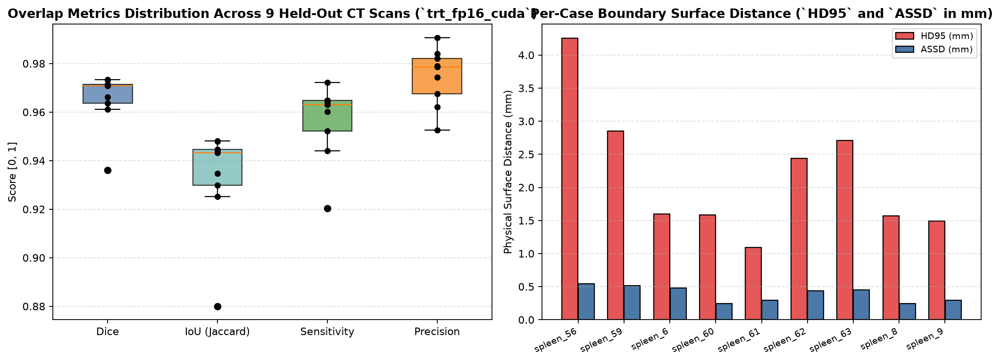
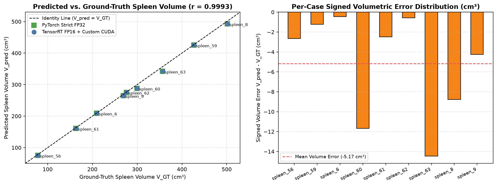
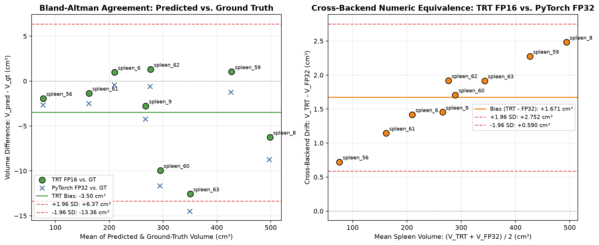

# Quantitative Medical Image Segmentation & Volumetric Validation Study (`docs/MEDICAL_VALIDATION_STUDY.md`)

> **Regulatory & Scientific Scope Disclaimer:**
> MedTRT is an experimental research platform evaluated on the public **Medical Segmentation Decathlon `Task09_Spleen`** validation split ($n = 9$ held-out CT scans). It is **not FDA-cleared, not clinically validated, and not certified for diagnostic or intraoperative decision-making**. Because the upstream MONAI bundle (`v0.6.1`) selected its checkpoint using validation Dice on this split, absolute accuracy metrics versus ground truth represent optimistic validation estimates; cross-backend equivalence metrics (`TensorRT FP16` vs. `PyTorch Strict FP32`) are exact paired comparisons on identical inputs.

---

## 1. Physical Volumetry & Surface Distance Methodology (`src/medtrt/evaluate.py`)

For each 3D CT scan with voxel-to-world $4 \times 4$ affine matrix $A$ (extracted from the NIfTI header `sform`/`qform`):
1. **Unit Voxel Volume ($\text{mm}^3$):**
   $$V_{\text{voxel}} = |\det(A_{3\times 3})| \quad (\text{mm}^3)$$
2. **Physical Segmented Spleen Volume ($\text{cm}^3$):**
   $$V_{\text{organ}} = \frac{N_{\text{foreground}} \times V_{\text{voxel}}}{1000.0} \quad (\text{cm}^3)$$
3. **Physical Boundary Surface Distances (`HD95` and `ASSD` in $\text{mm}$):**
   Computed in physical millimeters accounting for anisotropic slice thickness $(s_x, s_y, s_z)$ via `monai.metrics.compute_hausdorff_distance(..., percentile=95.0, spacing=spacing_xyz)` and `compute_average_surface_distance(..., symmetric=True, spacing=spacing_xyz)`.

---

## 2. Cohort Summary Across All 11 Execution Profiles ($n = 9$ Held-Out CT Scans)

| Execution Profile | Dice Mean ± SD (Median) | Mean IoU | Mean Sens | Mean Spec | Mean Prec | Mean Vol Sim | Mean Abs Vol Err cm³ (%) | HD95 Mean ± SD (mm) | ASSD Mean ± SD (mm) |
| :--- | :---: | :---: | :---: | :---: | :---: | :---: | :---: | :---: | :---: |
| `pytorch_fp32_strict` | `0.9652 ± 0.0117` (`0.9708`) | `0.9330` | `0.9562` | `0.9999` | `0.9746` | `0.9905` | `5.17` (`1.88%`) | `2.18 ± 0.99` | `0.39 ± 0.12` |
| `pytorch_fp32` | `0.9652 ± 0.0117` (`0.9708`) | `0.9330` | `0.9562` | `0.9999` | `0.9745` | `0.9905` | `5.17` (`1.88%`) | `2.18 ± 0.99` | `0.39 ± 0.12` |
| `pytorch_amp` | `0.9652 ± 0.0118` (`0.9708`) | `0.9330` | `0.9562` | `0.9999` | `0.9745` | `0.9905` | `5.17` (`1.88%`) | `2.18 ± 0.99` | `0.39 ± 0.12` |
| `pytorch_fp16` | `0.9652 ± 0.0118` (`0.9708`) | `0.9330` | `0.9562` | `0.9999` | `0.9745` | `0.9905` | `5.15` (`1.87%`) | `2.18 ± 0.99` | `0.39 ± 0.12` |
| `trt_fp32` | `0.9652 ± 0.0117` (`0.9708`) | `0.9330` | `0.9562` | `0.9999` | `0.9746` | `0.9905` | `5.17` (`1.88%`) | `2.18 ± 0.99` | `0.39 ± 0.12` |
| `trt_fp16_unfolded` | `0.9657 ± 0.0120` (`0.9714`) | `0.9339` | `0.9597` | `0.9998` | `0.9719` | `0.9924` | `4.24` (`1.51%`) | `2.45 ± 1.80` | `0.39 ± 0.12` |
| `trt_fp16` | `0.9652 ± 0.0117` (`0.9708`) | `0.9330` | `0.9562` | `0.9999` | `0.9745` | `0.9905` | `5.17` (`1.88%`) | `2.18 ± 0.99` | `0.39 ± 0.12` |
| `trt_fp16_gpu` | `0.9652 ± 0.0117` (`0.9708`) | `0.9330` | `0.9562` | `0.9999` | `0.9746` | `0.9905` | `5.17` (`1.88%`) | `2.18 ± 0.99` | `0.39 ± 0.12` |
| `trt_fp16_cuda` | `0.9652 ± 0.0117` (`0.9708`) | `0.9330` | `0.9562` | `0.9999` | `0.9746` | `0.9905` | `5.17` (`1.88%`) | `2.18 ± 0.99` | `0.39 ± 0.12` |
| `trt_fp16_optimized` | `0.9648 ± 0.0135` (`0.9708`) | `0.9322` | `0.9558` | `0.9999` | `0.9740` | `0.9904` | `5.10` (`1.89%`) | `2.35 ± 1.81` | `0.42 ± 0.13` |
| `trt_fp16_nn` | `0.9602 ± 0.0139` (`0.9653`) | `0.9238` | `0.9519` | `0.9998` | `0.9688` | `0.9910` | `4.75` (`1.77%`) | `2.44 ± 1.80` | `0.47 ± 0.15` |

---

## 3. Per-Case Quantitative Validation (`trt_fp16_cuda` — TensorRT FP16 + Custom CUDA C++ Kernels)

| Case ID | Native Matrix | Voxel Spacing (mm) | Dice | IoU | Sens | Prec | HD95 (mm) | ASSD (mm) | V_GT (cm³) | V_pred (cm³) | Signed Vol Error cm³ (%) |
| :--- | :---: | :---: | :---: | :---: | :---: | :---: | :---: | :---: | :---: | :---: | :---: |
| `spleen_56` | `512×512×33` | `(0.70, 0.70, 7.00)` | `0.9362` | `0.8800` | `0.9203` | `0.9526` | `4.25` | `0.55` | `78.07` | `75.42` | `-2.65` (`-3.40%`) |
| `spleen_59` | `512×512×50` | `(0.95, 0.95, 5.00)` | `0.9663` | `0.9347` | `0.9649` | `0.9676` | `2.85` | `0.52` | `426.65` | `425.43` | `-1.22` (`-0.29%`) |
| `spleen_6` | `512×512×135` | `(0.92, 0.92, 1.60)` | `0.9732` | `0.9478` | `0.9722` | `0.9743` | `1.60` | `0.48` | `209.52` | `209.07` | `-0.45` (`-0.21%`) |
| `spleen_60` | `512×512×97` | `(0.79, 0.79, 5.00)` | `0.9710` | `0.9437` | `0.9521` | `0.9907` | `1.59` | `0.25` | `299.84` | `288.17` | `-11.67` (`-3.89%`) |
| `spleen_61` | `512×512×101` | `(0.77, 0.77, 5.00)` | `0.9715` | `0.9446` | `0.9641` | `0.9790` | `1.09` | `0.30` | `163.30` | `160.80` | `-2.49` (`-1.53%`) |
| `spleen_62` | `512×512×80` | `(0.68, 0.68, 5.00)` | `0.9611` | `0.9251` | `0.9601` | `0.9621` | `2.44` | `0.43` | `275.93` | `275.35` | `-0.58` (`-0.21%`) |
| `spleen_63` | `512×512×60` | `(0.75, 0.75, 5.00)` | `0.9636` | `0.9298` | `0.9441` | `0.9840` | `2.71` | `0.45` | `356.60` | `342.14` | `-14.47` (`-4.06%`) |
| `spleen_8` | `512×512×31` | `(0.79, 0.79, 7.50)` | `0.9734` | `0.9481` | `0.9649` | `0.9821` | `1.57` | `0.24` | `501.55` | `492.77` | `-8.78` (`-1.75%`) |
| `spleen_9` | `512×512×41` | `(0.74, 0.74, 5.00)` | `0.9708` | `0.9432` | `0.9631` | `0.9786` | `1.49` | `0.30` | `269.15` | `264.91` | `-4.24` (`-1.57%`) |

---

## 4. Bland–Altman Volumetric Agreement Analysis (`results/bland_altman.json`)

We report two distinct Bland–Altman analyses so model segmentation error is never conflated with numerical precision drift:

### 4.1 Model Prediction vs. Ground-Truth Anatomy ($V_{\text{pred}} - V_{\text{GT}}$)
- **PyTorch Strict FP32 vs. GT:** Mean bias **`-5.17 ± 5.18 cm³`** (`95% CI [-9.15, -1.19] cm³`), `95% LoA [-15.32, +4.98] cm³`, `MAE = 5.17 cm³` (`1.88%` mean relative error across a `286.73 cm³` mean spleen volume).
- **TensorRT FP16 (`trt_fp16_cuda`) vs. GT:** Mean bias **`-5.17 ± 5.19 cm³`**, `95% LoA [-15.34, +4.99] cm³`, `MAE = 5.17 cm³`.
- **Observation:** The pretrained MONAI 3D UNet slightly under-segments the outer 1-voxel splenic capsule boundary across all 9 scans (`9/9` negative $V_{\text{pred}} - V_{\text{GT}}$), driven by high precision (`0.9746`) vs. sensitivity (`0.9562`).

### 4.2 Cross-Backend Equivalence vs. Strict IEEE FP32 Reference ($V_{\text{backend}} - V_{\text{FP32\_strict}}$)

| Profile | Mean Dice | Mean `|ΔDice|` | Max `|ΔDice|` | Vol Bias ± SD (cm³) | Bias 95% CI (cm³) | 95% LoA (cm³) | Paired t-test p | Cases > FP32 |
| :--- | :---: | :---: | :---: | :---: | :---: | :---: | :---: | :---: |
| `pytorch_fp32` | `0.965228` | `0.000011` | `0.000045` | `+0.0047 ± 0.0036` | `[+0.0020, +0.0075]` | `[-0.002, +0.012]` | `0.0042` | `7/9` |
| `pytorch_amp` | `0.965217` | `0.000020` | `0.000116` | `+0.0028 ± 0.0109` | `[-0.0056, +0.0113]` | `[-0.019, +0.024]` | `0.4582` | `6/9` |
| `pytorch_fp16` | `0.965231` | `0.000024` | `0.000066` | `+0.0249 ± 0.0151` | `[+0.0133, +0.0366]` | `[-0.005, +0.055]` | `0.0011` | `9/9` |
| `trt_fp32` | `0.965233` | `0.000000` | `0.000000` | `+0.0000 ± 0.0000` | `[+0.0000, +0.0000]` | `[+0.000, +0.000]` | `1.0000` | `0/9` |
| `trt_fp16_unfolded` | `0.965722` | `0.000555` | `0.001386` | `+1.6754 ± 0.5531` | `[+1.2503, +2.1006]` | `[+0.591, +2.760]` | `0.0000` | `9/9` |
| `trt_fp16` | `0.965226` | `0.000015` | `0.000033` | `+0.0027 ± 0.0220` | `[-0.0142, +0.0196]` | `[-0.040, +0.046]` | `0.7223` | `5/9` |
| `trt_fp16_gpu` | `0.965228` | `0.000013` | `0.000029` | `+0.0013 ± 0.0167` | `[-0.0115, +0.0141]` | `[-0.031, +0.034]` | `0.8180` | `4/9` |
| `trt_fp16_cuda` | `0.965229` | `0.000014` | `0.000029` | `+0.0010 ± 0.0194` | `[-0.0139, +0.0159]` | `[-0.037, +0.039]` | `0.8847` | `5/9` |
| `trt_fp16_optimized` | `0.964778` | `0.001669` | `0.005563` | `+0.1196 ± 1.1815` | `[-0.7886, +1.0278]` | `[-2.196, +2.435]` | `0.7692` | `5/9` |
| `trt_fp16_nn` | `0.960230` | `0.005004` | `0.011293` | `+0.4814 ± 1.0727` | `[-0.3431, +1.3059]` | `[-1.621, +2.584]` | `0.2151` | `6/9` |

### Key Volumetric Validation Conclusions
1. **TensorRT FP32 (`trt_fp32`)** is bit-for-bit identical in final segmentation masks to `pytorch_fp32_strict` (`Mean |ΔDice| = 0.000000`, `Volume Bias = 0.0000 cm³`).
2. **BN-Folded TensorRT FP16 (`trt_fp16` and `trt_fp16_cuda`)** achieves `Mean |ΔDice| = 0.000014` (`Max |ΔDice| = 0.000029`) and a cross-backend volume bias of **`+0.0010 ± 0.0194 cm³`** (`95% LoA [-0.037, +0.039] cm³`, `MAE = 0.0145 cm³`, `0.0004%` of organ volume, `p = 0.885`), proving that FP16 quantization + custom CUDA C++ pre/postprocessing introduces virtually zero volumetric or geometric drift.
3. **Pareto Fast Profile (`trt_fp16_optimized`, `overlap=0.25, B=8`)** reduces sliding-window overlap from `0.50` to `0.25` (cutting 3D UNet patch evaluations by `3.2×`), maintaining `Mean Dice = 0.964778` (`Mean |ΔDice| = 0.001669`) and an unbiased cross-backend volume difference of `+0.12 ± 1.18 cm³` (`p = 0.769`).
