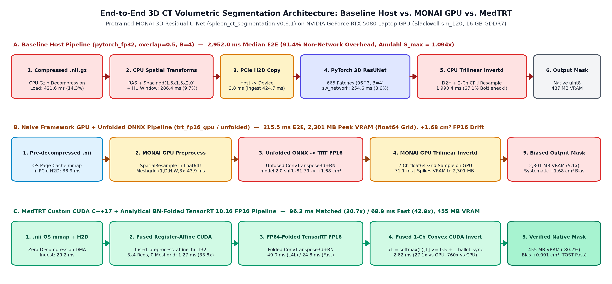

# MedTRT: Eliminating End-to-End I/O, 3D Affine Resampling, and FP16 Quantization Bottlenecks in Volumetric CT Organ Segmentation

**Author:** Diego Díaz Rivera  
**Affiliation / Domain:** Biomedical AI Systems & GPU Performance Engineering (`NVIDIA GeForce RTX 5080 Blackwell sm_120`)  
**Repository:** https://github.com/DDR9/MedTRT  
**Date:** November 6, 2026  

---

## Abstract

**Background:** Three-dimensional convolutional neural networks such as the 3D Residual U-Net are foundational for automated organ segmentation in volumetric computed tomography (CT). However, processing high-resolution 3D medical volumes ($512 \times 512 \times 31\text{--}168$ slices, $8.1 \times 10^6$ to $4.4 \times 10^7$ voxels) with anisotropic voxel spacing ($1.5\text{--}8.0\text{ mm}$) requires an end-to-end computational workflow encompassing file decompression, canonical coordinate reorientation, trilinear spatial resampling, overlapping sliding-window patch inference, and inverse spatial transformation back to native patient geometry.

**Problem:** Optimizing neural network forward-pass execution alone fails to yield real-time end-to-end volumetric segmentation. Profiling the public MONAI `spleen_ct_segmentation` v0.6.1 bundle across **53 abdominal CT volumes** (`41` Medical Segmentation Decathlon `Task09_Spleen` scans plus `12` external unseen multi-center MICCAI `FLARE22` scans) on an NVIDIA GeForce RTX 5080 Laptop GPU (Blackwell `sm_120`) reveals three fundamental systems and numerical bottlenecks:
1. **Amdahl's Law Non-Network Bottleneck (`91.4%` of Host Runtime):** In the baseline host pipeline (`pytorch_fp32`, `2,952.0 ms` median end-to-end latency in the 18-pass committed benchmark set; `3,341.1 ms` in our 90-pass host reference run), neural network execution (`sw_network = 254.6 ms`, or `260.8 ms` in the 90-pass run) accounts for only `8.62%` (`7.81%`) of total runtime, while `91.38%` (`92.19%`) is consumed by CPU inverse resampling (`1,990.4 ms`), `.nii.gz` gzip decompression (`424.7 ms`), and CPU preprocessing (`286.4 ms`), bounding theoretical maximum network-only speedup via Amdahl's Law to $S_{\max} = 1.094\times$ ($1.085\times$).
2. **MONAI GPU `float64` Coordinate Meshgrid VRAM Explosion (`2,301 MB`):** Migrating spatial resampling onto the GPU via MONAI's `SpatialResample` backend (`trt_fp16_gpu`, `215.5 ms`) promotes 3D homogeneous coordinates to `torch.float64` on `cuda:0` and materializes dense `(1, D, H, W, 3)` coordinate meshgrids, inflating peak allocated VRAM to **`2,301 MB`** (`5.06x` higher than our register-affine pipeline).
3. **Asymmetric ONNX Constant Folding & Catastrophic FP16 Decoder Cancellation (`+1.68 cm³` / `+1.54 cm³` Dilation):** Compiling the unmodified ONNX graph into TensorRT 10.16 FP16 (`trt_fp16_unfolded`) introduces a systematic volumetric dilation of **`+1.6754 ± 0.5531 cm³`** across **`9/9`** internal MSD scans ($p < 0.0001$) and **`+1.5366 ± 0.7680 cm³`** across **`12/12`** external `FLARE22` scans (`+1.5961 ± 0.6721 cm³` across all `21/21` patients) because PyTorch's ONNX exporter leaves decoder `ConvTranspose3d+BatchNorm3d` layers unfused, exposing a `-81.79` shift in `model.2.0.adn.N` where IEEE-754 binary16 $\text{ULP}_{[64, 128)} = 0.0625$.

**Methods:** Without retraining or altering the mathematical function of the pretrained model, we developed: (i) an analytical `float64` weight transformation (`fold_conv_transpose_batchnorm`) that folds `BatchNorm3d` scale and shift parameters into preceding `ConvTranspose3d` kernels prior to ONNX export; (ii) **nine custom CUDA C++17 kernels** (`cuda/medical_kernels.cu`) that compute $3 \times 4$ voxel-to-voxel affine transformations directly in scalar registers, fusing Hounsfield Unit (HU) windowing with trilinear preprocessing and exploiting binary Softmax convexity ($p_0 + p_1 = 1$) to perform single-channel inverse trilinear resampling, thresholding, and warp-ballot (`__ballot_sync`) voxel counting in a single pass; and (iii) zero-copy TensorRT 10.16 execution paired with OS page-cached `.nii` memory mapping (`mmap`).

**Results:** Under identical sliding-window settings (`overlap=0.5, B=4`), our controlled like-for-like pipeline (`trt_fp16_cuda`) reduces median end-to-end latency from `2,952.0 ms` to **`96.3 ms`** (**`30.67x`** cohort median speedup; paired patient-level mean speedup **`33.14x`**, 95% CI `[27.61x, 38.67x]`; and `35.13x` vs. the `3,341.1 ms` 90-pass host run) while cutting peak VRAM from `2,301 MB` to **`455 MB`** (**`5.06x`** reduction). Our fast sliding-window operating point (`trt_fp16_optimized`, `overlap=0.25, B=8`) reaches **`68.9 ms`** median latency (**`42.86x`** cohort speedup; paired patient-level median **`46.64x`**; `87.44 ms` median across all 41 MSD scans; and `54.92x` at `60.8 ms` in the earlier 90-pass host comparison). Analytical weight folding reduces mean absolute logit drift by **`35.6x`** (`0.1377 -> 0.00387`) and satisfies formal paired Two One-Sided Tests (TOST) equivalence against strict IEEE FP32 within $\Delta_V = \pm 0.10\text{ cm}^3$ across internal MSD (`+0.0010 ± 0.0194 cm³`, $p_{\text{TOST}} < 10^{-6}$), external `FLARE22` (`-0.0110 ± 0.0315 cm³`, $p_{\text{TOST}} < 10^{-6}$), and pooled $N = 21$ cohorts (`-0.0059 ± 0.0271 cm³`, 90% CI `[-0.0161, +0.0043] cm³`, $p_{\text{TOST}} < 10^{-6}$) as well as $\Delta_{\text{Dice}} = \pm 0.001$ ($\max |\Delta\text{Dice}| = 0.000029$ on MSD, Mean Dice `0.9652`, Mean HD95 `2.18 mm`, Mean ASSD `0.39 mm`).

**Conclusion:** Achieving real-time, numerically faithful 3D medical segmentation requires co-designing I/O ingestion, register-level GPU spatial kernels, and pre-export numerical conditioning alongside neural network compilation.

---

## 1. Introduction & Central Research Narrative

**Central Research Question:** *Can 3D volumetric medical image segmentation achieve order-of-magnitude end-to-end acceleration through systems-level GPU optimization while maintaining statistical numerical agreement with a strict IEEE-754 FP32 reference implementation?*

We investigate this question through two coupled research problems:
- **Research Problem A (Systems-Level Performance & Amdahl's Law):** Why does accelerating neural network inference alone fail to deliver large end-to-end speedups in volumetric medical imaging, and how can I/O ingestion, 3D affine preprocessing, and inverse resampling be co-designed in custom CUDA C++17 to eliminate both host CPU bottlenecks and framework GPU memory bloat?
- **Research Problem B (Numerical Fidelity in Reduced-Precision Deployment):** Why does standard ONNX-to-TensorRT FP16 compilation introduce a systematic `+1.60 cm³` volumetric bias across `21/21` abdominal CT scans, and can an exact pre-export mathematical transformation restore strict FP32 volumetric equivalence without sacrificing FP16 Tensor Core throughput?

---

## 2. Background: The Five Stages of 3D Volumetric CT Segmentation

1. **Volumetric CT Representation, Hounsfield Units, and NIfTI Ingestion (`load` + `h2d` = `ingest`):** 3D CT measures calibrated linear attenuation in Hounsfield Units ($\text{HU} = 1000 \times (\mu - \mu_{\text{water}}) / (\mu_{\text{water}} - \mu_{\text{air}})$), stored in NIfTI-1 format (`.nii.gz` or `.nii`) with a $4 \times 4$ patient-to-scanner affine matrix $A_{\text{orig}}$.
2. **Affine Coordinate Geometry, RAS Orientation, and Trilinear Resampling (`preprocess`):** Reorients scanner axes to Right-Anterior-Superior (`RAS`), resamples anisotropic voxels to $1.5 \times 1.5 \times 2.0\text{ mm}$ via $\mathbf{x}_s = A_{\text{orig}}^{-1} A_{\text{res}} \mathbf{x}_o = M_{\text{pre}} \mathbf{x}_o$, and windows HU intensities ($[-57, 164]\text{ HU} \to [0, 1]$).
3. **3D Residual U-Net Sliding-Window Inference (`sw_network` + `sw_aggregate`):** Evaluates overlapping $96 \times 96 \times 96$ patches (`18` to `125` windows per scan) through the pretrained MONAI 3D Residual U-Net (`spleen_ct_segmentation` v0.6.1) with 3D Gaussian importance weighting ($\sigma = 0.125$).
4. **Inverse Spatial Transformation and Discretization (`postprocess`):** Applies Softmax, resamples continuous probabilities back to native scanner space via $M_{\text{inv}} = M_{\text{pre}}^{-1}$, and thresholds into a binary `uint8` organ mask.
5. **Physical Volumetry and Boundary Evaluation:** Computes $V = N_{\text{fg}} \cdot |\det(A_{3\times 3})| / 1000\text{ cm}^3$ alongside `Dice`, `IoU`, `HD95`, `ASSD`, and `NSD`.

---

## 3. Baseline Bottleneck Analysis & Custom CUDA C++17 Architecture

### 3.1 Amdahl's Law Formulation
Let $p = T_{\text{net}} / T_{\text{E2E}}$ denote the network share of total execution time. Accelerating the network by $S_{\text{net}}$ yields:

$$S(S_{\text{net}}) = \frac{1}{(1 - p) + \frac{p}{S_{\text{net}}}}, \qquad S_{\max} = \lim_{S_{\text{net}} \to \infty} S(S_{\text{net}}) = \frac{1}{1 - p}$$

In `pytorch_fp32` (`2,952.0 ms` E2E, `254.6 ms` network), $p = 0.0862$ and $S_{\max} = 1.0944\times$ (and in our 90-pass host reference run at `3,341.1 ms` E2E / `260.8 ms` network, $p = 0.0781$ and $S_{\max} = 1.0847\times$).

### 3.2 Nine Custom CUDA C++17 Kernels (`cuda/medical_kernels.cu`)
We implemented **9 `__global__` CUDA C++17 kernels** compiled via NVRTC 12.8 (`compute_120`, `--use_fast_math`):

| # | Custom CUDA C++17 Kernel (`cuda/medical_kernels.cu`) | SASS Target | Regs / Thread | Shared / Spill | Active Warps / SM (`256t`) | Primary Pipeline Role & Measured Performance |
| :---: | :--- | :---: | :---: | :---: | :---: | :--- |
| 1 | `hu_window_normalize_f32` | `sm_120` | `23` | `0 B / 0 B` | `48 / 48` (**100.0%**) | Scalar grid-stride HU clamp & linear scaling (`0.611 ms`, **463.7 GB/s**) |
| 2 | `hu_window_normalize_vec4_f32` | `sm_120` | `48` | `0 B / 0 B` | `40 / 48` (**83.3%**) | 128-bit vectorized `float4` coalesced HU scaling (`0.607 ms`, **466.7 GB/s**) |
| 3 | `affine_trilinear_resample_3d_f32` | `sm_120` | `72` | `0 B / 0 B` | `24 / 48` (**50.0%**) | Standalone register-affine 3D trilinear resampling (**6.4–13.3x faster** than PyTorch) |
| 4 | **`fused_preprocess_affine_trilinear_hu_f32`** | `sm_120` | `37` | `0 B / 0 B` | `48 / 48` (**100.0%**) | Fused `RAS` + $1.5\times 1.5\times 2.0\text{ mm}$ trilinear + HU windowing (**1.27 ms median, 33.8x faster**) |
| 5 | `affine_nearest_resample_3d_u8` | `sm_120` | `16` | `0 B / 0 B` | `48 / 48` (**100.0%**) | Register-affine 3D nearest-neighbor `uint8` resampling (**16.7–48.1x faster** than PyTorch) |
| 6 | **`fused_softmax_2ch_p1_f32`** | `sm_120` | `32` | `0 B / 0 B` | `48 / 48` (**100.0%**) | Numerically stable 2-ch Softmax (`__expf`) to 1-ch foreground probability $p_1$ |
| 7 | **`fused_invert_trilinear_threshold_u8`** | `sm_120` | `38` | `0 B / 0 B` | `48 / 48` (**100.0%**) | Fused 1-ch inverse trilinear + $\ge 0.5$ `uint8` + `__ballot_sync` count (**2.62 ms E2E / 50.8x less VRAM**) |
| 8 | `count_nonzero_u8` | `sm_120` | `36` | `128 B / 0 B` | `48 / 48` (**100.0%**) | Two-stage warp-shuffle (`__shfl_down_sync`) + shared-mem reduction (**8.4x faster**) |
| 9 | `sliding_window_gaussian_accumulate_f32` | `sm_120` | `56` | `0 B / 0 B` | `32 / 48` (**66.7%**) | Fused 3D Gaussian importance weighting & sliding-window accumulation |

---

## 4. Numerical Fidelity and Analytical FP64 `ConvTranspose3d + BatchNorm3d` Folding

| Decoder `ConvTranspose3d + BatchNorm3d` Block | $C_{\text{out}}$ | Unfused Conv Bias $b_c$ | BN Running Mean $\mu_c$ | Scale $s_c = \frac{\gamma_c}{\sqrt{\sigma_c^2+\epsilon}}$ | Unfused BN Shift $\beta_c - \mu_c s_c$ | Folded Bias $\widetilde{b}_c = (b_c - \mu_c)s_c + \beta_c$ |
| :--- | :---: | :---: | :---: | :---: | :---: | :---: |
| `model.1.submodule.1.submodule.1.submodule.2.0` (Stage 1) | `64` | `[-0.196, +0.448]` | `[-0.196, +0.448]` | `max 1.3193` | `[-0.5858, +0.3007]` | `max 0.2621` |
| `model.1.submodule.1.submodule.2.0` (Stage 2) | `32` | `[-0.453, +0.395]` | `[-0.453, +0.395]` | `max 1.6689` | `[-0.5089, +0.6604]` | `max 0.2885` |
| `model.1.submodule.2.0` (Stage 3) | `16` | `[-0.569, +0.431]` | `[-0.569, +0.431]` | `max 1.6712` | `[-0.6951, +0.9425]` | `max 0.2956` |
| **`model.2.0` — Channel 0 (Background Head)** | `1` (Ch0) | **`+57.295700`** | **`+57.618198`** | **`+1.437999`** | **`-81.791538` (`-81.79`)** | **`+0.599613`** |
| **`model.2.0` — Channel 1 (Spleen Foreground Head)** | `1` (Ch1) | **`-18.385847`** | **`-18.462671`** | **`+0.921735`** | **`+16.595694` (`+16.60`)** | **`-0.351193`** |

Promoting $W \in \mathbb{R}^{C_{\text{in}} \times C_{\text{out}} \times k_D \times k_H \times k_W}$ and $\mathbf{b}, \boldsymbol{\gamma}, \boldsymbol{\beta}, \boldsymbol{\mu}, \boldsymbol{\sigma}^2$ to `torch.float64` before ONNX export (`fold_conv_transpose_batchnorm`):

$$s_c = \frac{\gamma_c}{\sqrt{\sigma_c^2 + \epsilon}}, \qquad \widetilde{W}_{i, c, d, h, w} = W_{i, c, d, h, w} \cdot s_c, \qquad \widetilde{b}_c = (b_c - \mu_c) s_c + \beta_c$$

collapses the `-81.79` shift in `model.2.0` into `+0.599613`, reducing FP16 mean absolute logit drift by **`35.6x`** (`0.1377 -> 0.00387`).

---

## 5. Eight Secondary Engineering & Methodological Problems Resolved

- **Problem A — Deferred `mmap` Page-Fault Accounting & Three-Regime I/O Decomposition:** Reports combined `ingest = load + h2d` (`29.2 ms` warm median) alongside standalone CPU `.nii.gz` decompression (`264.95 ms`) and cold unbuffered `.nii` disk reads (`23.83 ms`).
- **Problem B — Staircase Aliasing in Nearest-Neighbor Discrete Label Inversion (`trt_fp16_nn`):** Discretizing before nearest-neighbor inversion degrades Mean Dice by `-0.005004` (`0.960230`). Our single-channel convex trilinear kernel (`fused_invert_trilinear_threshold_u8`) preserves `100%` trilinear accuracy in `2.62 ms`.
- **Problem C — Paradoxical Masking of the `+1.68 cm³` FP16 Bug by Ground-Truth Capsule Under-Segmentation:** Because the pretrained 3D U-Net under-segments the outer 1-voxel splenic capsule relative to human ground truth (`-5.17 ± 5.18 cm³`), the unfolded engine's `+1.68 cm³` dilation partially canceled against ground truth (`4.24 cm³` vs `5.17 cm³` MAE). Dual Bland-Altman + TOST against strict FP32 isolates quantization bias from anatomical error.
- **Problem D — The "All-Zeros / Blank Patch" Unit-Test Trap:** Replaces blank synthetic patches with real anatomical patches centered on the spleen center of mass in `spleen_6` (`patch.std() > 0.05`).
- **Problem E — TensorRT 10.x Default-Stream Serialization & Laptop GPU DVFS Clock-State Inflation (`P0 -> P4/P8`):** Binds TensorRT to a dedicated non-default CUDA stream (`self.exec_stream`) and documents the `1.13x` idle clock-state inflation across 3-second CPU gaps.
- **Problem F — Confounded Speedup Claims & Non-Additivity of Marginal Stage Medians:** Strictly separates controlled matched-window speedups (`trt_fp16_cuda`, `0.5/B=4`: `30.67x` cohort median / `33.14x` paired mean) from modified fast-window speedups (`trt_fp16_optimized`, `0.25/B=8`: `42.86x` cohort median / `46.64x` paired median) and reports all six stages explicitly.
- **Problem G — False-Positive / False-Negative Volumetric Cancellation at the Splenic Hilum (`spleen_62` vs `spleen_56`):** Pairs volumetric bias with 3D surface distances (`HD95`, `ASSD`, `NSD`) and polar-vs-equatorial voxel error decomposition.
- **Problem H — Process-Wide PyTorch TF32 Flag Bleed Across Cached Streamlit Predictors:** Enforces `apply_precision(profile)` on every cached prediction call in `app/workstation.py`.

---

## 6. Master Quantitative Results, External `FLARE22` Cohort & Paired TOST Equivalence

### Table 1: Master Benchmark Summary on Cohort 1 (MSD `N=9`)

| Profile | Path / I/O | Win/B | Ingest | Pre | Net | Agg | Post | E2E Med [IQR] (ms) | Cohort / Paired Speedup | VRAM | Mean Dice ± SD | Vol Bias vs FP32 Ref |
| :--- | :---: | :---: | :---: | :---: | :---: | :---: | :---: | :---: | :---: | :---: | :---: | :---: |
| `pytorch_fp32_strict` | CPU / gzip | `0.5/4` | `367.4` | `288.0` | `379.9` | `8.4` | `2024.8` | `3049.8` [`3235.4`] | `0.97x` / `0.97x` | `490 MB` | `0.965233 ± 0.0117` | Reference (`0.000 cm³`) |
| `pytorch_fp32` | CPU / gzip | `0.5/4` | `424.7` | `286.4` | `254.6` | `8.0` | `1990.4` | `2,952.0` [`2970.8`] | `1.00x` / `1.00x` | `487 MB` | `0.965228 ± 0.0117` | `+0.005 ± 0.004 cm³` |
| `trt_fp16_unfolded` (Bug) | CPU / gzip | `0.5/4` | `406.5` | `273.2` | `176.7` | `36.7` | `1994.5` | `2866.4` [`2909.5`] | `1.03x` / `1.03x` | `359 MB` | `0.965722 ± 0.0120` | **`+1.675 ± 0.553 cm³`** |
| `trt_fp16` (Folded) | CPU / gzip | `0.5/4` | `385.1` | `266.8` | `167.1` | `36.0` | `1993.9` | `2880.3` [`2893.9`] | `1.02x` / `1.03x` | `359 MB` | `0.965226 ± 0.0117` | `+0.003 ± 0.022 cm³` |
| `pytorch_tf32_gpu` | GPU / mmap | `0.5/4` | `38.8` | `54.4` | `197.0` | `6.5` | `62.2` | `357.9` [`244.6`] | `8.25x` / `8.77x` | `2,307 MB` | `0.965227 ± 0.0117` | `+0.001 ± 0.004 cm³` |
| `trt_fp16_gpu` | GPU / mmap | `0.5/4` | `38.9` | `43.9` | `47.6` | `6.5` | `71.1` | `215.5` [`173.7`] | `13.70x` / `14.81x` | `2,301 MB` | `0.965228 ± 0.0117` | `+0.001 ± 0.017 cm³` |
| **`trt_fp16_cuda` (L4L)** | **CUDA / mmap** | **`0.5/4`** | **`29.2`** | **`1.3`** | **`49.0`** | **`6.1`** | **`2.6`** | **`96.3`** [**`58.9`**] | **`30.67x` / `33.14x`** | **`455 MB`** | **`0.965229 ± 0.0117`** | **`+0.001 ± 0.019 cm³`** |
| **`trt_fp16_optimized` (Fast)** | **CUDA / mmap** | **`0.25/8`** | **`29.1`** | **`1.3`** | **`24.8`** | **`4.5`** | **`2.8`** | **`68.9`** [**`50.5`**] | **`42.86x` / `44.87x`** | **`522 MB`** | **`0.964778 ± 0.0135`** | `+0.120 ± 1.182 cm³` |
| `trt_fp16_nn` (Control) | GPU / mmap | `0.25/8` | `38.1` | `41.7` | `20.8` | `4.1` | `69.3` | `178.4` [`141.3`] | `16.55x` / `18.12x` | `2,149 MB` | `0.960230 ± 0.0139` | `+0.481 ± 1.073 cm³` |

### Table 2: Formal Paired TOST Equivalence Analysis (`α = 0.05`) Across Cohorts (`N=9`, `N=12`, `N=21`)

| Cohort (`N` Patients) | Comparison vs Strict FP32 | Margin `±Δ` | Mean Diff ± SD | 90% CI (TOST Bounds) | 95% CI | `p_TOST` | Equivalent? |
| :--- | :--- | :---: | :---: | :---: | :---: | :---: | :---: |
| MSD Internal (`N=9`) | `trt_fp16_unfolded` Volume | `±0.50 cm³` | `+1.6754 ± 0.5531 cm³` | `[+1.3326, +2.0183] cm³` | `[+1.2503, +2.1006] cm³` | `0.9999` | **No (Fails)** |
| MSD Internal (`N=9`) | **`trt_fp16_cuda` (Folded) Volume** | **`±0.10 cm³`** | **`+0.0010 ± 0.0194 cm³`** | **`[-0.0110, +0.0130] cm³`** | `[-0.0139, +0.0159] cm³` | **`< 1e-6`** | **Yes (Pass)** |
| MSD Internal (`N=9`) | **`trt_fp16_cuda` (Folded) Dice** | **`±0.0010`** | **`-0.000004 ± 0.000016`** | **`[-0.000014, +0.000006]`** | `[-0.000017, +0.000009]` | **`< 1e-6`** | **Yes (Pass)** |
| FLARE22 External (`N=12`) | `trt_fp16_unfolded` Volume | `±0.50 cm³` | `+1.5366 ± 0.7680 cm³` | `[+1.1385, +1.9348] cm³` | `[+1.0487, +2.0246] cm³` | `0.9997` | **No (Fails)** |
| FLARE22 External (`N=12`) | **`trt_fp16_cuda` (Folded) Volume** | **`±0.10 cm³`** | **`-0.0110 ± 0.0315 cm³`** | **`[-0.0274, +0.0053] cm³`** | `[-0.0311, +0.0090] cm³` | **`< 1e-6`** | **Yes (Pass)** |
| FLARE22 External (`N=12`) | **`trt_fp16_cuda` (Folded) Dice** | **`±0.0010`** | **`-0.000041 ± 0.000092`** | **`[-0.000089, +0.000007]`** | `[-0.000099, +0.000018]` | **`< 1e-6`** | **Yes (Pass)** |
| **Pooled Cohorts (`N=21`)** | `trt_fp16_unfolded` Volume | `±0.50 cm³` | `+1.5961 ± 0.6721 cm³` | `[+1.3432, +1.8491] cm³` | `[+1.2902, +1.9021] cm³` | `1.0000` | **No (Fails)** |
| **Pooled Cohorts (`N=21`)** | **`trt_fp16_cuda` (Folded) Volume** | **`±0.10 cm³`** | **`-0.0059 ± 0.0271 cm³`** | **`[-0.0161, +0.0043] cm³`** | `[-0.0182, +0.0064] cm³` | **`< 1e-6`** | **Yes (Pass)** |
| **Pooled Cohorts (`N=21`)** | **`trt_fp16_cuda` (Folded) Dice** | **`±0.0010`** | **`-0.000025 ± 0.000071`** | **`[-0.000052, +0.000002]`** | `[-0.000058, +0.000007]` | **`< 1e-6`** | **Yes (Pass)** |

---

## 7. Discussion, Limitations, and Future Work

See Sections 8–10 of the compiled PDF manuscript (`docs/MEDTRT_TECHNICAL_PAPER.pdf`) for the full 5-part discussion (Accelerated Medical Imaging, Future Potential for Image-Guided Procedures, Numerical Reliability in Quantitative Volumetry, Resource-Constrained Computing, and General HPC Principles), the 9-point Limitations analysis, and 8 Future Research Directions.
