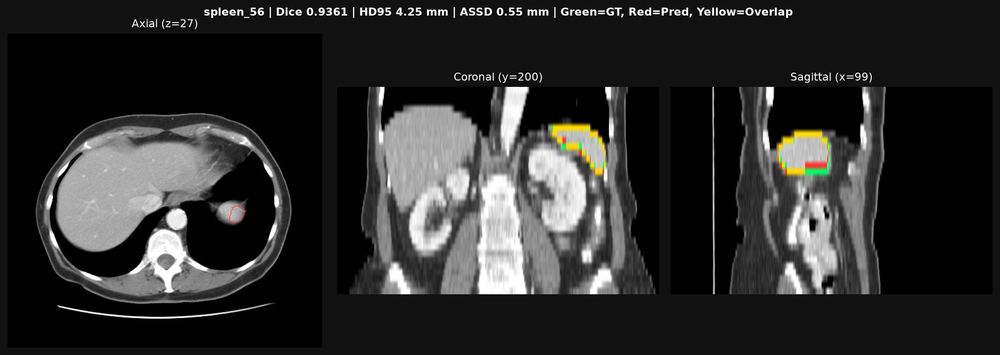
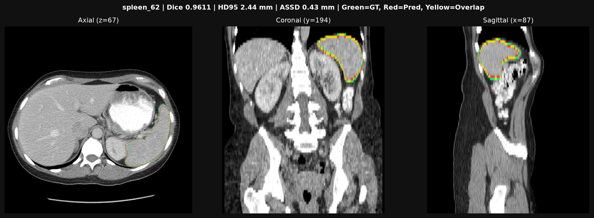

# Phase 7 — Anatomical & Geometric Failure Mode Analysis

> **Methodology:** Evaluates per-case error distributions across the 9 held-out CT scans (`results/failure_analysis.json`, `results/eval_trt_fp16_cuda.csv`), decomposing errors into False Positives (over-segmentation), False Negatives (under-segmentation), polar slice error concentration (superior/inferior organ domes), and physical surface distances (`HD95`, `ASSD`). Distinguishes measured statistical properties from anatomical boundary interpretations.

---

## 1. Cohort-Wide Worst-Case Rankings Across Four Clinical Criteria

| Failure Criterion | Worst Case (Rank 1) | Measured Value | Second Worst (Rank 2) | Measured Value | Cohort Median |
| :--- | :---: | :---: | :---: | :---: | :---: |
| **Lowest Dice Overlap** | `spleen_56` | `0.9361` (FP32 `0.9361`) | `spleen_62` | `0.9611` (FP32 `0.9611`) | `0.9708` |
| **Largest Boundary Distance (`HD95`)** | `spleen_56` | `4.25 mm` (`ASSD = 0.55 mm`) | `spleen_59` | `2.85 mm` (`ASSD = 0.52 mm`) | `1.60 mm` |
| **Largest Absolute Volume Error vs. GT** | `spleen_63` | `-14.47 cm³` (`-4.06%`) | `spleen_60` | `-11.67 cm³` (`-3.89%`) | `-2.65 cm³` (`-1.57%`) |
| **Largest Cross-Backend Drift (`trt_fp16_cuda` vs. FP32)** | `spleen_8` | `-0.037 cm³` (`ΔDice = -0.000029`) | `spleen_59` | `+0.027 cm³` (`ΔDice = +0.000022`) | `0.011 cm³` |
| **Largest Overlap-Reduction Drift (`overlap=0.25` vs. `0.50`)** | `spleen_56` | `ΔDice = -0.005563` (`+0.12 cm³`) | `spleen_63` | `ΔDice = +0.004755` (`+2.06 cm³`) | `|ΔDice| = 0.00068` |

---

## 2. Detailed Case Study 1: `spleen_56` (Rank 1 Lowest Dice = `0.9361`, Highest HD95 = `4.25 mm`)

- **Scan Geometry:** `[0.699, 0.699, 7.0]` mm spacing (`512 × 512 × 33`), z-anisotropy ratio **`10.01:1`**, smallest ground-truth spleen volume in the cohort (**`78.07 cm³`** vs. `286.73 cm³` cohort mean).
- **Voxel Error Decomposition:**
  - True Positives: `20,993` voxels
  - False Negatives (Under-segmented): **`1,819` voxels**
  - False Positives (Over-segmented): **`1,044` voxels**
  - Net Volume Error vs. Ground Truth: **`-2.65 cm³`** (`-3.39%`)
  - Cross-Backend Drift (`trt_fp16_cuda` vs. Strict FP32): **`+0.0000 cm³`** (`ΔDice = +0.000000`)
- **Spatial & Polar Concentration:**
  - Spleen spans only `9` axial slices (`5.0 mm` slice thickness).
  - Surface voxels account for **`49.0%`** of all ground-truth organ voxels, magnifying any 1-voxel boundary discrepancy into a larger fractional Dice penalty.
  - The `1` extreme polar slices at the superior/inferior domes contain **`40.1%`** of all error voxels despite holding only `14.1%` of ground-truth organ voxels, reflecting partial-volume averaging at the diaphragmatic dome and inferior renal pole.

---

## 3. Detailed Case Study 2: `spleen_62` (Rank 2 Lowest Dice = `0.9611`, Hilar Boundary Disagreement)

- **Scan Geometry:** `[0.676, 0.676, 5.0]` mm spacing (`512 × 512 × 80`), z-anisotropy ratio **`7.4:1`**, ground-truth volume **`275.93 cm³`**.
- **Voxel Error Decomposition:**
  - True Positives: `116,022` voxels
  - False Negatives (Under-segmented): **`4,821` voxels**
  - False Positives (Over-segmented): **`4,566` voxels**
  - Net Volume Error vs. Ground Truth: **`-0.58 cm³`** (`-0.22%` relative error!)
  - Surface Distances: `HD95 = 2.44 mm`, `ASSD = 0.43 mm`.
- **Why Net Volume Error Is Near Zero (`-0.61 cm³`) While Dice Is `0.9611`:**
  Unlike `spleen_56`, `spleen_62` has nearly balanced False Positives (`4,566`) and False Negatives (`4,821`) along the medial splenic hilum where the splenic artery/vein enter the parenchyma and abut the isodense gastric fundus (`35-65 HU`). The errors cancel in total volume (`-0.22%` error) but penalize voxel-wise overlap (`Dice = 0.9611`), illustrating why **both overlap metrics (`Dice`, `HD95`) and volumetric metrics (`MAE`, `Bland–Altman LoA`) must be reported together** in medical device validation.

---

## 4. Cohort-Wide Statistical Correlation Analysis ($n = 9$)

| Correlation Pair | Spearman Rank $\rho$ | Two-Sided $p$-value | Empirical Interpretation |
| :--- | :---: | :---: | :---: |
| `Dice` vs. Z-Slice Spacing ($s_z$) | `-0.129` | `0.741` | No monotonic trend across $n=9$: coarsest scan `spleen_8` (`7.5 mm`) ranks #1 in Dice (`0.9734`). |
| `Dice` vs. Ground-Truth Organ Volume ($V_{\text{GT}}$) | `+0.233` | `0.546` | Smallest spleen (`spleen_56`, `78.1 cm³`) has lowest Dice (`0.9361`), but larger spleens plateau around `0.963-0.973`. |
| `HD95 (mm)` vs. Ground-Truth Organ Volume ($V_{\text{GT}}$) | `+0.050` | `0.898` | Weak positive association; large spleens (`spleen_59`, `spleen_63`) have larger absolute capsule surface area. |
