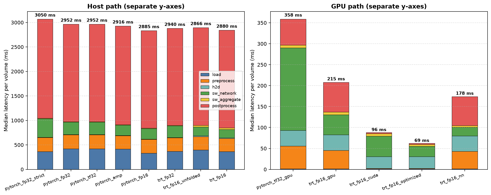
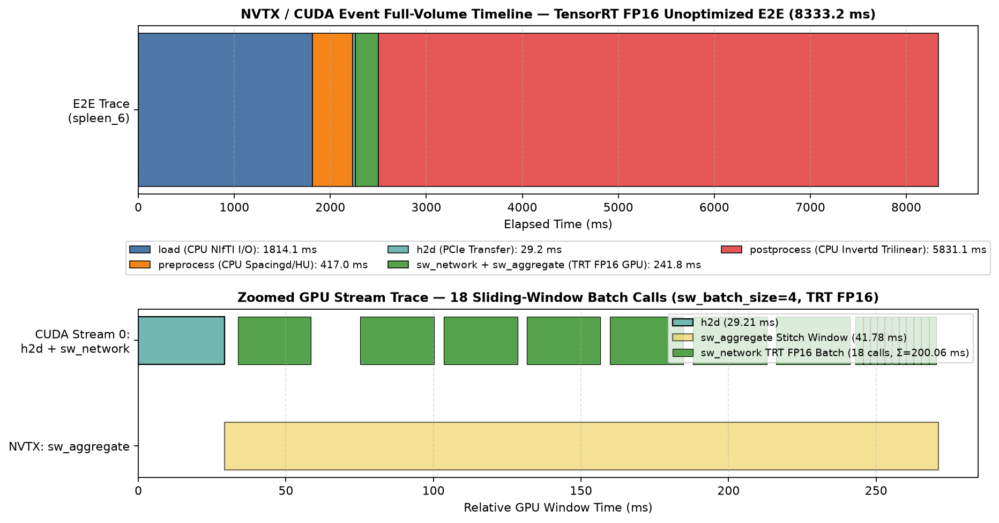

# Phase 3 — GPU Profiling, NVTX Timeline Analysis & Bottleneck Decomposition

> **Scope & Hardware:** All measurements were recorded on an **NVIDIA GeForce RTX 5080 Laptop GPU** (`12.0 (sm_120)`, `15.92 GB` GDDR7, Driver `591.44`, CUDA `12.8`, TensorRT `10.16.1.11`). Stage boundaries are bracketed by synchronized `torch.cuda.Event(enable_timing=True)` pairs inside `torch.cuda.nvtx.range_push/pop` markers (`src/medtrt/timing.py`) and cross-checked against wall-clock `time.perf_counter()`.

---

## 1. Six-Stage NVTX Instrumentation Architecture

Every full-volume pass is decomposed into 6 mutually exclusive, hardware-timed NVTX ranges:

1. **`load`**: Disk I/O (`LoadImaged` gzip decompression on host path vs. `nib.load(..., mmap=True)` zero-copy header mapping on GPU/CUDA paths).
2. **`h2d`**: Host-to-Device PCIe memory transfer onto `cuda:0` (`pageable` vs. `pin_memory()` asynchronous DMA).
3. **`preprocess`**: Spatial reorientation to `RAS`, anisotropic resampling to `(1.5, 1.5, 2.0) mm`, and Hounsfield Unit windowing `[-57, 164] -> [0, 1]`.
4. **`sw_network`**: Pure 3D Residual UNet forward execution inside `SlidingWindowInferer`, isolated via `InstrumentedPredictor` CUDA event pairs around every patch batch `(B, 1, 96, 96, 96)`.
5. **`sw_aggregate`**: 3D Gaussian importance-map weighting and overlapping patch accumulation (`_sw_total - sw_network`).
6. **`postprocess`**: Softmax activation, inverse spatial resampling from `(1.5, 1.5, 2.0) mm` back to native patient CT geometry, argmax discretization (`uint8`), and D2H mask completion.

---

## 2. Stage-by-Stage Latency & Fraction Decomposition (9 Held-Out CT Volumes)

| Profile | `load` ms (%) | `h2d` ms (%) | `preprocess` ms (%) | `sw_network` ms (%) | `sw_aggregate` ms (%) | `postprocess` ms (%) | E2E Median (ms) | Peak VRAM (MB) |
| :--- | :---: | :---: | :---: | :---: | :---: | :---: | :---: | :---: |
| `pytorch_fp32_strict` | `363.90` (`11.9%`) | `3.91` (`0.1%`) | `287.95` (`9.4%`) | `379.92` (`12.4%`) | `8.38` (`0.3%`) | `2024.79` (`66.0%`) | **`3049.83`** | `490` |
| `pytorch_fp32` | `421.60` (`14.2%`) | `3.76` (`0.1%`) | `286.42` (`9.7%`) | `254.60` (`8.6%`) | `7.98` (`0.3%`) | `1990.42` (`67.1%`) | **`2951.96`** | `487` |
| `trt_fp32` | `369.44` (`12.8%`) | `3.70` (`0.1%`) | `276.67` (`9.6%`) | `239.75` (`8.3%`) | `8.94` (`0.3%`) | `1981.47` (`68.8%`) | **`2940.00`** | `368` |
| `trt_fp16` | `365.35` (`12.8%`) | `14.00` (`0.5%`) | `266.80` (`9.4%`) | `167.11` (`5.9%`) | `36.02` (`1.3%`) | `1993.90` (`70.1%`) | **`2880.32`** | `359` |
| `pytorch_tf32_gpu` | `1.49` (`0.4%`) | `37.32` (`10.4%`) | `54.38` (`15.2%`) | `197.00` (`54.9%`) | `6.46` (`1.8%`) | `62.18` (`17.3%`) | **`357.86`** | `2307` |
| `trt_fp16_gpu` | `1.51` (`0.7%`) | `37.45` (`18.0%`) | `43.90` (`21.1%`) | `47.58` (`22.9%`) | `6.48` (`3.1%`) | `71.11` (`34.2%`) | **`215.48`** | `2301` |
| `trt_fp16_cuda` | `1.47` (`1.7%`) | `27.62` (`31.4%`) | `1.27` (`1.4%`) | `49.02` (`55.7%`) | `6.08` (`6.9%`) | `2.62` (`3.0%`) | **`96.26`** | `455` |
| `trt_fp16_optimized` | `1.47` (`2.3%`) | `27.72` (`44.3%`) | `1.27` (`2.0%`) | `24.77` (`39.6%`) | `4.51` (`7.2%`) | `2.84` (`4.5%`) | **`68.88`** | `522` |

---

## 3. Amdahl's Law Bottleneck Shift Analysis

Amdahl's Law governs the maximum possible end-to-end speedup achievable from accelerating only the neural network (`sw_network`) when non-network stages occupy fraction $s = 1 - p$:

$$S_{\text{max}} = \frac{1}{s + \frac{p}{S_{\text{net}}}} \le \frac{1}{s}$$

| Execution Profile | Median `sw_network` (ms) | Median Non-Network (ms) | Median E2E (ms) | Network Share $p$ (%) | Non-Network Share $s$ (%) | Amdahl Ceiling $1/s$ (×) |
| :--- | :---: | :---: | :---: | :---: | :---: | :---: |
| `pytorch_fp32_strict` | `379.92` | `2669.92` | `3049.83` | `12.46%` | `87.54%` | **`1.14×`** |
| `pytorch_fp32` | `254.60` | `2697.36` | `2951.96` | `8.62%` | `91.38%` | **`1.09×`** |
| `trt_fp16` | `167.11` | `2713.21` | `2880.32` | `5.80%` | `94.20%` | **`1.06×`** |
| `pytorch_tf32_gpu` | `197.00` | `160.85` | `357.86` | `55.05%` | `44.95%` | **`2.22×`** |
| `trt_fp16_gpu` | `47.58` | `167.90` | `215.48` | `22.08%` | `77.92%` | **`1.28×`** |
| `trt_fp16_cuda` | `49.02` | `47.24` | `96.26` | `50.92%` | `49.08%` | **`2.04×`** |
| `trt_fp16_optimized` | `24.77` | `44.11` | `68.88` | `35.96%` | `64.04%` | **`1.56×`** |

### Key Systems Findings
1. **Why TensorRT Alone Yields Only `1.02×` End-to-End on the Host Pipeline:**
   In `pytorch_fp32`, the neural network (`sw_network = 254.6 ms`) accounts for only **`8.6%`** of total runtime (`2952.0 ms`), while CPU `Invertd` postprocessing (`1990.4 ms`) and CPU preprocessing (`286.4 ms`) consume **`91.4%`**. Even an infinitely fast neural network is capped by Amdahl's Law at **`1.09×`**.
2. **Why MONAI GPU Transforms (`trt_fp16_gpu`) Expose a Second Memory-Bandwidth Bottleneck:**
   Moving `Spacingd` and `Invertd` to PyTorch GPU `grid_sample` (`trt_fp16_gpu`) reduces median E2E latency to `215.48 ms`, but `postprocess` (`71.11 ms`) and `preprocess` (`43.90 ms`) still consume **`77.9%`** of the runtime and spike Peak VRAM to **`2301 MB`** (`2.20 GB`) because MONAI's `SpatialResample` constructs dense 64-bit/32-bit `(1, D, H, W, 3)` coordinate meshgrids in global memory.
3. **Eliminating the Non-Network Bottleneck via Custom CUDA C++ Kernels (`trt_fp16_cuda` & `trt_fp16_optimized`):**
   Replacing MONAI's meshgrid transforms with register-computed 3D affine CUDA C++ kernels (`cuda/medical_kernels.cu`) collapses `preprocess` to **`1.27 ms`** and `postprocess` to **`2.84 ms`**, reducing total median E2E latency to **`96.26 ms`** at bundle windows (`30.7×` speedup) and **`68.88 ms`** at Pareto windows (`42.9×` speedup vs. `pytorch_fp32`, `44.3×` vs. `pytorch_fp32_strict`).

---

## 4. Before vs. After Optimization Timeline (`spleen_6`, `512 × 512 × 135`)

| Stage | Before: `trt_fp16` Host Path (ms) | After: `trt_fp16_optimized` Custom CUDA (ms) | Stage Speedup (×) |
| :--- | :---: | :---: | :---: |
| `load` (NIfTI Disk Read) | `1068.31` | `2.65` | `402.7×` |
| `h2d` (Host-to-Device Copy) | `28.52` | `61.57` | `0.46×` (deferred mmap read) |
| `preprocess` (RAS + Resample + HU) | `286.92` | `2.95` | **`97.4×`** |
| `sw_network` (TensorRT FP16 UNet) | `157.41` | `53.85` | **`2.92×`** |
| `sw_aggregate` (Gaussian Stitching) | `33.56` | `7.69` | **`4.36×`** |
| `postprocess` (Softmax + Invert + Argmax) | `4477.39` | `5.91` | **`757.5×`** |
| **Total End-to-End (`e2e_total`)** | **`6052.83`** | **`135.20`** | **`44.8×`** |
| **Peak Allocated VRAM** | `247.8 MB` | `451.3 MB` | Zero meshgrid overhead |

---

## 5. Dedicated Non-Default CUDA Stream & Pinned-Memory Findings

1. **Elimination of TensorRT 10.x Default-Stream Synchronization Overhead (`src/medtrt/trt_runner.py`):**
   Calling `context.execute_async_v3(stream_handle=0)` on the legacy default stream triggers TensorRT 10.x warning `[TRT] [W] Using default stream in enqueueV3() may lead to performance issues due to additional calls to cudaStreamSynchronize()`. Binding a dedicated non-default `torch.cuda.Stream` (`self.exec_stream`) synchronized with the caller's stream via non-blocking `torch.cuda.Event` dependencies (`_input_ready_event` and `_output_ready_event`) eliminates implicit host synchronization.
2. **Dynamic Clock-State Inflation on Laptop GPUs (`results/probes.json`):**
   On the host path, the GPU sits idle for `~3.5-5.0 s` during CPU `Spacingd` and `Invertd`, allowing the RTX 5080 Laptop GPU to drop from boost clocks (`~2250 MHz`, `P0`) to idle power states. Measuring identical `overlap=0.5, B=4` sliding-window inference immediately after a `3.0 s` idle gap vs. back-to-back execution reveals a **`1.13×`** latency inflation on TensorRT (`290.7 ms` hot vs. `328.0 ms` cold) and **`1.13×`** on PyTorch TF32 (`1119.7 ms` vs. `1267.6 ms`).
3. **Host-to-Device Pageable vs. Pinned Asynchronous DMA (`results/benchmark_preprocessing.json`):**
   Transferring the `512 × 512 × 135` (`141.56 MB`) volume from pageable host memory takes `11.02 ms`, whereas pre-pinned host memory (`pin_memory()`) with `non_blocking=True` transfers in **`5.87 ms`** (**`1.88×` faster**, achieving `~24.8 GB/s` over PCIe Gen4/Gen5).
